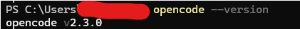
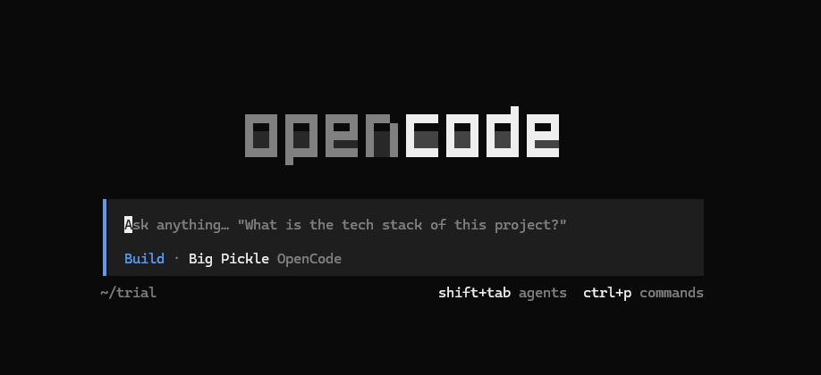

## OpenCode 導入ガイド：インストールから初回実行まで

OpenCodeは、ターミナル上で動作するオープンソースのAIコーディングエージェントです。自然言語の指示だけで、コードの作成・修正・テスト実行・デバッグまでを自律的に行います。本稿では、OpenCode 2系（2026年11月時点の最新版は2.2.6）を導入し、実際に使い始めるまでの過程を段階的に解説します。


### 1. 導入前の確認事項

OpenCodeはmacOS、Linux、Windows（WSL推奨）に対応しています。Windowsのパッケージマネージャー（wingetやchocoなど）には公式対応していないため、WindowsユーザーはWSL2上のUbuntuなどのLinux環境で利用することを推奨します。

必要な環境：
- **macOS / Linux**: ターミナル（iTerm2、Terminal、GNOME Terminalなど）
- **Windows**: WSL2（Windows Subsystem for Linux）
- **共通**: Node.jsがインストールされている場合はnpm経由も可能

### 2. インストール方法

OpenCode 2系のインストールには、主に3つの方法があります。いずれも1行のコマンドで完了します。

__方法A：curlによるワンライナーインストール__

```bash
curl -fsSL https://opencode.ai/v2/install | bash
```

この方法では、利用しているOSとアーキテクチャに合わせた最新のバイナリが自動的にダウンロードされ、PATHの通ったディレクトリに配置されます。インストール後、ターミナルを再起動するか、`source ~/.bashrc`（または `~/.zshrc`）を実行してPATHを反映させます。

__方法B：npmによるインストール__

こちはwindowsの場合おすすめの方法です。
Node.jsが既にインストールされている場合は、npmからグローバルインストールできます。

```bash
npm install -g @opencode/cli@latest
```

Bunやpnpmをお使いの場合も対応しています。Vite+を利用している場合は追加のフラグは不要ですが、Bunやpnpmではpostinstallスクリプトの許可が必要な場合があります。

__方法C：Homebrewによるインストール（macOS / Linux）__

```bash
brew install anomalyco/tap/opencode
```

Homebrewのtapを追加し、公式のFormulaからインストールします。アップデートも `brew upgrade opencode` で一括管理できます。

### インストールの確認

いずれの方法でも、以下のコマンドでバージョンが表示されれば成功です。

```bash
opencode --version
```

2026年11月時点では `2.2.6` などの2系のバージョンが表示されるはずです。もし1系（1.19系など）が入った場合は、インストールコマンドを見直し、V2用のURLやパッケージ名を確認してください。



### 3. 初回起動と基本操作

インストールが完了したら、実際に作業したいプロジェクトのディレクトリに移動してOpenCodeを起動します。

```bash
cd ~/projects/my-app
opencode
```

初回起動時には、フルスクリーンのTUI（Terminal User Interface）が立ち上がります。画面下部には入力欄があり、上部にはエージェントの思考過程や実行結果が表示されます。



### 最初に覚える操作

| キー / コマンド | 動作 |
|---|---|
| `Ctrl + c` | OpenCodeを終了 |
| `/connect` | LLMプロバイダーの接続設定 |
| `/models` | 利用するモデルの選択 |
| `/help` | コマンド一覧の表示 |
| `@` + ファイル名 | 特定のファイルをコンテキストに追加 |
| `Tab` | Planモード（計画のみ）とBuildモード（実行）の切り替え |

### 4. LLMプロバイダーの接続

OpenCodeは75種類以上のLLMプロバイダーに対応しています。利用するAIモデルを接続するには、TUI内で `/connect` を実行します

__手順__

1. TUIの入力欄に `/connect` と入力し、Enter
2. プロバイダー一覧が表示されるので、矢印キーで選択
3. 認証方式（APIキー、OAuthなど）を選択
4. プロンプトに従ってAPIキーを入力、またはOAuthの認証URLを開いて許可

__主なプロバイダーの接続例__

**OpenCode Zen（公式無料モデル）**
- APIキー不要、アカウント不要
- `/connect` 後に「OpenCode Zen」を選択するだけ
- GLM-5.3-Flash Free、DeepSeek V4.1 Flash Freeなどが利用可能

**Google Gemini**
- Google AI Studioで無料APIキーを取得（https://aistudio.google.com/app/apikey）
- `/connect` → 「Google Gemini」を選択 → APIキーを入力
- 1日250リクエストの無料枠あり

**Groq**
- Groq ConsoleでサインアップしAPIキーを取得（https://console.groq.com）
- `/connect` → 「Groq」を選択 → APIキーを入力
- 高速推論、無料枠あり

**Ollama（ローカルLLM）**
- Ollamaを別途インストールし、モデルをプルしておく（例：`ollama pull qwen2.5-coder`）
- OpenCodeは起動中Ollamaを自動検出し、プロバイダー一覧に表示
- `/connect` → 「Ollama」を選択 → 利用するモデルを選択

**GitHub Copilot Free**
- 既存のGitHubアカウントでサインイン
- `/connect` → 「GitHub Copilot」を選択 → OAuthで認証

接続が完了したら、`/models` を実行して、実際に使用するモデルを選択します。複数のプロバイダーを接続している場合は、ここでモデルを切り替えることができます。

### 5. プロジェクト設定（opencode.jsonc）

プロジェクトごとにOpenCodeの動作を細かく設定するには、プロジェクトのルートに `opencode.jsonc` を作成します。JSONC（コメント付きJSON）形式に対応しているため、設定意図をコメントで残せます。

__基本的な設定例__

```jsonc
{
  "$schema": "https://opencode.ai/config.json",
  // デフォルトで使用するモデル
  "model": "anthropic/claude-sonnet-5-5",

  // 権限設定：ツールやコマンドの実行許可レベル
  "permissions": {
    // フイルの読み書き：許可
    "file_write": "allow",
    // シェルコマンド実行：毎回確認
    "bash": "ask",
    // 外部への通信：拒否
    "fetch": "deny"
  },

  // エージェントへの指示（プロジェクト固有のルール）
  "instructions": "このプロジェクトはTypeScriptで書かれています。テストはVitestを使用し、命名規則はcamelCaseを遵守してください。"
}
```

__権限設定の重要性__

初期状態では、ファイルの読み書きやコマンド実行が比較的広く許可されている場合があります。セキュリティを確保するため、以下のように段階的に権限を調整することを推奨します。

| 権限レベル | 意味 | 推奨用途 |
|---|---|---|
| `allow` | 確認なしで実行 | ファイル読み込みなど安全な操作 |
| `ask` | 毎回確認して実行 | ファイル書き込み、コマンド実行 |
| `deny` | 実行を拒否 | 外部通信、削除コマンドなど危険な操作 |

### 6. AGENTS.mdによるプロジェクト固有の指示

プロジェクトのルートに `AGENTS.md` を作成すると、OpenCodeはセッション開始時にその内容を自動的に読み込み、エージェントの振る舞いに反映させます。これは「プロジェクトのREADME for AI」として機能します。

__記述例__

```markdown
# AGENTS.md

## プロジェクト概要
- Next.js 15 + TypeScript + Tailwind CSSで構築されたWebアプリケーション
- App Routerを使用
- 状態管理はZustand

## コーディング規約
- コンポーネントは関数コンポーネント（アロー関数）で記述
- 型定義は `types/` ディレクトリに集約
- API通信は `lib/api.ts` のラッパーを使用

## テスト方針
- ユニットテスト：Vitest + React Testing Library
- E2Eテスト：Playwright
- 新機能追加時は必ず対応するテストを同時に作成

## 注意事項
- `legacy/` ディレクトリ内のコードは触らないこと
- 環境変数は `.env.local` に述し、コミットしないこと
```

このファイルを置くだけで、エージェントは「Next.jsのApp Routerを使う」「Zustandで状態管理する」「legacyディレクトリは触らない」といったプロジェクト固有の知識を持った状態で作業を開始します。

### 7. 初回実行：実際にタスクを依頼する

設定が完了したら、いよいよ最初のタスクを依頼します。TUIの入力欄に自然言語で指示を入力します。

__基本的な依頼の例__

```
「src/utils/date.ts にある日付フォーマット関数のバグを修正して。ISO文字列を受け取ったときにNaNが返る場合がある」
```

```
「components/Button.tsx に単体テストを追加して。クリックイベントとdisabled状態のテストを含めて」
```

```
「@package.json の依存関係を確認して、古くなっているパッケージを更新して」
```

__PlanモードとBuildモード__

- **Planモード（Tabキーで切り替え）**: エージェントは計画だけを提示し、実際のファイル変更は行ません。大規模な修正前に「どう動くか」を確認したい場合に有用です。
- **Buildモード（デフォルト）**: 計画を立てたうえで、実際にファイルの編集・コマンド実行まで行います。

### 8. よくあるトラブルと対処法

__Q1: `/connect` でプロバイダーが表示されない__

- OpenCodeのバージョンを確認（`opencode --version`）。1系の場合はV2を再インストールしてください。
- ネットワーク接続を確認。プロバイダーカタログはmodels.devから取得されます。

__Q2: Ollamaが検出されない__

- Ollamaが起動しているか確認（`ollama list` でモデル一覧が表示されるか）
- OpenCodeをOllama起動後に再起動

__Q3: 権限エラーでファイルが編集できない__

- `opencode.jsonc` の `permissions.file_write` が `allow` または `ask` になっているか確認
- 対象ファイルのファイルシステム権限（chmod/chown）を確認

__Q4: モデルの応答が遅い__

- `/models` で別のモデルに切り替えて試行。GroqやOpenCode Zen高速モデルを検討
- コンテキストに含めるファイル数を減らす（`@` で必要なファイルのみ指定）

### 9. 導入後の推奨ワークフロー

OpenCodeを導入した後は、以下のワークフローで段階的に慣れていくことを推奨します。

| 段階 | タスク | 目的 |
|---|---|---|
| **第1週** | 単純なバグ修正、コメント追加、リネーム | 操作感と権限設定に慣れる |
| **第2週** | テストの自動生成、小規模なリファクタリグ | Plan/Buildモードの使い分けを覚える |
| **第3週** | 新機能の実装（1〜2ファイル程度） | 複数ファイルの連携とAGENTS.mdの活用 |
| **第4週** | 大規模リファクタリング、依存関係の更新 | 自律エージェントの本領を体験 |

### まとめ

OpenCodeの導入は、以下の7ステップで完了します。

1. **インストール**: `curl -fsSL https://opencode.ai/v2/install | bash`
2. **起動**: 作業ディレクトリで `opencode` を実行
3. **接続**: `/connect` でプロバイダー（OpenCode ZenやGeminiなど）を選択
4. **モデル選択**: `/models` で使用するモデルを決定
5. **設定**: `opencode.jsonc` で権限とデフォルトモデルを設定
6. **指示書作成**: `AGENTS.md` でプロジェクト固有のルールを記述
7. **実行**: 自然言語でタスクを依頼し、Plan/Buildモードで管理

完全オープンソースであり、無料のモデルから始められるOpenCodeは、AIコーディングエージェントへの入口として最も手軽で自由度の高い選択肢です。まずはOpenCode Zenで操作感を確かめ、慣れてきたらGoogle GeminiやOllamaなど、自分のニーズに合ったモデルへと拡張していくことをおすすめします。
