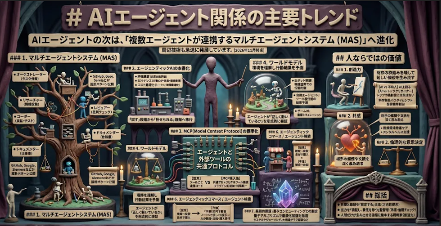

先日職場でAIエージェントを使った機能開発を目の当たりにして非常に衝撃を受けました。
そんなAIエージェントについて語っていきます。



## AIエージェント関係の主要トレンド

AIエージェントの次に注目されている技術は、**単一エージェントから「複数エージェントが連携するマルチエージェントシステム（MAS）」** への進化が中心ですが、それを支え周辺技術も急速に発展しています。以下、2026年11月時点で注目されている主要な技術トレンドを整理します。

### 1. マルチエージェントシステム（Multi-Agent Systems / MAS）

単一のAIエージェントでは対処しきれない複雑な課題を、**複数の専門エージェントが協調・分業・競合**することで解決するアーキテクチャです。[日経クロステック](https://xtech.nikkei.com/atcl/nxt/mag/nc/18/063000494/111200006/)

__具体例__

| エージェントの役割 | 担当業務 |
|---|---|
| **オーケストレーター** | タスクの分解と他エージェントへの振り分け |
| **リサーチャー** | 情報収集・調査・文脈の整理 |
| **コーダー** | 実装・リファクタリング・テスト作成 |
| **レビュアー** | コードレビュー・品質チェック |
| **ドキュメンター** | 仕様書・README・コメントの整備 |

GitHub、Google、Siemensなどが、マルチエージェントの設計パターンを15種類以上公開しており、開発現場での実用化が進んでます。[＠IT](https://atmarkit.itmedia.co.jp/ait/articles/2611/08/news001.html)

### 2. エージェンティックAI（Agentic AI）の本番化

「試す」段階から「任せられる」段階へ移行するための技術基盤です。2026年は、AIエージェントを実運用に載せるための**品質評価・責務境界・セキュリティ・コスト設計**が重要視されています。[trends](https://trends.codecamp.jp/blogs/media/agentic-ai-summit-26-fall-day2-track1)

__注目ポイン__

- **評価基盤**：エージェントの出力品質を自動評価するフレームワーク
- **ガバナンス**：自律エージェントの行動ログ・監査・権限管理
- **コスト最適化**：トークン消費と実行時間の最適化

### 3. MCP（Model Context Protocol）の標準化と普及

エージェントと外部ツール（ファイルシステム、データベース、API、ブラウザなど）を連携させるための**共通プロトコル**です。OpenCodeも標準対応しており、2026年に大きな注目を集めています。[Firecrawl](https://www.firecrawl.dev/blog/agentic-ai-trends)

__なぜ注目されているか__

| 従来 | MCP導入後 |
|---|---|
| ツールごとに独自の連携コードが必要 | 共通プロトコルであらゆるツールに接続可能 |
| エージェントとツールの結合度が高い | プラグイン的にツールを追加・交換できる |
| セキュリティ管理が分散 | プロトコルレベルで権限・監査を統一 |

### 4. ワールドモデル（World Models）

AIが**環境を理解し行動の結果を予測する**内部的な世界モデルを構築する技術です。単なるテキスト生成を超えて、「この行動を取ったら何が起こるか」をシミュレートできるようになります。[Report AI](https://report-ai.org/after-the-agent-next-ai-paradigm/)

__応用例__

- ロボット制御：物理世界での行動計画
- 自律エージェント：ツール実行前の結果予測
- ゲームAI：複数手先の展開シミュレーション

### 5. AIエージェントの信頼性・検証可能性（Verifiability）

エージェントが「正しく動いているか」を**形式的に検証・保証**する技術です。自律エージェントが本番環境で動く以上、出力の信頼性は不可欠です。[Firecrawl](https://www.firecrawl.dev/blog/agentic-ai-trends)

__主要アプローチ__

- **自己検証ループ**：エージェントが自分の出力をテスト・検証する
- **人間による監督（Human-in-the-Loop）**：重要な判断で人間の承認を挟む
- **形式的検証**：数学的に正しさを保証する（研究段階）

### 6. エージェンティックコマース / エージェント検索

消費者向けでは、**AIエージェントが検索・比較・購入**まで代行する「エージェンティックコマース」が台頭しています。Googleの検索エージェント化もこの流れの一環です。[AI検索パートナーズ](https://ai-search.techsuite.co.jp/14837/)

__変化の例__

```
【従来】ユーザーが検索 → サイトを比較 → 自分で購入
【今後】ユーザーが「予算5万円で静音性重視のノートPCを探して」と指示
       → AIエージェントが検索・比較・購入まで実行
```

### 7. 長期的展望：量子コンピューティングとの融合

2026年のITトレンドとして、量子コンピューティングの実用化予兆も挙げられています。AIエージェントの最適化問題（タスクスケジューリング、大規模グラフ探索など）を量子アルゴリズムで加速する研究が進んでいます。[三菱電機](https://www.mitsubishielectric.co.jp/medigital/column/it-infra/076/)

## AIエージェントの要素

AIエージェントの利用拡大を加速させている要素は、**スピードだけではありません**。むしろ「スピード」は結果として生まれる一つの側面に過ぎず、本質的な推進力は以下の複数の要素が複合したものです。

### 1. 自律性（Autonomy）：「待たなくていい」という価値

最も大きな要素は、**人間が介在しなくても自律的にタスクを完結できる**ことです。

| 従来のAI | AIエージェント |
|---|---|
| 質問→回答→人間が次のアクションを判断 | 目標を与えるだけで、計画・実行・検証まで自律的に完結 |
| 人間が常に待機・指示する必要あり | 人間は結果を確認するだけでよい |

この「人間の時間を買い取る」能力が、業務効率化の本質です。スピードではなく、**人間の介在コストをゼロに近づける**点に価値があります。

### 2. 自然言語インターフェース：「誰でも使える」という民主化

プログラミングや専門的な操作が不要で、**普段の言葉で指示できる**ことが普及の大きな推進力です。

- エンジニアでなくても「このフォルダのCSVを整理してグラフにして」と頼める
- 小売店の店主が「先月の売上レポートを作って」と自然に指示できる
- 高齢者でも「明日の予定を確認して、必要ならリマインダーを設定して」と頼める

**技術的障壁の消失**が、利用者層を爆発的に広げています。

### 3. ツール連携能力：「既存の世界に溶け込む」適応性

AIエージェントが身の回りに広がる理由の一つは、**既存のツール・サービスと連携できる**点です。

- ブラウザを操作してWeb検索・フォーム入力ができる
- Excel、メール、Slack、GitHubなど既存ツールを使える
- APIを通じて企業の業務システムと接続できる

これにより「AI専用の新しいシステムを導入する」必要がなく、**今使っているツールの延長線上でAIが動く**ため、導入障壁が極めて低いのです。

### 4. 継続的・並列的な実行：「24時間×複数タスク」というスケール

人間とは異なり、AIエージェントは：

- **24時間休まず動く**
- **複数のタスクを同時並行で処理できる**
- **数百・数千の単純作業を一気にこなせる**

これは「速さ」ではなく「**スケーラビリティ**」の問題です。1つのタスクを1秒で終わらせるのではなく、**1000個のタスクを同時に処理する**能力が業務変革をもたらします。

### 5. コスト構造の変化：「人件費の代替」ではなく「人件費の拡張」

AIエージェントの普及は、単純な「人を削減する」話ではなく、**一人の人間が扱える業務量を桁違いに増やす**点にあります。

```
【従来】1人の営業担当が1日10件の顧客フォロー
【エージェント活用】1人の営業担当がAIエージェント10体を指揮し、
                    1日1000件のフォロー・資料作成・予約調整を完結
```

人間の「判断・創造性・共感」は残しつつ、**周辺業務をAIに委任する**ことで、一人あたりの生産性が飛躍的に向上します。

### 6. 汎用性と特化性の両立：「1体で何でも」から「専門家チーム」へ

単一のAIエージェントが汎用的に動くこともあれば、**特定業務に特化したエージェント**を複数連携させることもできます。

- 汎用エージェント：個人の秘書的な存在
- 特化エージェント：法務チェック専用、コードレビュー専用、顧客対応専用

この **「必要な時に必要な専門性を呼び出せる」** 構造が、個人利用から企業利用まで幅広く対応できる理由です。

## 人ならではの価値

ではAIエージェントの優れた能力でもってしても代替が難しい、人ならではの価値は何でしょうか。
以下公開された情報を参考にリストアップしました。

### 1. 創造力：既存の枠組みを壊して新しい価値を生み出す力

__具体的な例__

**科学発見におけるパラダイムシフト**

アインシュタインが一般相対性理論を定式化したように、既存の物理学の前提（ニュートン力学）を根本から覆す発想は、過去のデータの延長線上では決して生まれません。Google DeepMindの研究でも、AIは既存の知識の組み合わせや応用は得意ですが、**ゼロからの独創的な仮説の立て方ができない**と指摘されています。[Forbes JAPAN](https://forbesjapan.com/articles/detail/103254)

**芸術における「傑作」の創出**

AIは「平均的に良い」絵画や音楽を大量に生成できます。しかし、ピカソの「ゲルニカ」やベートーヴェンの「第九」のように、時代の価値観を揺さぶり、新しい表現形式そのものを開拓する創作は、人間の領域です。

__説得力の根拠__

モントリオール大学を中心とした研究チームが、GPT-4やClaude、Geminiなどの主要LLMと**10万人以上の人間**を創造性テストで直接比較した結果、以下が明らかになりました。[WIRED.jp](https://wired.jp/article/ai-creativity-surpasses-average-humans-but-not-top-creators/)

| 比較対象 | 結果 |
|---|---|
| AI vs. 平均的な人間 | AIが発散的思考テストで上回る |
| AI vs. 最も創造的な人間 | **トップクリエイターの独創性には明確に及ばない** |

さらに、*Scientific Reports* に掲載された研究では、生成AIは**ゼロからの科学発見（scientific discovery from scratch）ができない**と結論付けられています。[Scientific Reports](https://www.nature.com/articles/s41598-025-93794-9)

**なぜAIにはできないのか**

AIの創造性は「過去のデータの再構成」に過ぎません。一方、人間の創造性は「正解が存在しない問いを自分で設定し、未知の領域に踏み込む」能力です。MIT Technology Reviewの調査でも、AIは独創的判断を要するオープンエンドな研究では**査読不合格水準にとどまった**と報告されています。[MIT Technology Review](https://www.technologyreview.jp/s/387981/ais-recursive-self-improvement-might-not-come-so-quickly-after-all/)

### 2. 共感：相手の感情や文脈を深く汲み取る力

__具体的な例__

**医療現場での患者ケア**

がんの診断を受けた患者が「治療を続けるべきか」と医師に相談する場面を想像してください。AIは統計的な生存率や治療オプションを提示できますが、患者の**家族の状況、人生の目標、死生観、経済的な不安**までを総合的に汲み取り、「この人にとっての最善」を一緒に考えることは人間にしかできません。

**メンタルヘルス支援**

摂食障害の患者がチャットボットに相談した際、AIが「有害なダイエットアドバイス」を出力してしまった事例が報告されています。AIは「共感的に聞こえる言葉」を生成できますが、**本当に相手の痛みを理解しているわけではない**ため、深刻な状況で危険な誤判断をするリスクがあります。[alphaXiv](https://www.alphaxiv.org/ja/abs/2405.12021)

__説得力の根拠__

*British Medical Bulletin*（Oxford Academic）に掲載された系統的レビュー・メタ分析では、AIチャットボットと人間医療従事者の共感性を比較した結果、**AIは「共感的に見える」回答を生成できるが、臨床現場での実際の患者転帰や安全性は別問題**であると結論付けられています。[Oxford Academic](https://academic.oup.com/bmb/article/156/1/ldaf017/8293249)

さらに、実患者2,069人を対象とした多施設臨床試験では、AIが作成した診療前レポートを**専門医が確認する仕組み**で診察時間と対話指標が改善された一方、**専門医診療そのものをAIが代替することは支持されなかった**と報告されています。[Zenodo](https://doi.org/10.5281/zenodo.22065351)

**なぜAIにはできないのか**

AIの「共感」は、学習データに含まれる「共感的な表現パターン」の模倣に過ぎません。人間の共感は、**自分も痛みを知っているという実存的理解、相手の背景や文脈への深い関与、信頼関係の歴史的蓄積**によって成り立ちます。ブラウン大学の研究では、AIセラピストには**15の深刻な倫理的リスク**が存在し、「寄り添い」として不十分であると指摘されています。[WIRED.jp](https://wired.jp/article/ai-therapist-ethical-risks-llm-mental-health/)

### 3. 倫理的な意思決定：責任を伴う価値判断

__具体的な例__

**医療現場での治療方針選択**

延命治療を続けるか、緩和ケアに切り替えるか。AIは生存率の統計やコスト効率を提示できますが、「この患者にとっての尊厳とは何か」「家族の意思をどう尊重するか」という**価値の衝突**を解く最終判断は、人間の医師が責任を持って行う必要があります。

**企業の採用判断**

AIは履歴書のスコアリングやスキルマッチングを自動化できます。しかし、「この候補者を採用することで組織の多様性が向上するか」「経歴の空白期間の背景をどう評価するか」といった、**公平性・包摂性・組織文化への配慮**を含めた総合判断は、人間の採用担当者が責任を持って行う領域です。

**自動運転車の「トロッコ問題」**

事故が避けられない状況で、歩行者Aを優先するか歩行者Bを優先するか。AIは確率計算はできますが、**「誰の命を優先するか」という社会的・倫理的合意を形成し、その責任を取る**のは人間社会の役割です。

__説得力の根拠__

*NEC* のAIエージェントに関する諮問会議では、AIと人間の**役割・責任の境界**をどう設計するかが最重要課題として議論されています。AIが自律的に動く以上、その行動の最終的な責任の所在を明確にする必要があり、それは人間にしかできないガバナンス機能です。[NEC](https://group.nec/global/ja/about/sustainability/social/ai/digitaltrust-ai/digitaltrust-ai-202603)

*Nature Computational Science* の論文では、心理療法におけるLLMの使用について、**計算的精度と倫理的責任は別物**であると論じられています。AIは「正しい」回答を出力できても、その回答が患者の人生に与える影響に対する**説明責任（accountability）**を負うことはできません。[Nature Computational Science](https://www.nature.com/articles/s43588-025-00874-x)

**なぜAIにはできないのか**

倫理的決定の本質は「正解が一つではない」ことにあります。AIは与えられた目的関数の中で最適解を選びますが、**「この目的関数自体が倫理的か」という問い**や、**「判断の結果に対して誰が責任を取るのか」** という問いには、人間の社会的・道徳的な主体性が必要です。

## 総括

AIを使う人の立場は、**「実行する手」から「意味を定義し、AIを委任・監督する頭脳」** があるべき姿だと考えています。

具体的には以下の3点に集約されます。

__1. 目標と価値を「設定する」主体__

AIは与えられた目標の中で最適化できますが、**「何のために」「どの価値を優先するか」は人間が決める**必要があります。正解のない問いを立て、方向性を示すのが人間の役割です。

__2. 出力を「検証し、責任を持つ」監督者__

AIは高速に成果物を出せますが、その正しさ・安全性・倫理性の最終判断は人間が担います。特に医療、採用、経営判断など、**人の人生や尊厳に関わる領域**では、AIの出力を鵜呑みにせず、人間が責任を持って承認する構造が不可欠です。

__3. 人間だけが生み出せる価値に集中する戦略家__

AIに単純作業・情報処理・反復的実行を任せ、人間は**創造的な問いの設定、深い共感を要する対人関係、倫理的な価値判断**に時間と知性を集中させる。これがAI時代の最も生産的な人間の立ち位置です。


