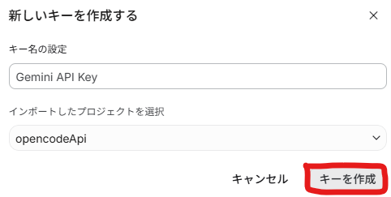
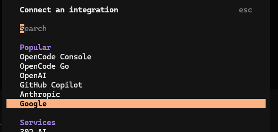

OpenCode v2.3.0がインストール済みの環境から、Google Geminiの無料APIキーを取得し、OpenCodeに接続して実際に使い始めるまでの過程を解説します。

## ステップ1：Google AI Studioで無料APIキーを取得

Google Gemini APIは、Google AI Studioから無料でAPIキーを発行できます。クレジットカードは不要です。

### 手順

1. ブラウザで以下のURLを開きます。
   https://aistudio.google.com/app/apikey
2. Googleアカウントでサインインします（GmailアカウントでOK）。
3. 「APIキーを作成」ボタンをクリックします。

   
4. 新しいAPIキーが表示されます。以下のような形式です。

   ```
   AIzaSyxxxxxxxxxxxxxxxxxxxxxxxxxxxxxxxx
   ```
5. **この画面でキーをコピーして一時的に保存してください**。画面を閉じると再度表示できませ（再作成は可能です）。

### 無料枠について

- 1日250リクエストまで無料で利用可能
- `gemini-2.5-flash` などの高性能モデルが利用可能
- クレジットカード不要、Googleアカウントのみで開始可能

## ステップ2：OpenCodeを起動

PowerShellで、先ほど作成した trial ディレクトリに移動して OpenCode を起動します。

```powershell
cd C:\Users\yoshinaga\trial
opencode
```

起動すると、フルスクリーンのTUI（Terminal User Interface）が表示されます。画面下部に入力欄があります。

## ステップ3：プロバイダーに接続

TUIの入力欄に以下を入力します。

```
/connect
```

### 接続手順

1. プロバイダー一覧が表示されるので、矢印キーで **「Google」** を選択し、Enterを押します。

   
2. 認証方式を選択する画面が表示されます。**「APIキー」** を選択します。
3. APIキーの入力を求められるので、ステップ1でコピーしたキーを貼り付けてEnterを押します。

   ```
   AIzaSyxxxxxxxxxxxxxxxxxxxxxxxxxxxxxxxx
   ```
4. 接続が成功すると、「Google Geminiに接続しました」のようなメッセージが表示されます。

## ステップ4：モデルを選択

接続後、使用するモデルを選びます。入力欄に以下を入力します。

```
/models
```

### モデル選択のポイント

Google Geminiのモデル一覧が表示されます。無料枠で利用できる主なモデルは以下の通りです。

| モデル名             | 特徴           | 推奨用途                           |
| -------------------- | -------------- | ---------------------------------- |
| `gemini-2.5-flash` | 高速・軽量     | 日常のコーディング、簡単な修正     |
| `gemini-2.5-pro`   | 高精度・高機能 | 複雑な設計、大規模リファクタリング |

矢印キーでモデルを選択し、Enterを押してください。これで準備は完了です。

## ステップ5：実際にタスクを依頼

モデルが選択できたら、自然言語で指示を入力します。 trial ディレクトリは空なので、まずは簡単なファイル作成から試してみましょう。

### 試しに入力してみる例

```
「hello.py を作成して。'Hello, OpenCode + Gemini!' と表示するPythonスクリプトを書いて」
```

エージェントが以下を自動的に行います。

1. 指示を理解し、ファイル作成の計画を立てる
2. `hello.py` を作成する
3. 内容を確認するためのコマンドを実行する（設定で許可されている場合）

### 別の例

```
「このディレクトリのファイル一覧を確認して」
```

```
「README.md を作成して。このプロジェクトがOpenCodeとGeminiの試用プロジェクトであることを説明して」
```

## トラブルシューティング

### Q1: `/connect` で「Google Gemini」が表示されない

- OpenCodeのバージョンを確認: `opencode --version`（v2.3.0であることを確認）
- ネットワーク接続を確認: TUI内でエージェントがモデルカタログを取得する必要があります
- OpenCodeを一度終了（Ctrl + c）して再起動

### Q2: APIキー入力後に「認証エラー」と表示される

- APIキーのコピー漏れや余分な空白がないか確認
- Google AI Studioでキーを再作成して試す
- キーの有効化に数分かかることがあるため、少し待ってから再試行

### Q3: モデル一覧にGeminiモデルが表示されない

- `/connect` でGoogle Geminiが正しく接続されているか確認
- `/models` を再度実行
- もし別のプロバイダーも接続している場合、一覧に混在している可能性があります。モデル名に `gemini` が含まれるものを探しください

### Q4: ファイルの書き込みで権限エラーが出る

OpenCodeの初期状態では、ファイル書き込み権限が `allow` になっている場合があります。もし確認ダイアログが出た場合は「許可」を選択してください。権限を細かく制御したい場合は、プロジェクトルートに `opencode.jsonc` を作成します。

```jsonc
{
  "$schema": "https://opencode.ai/config.json",
  "model": "google/gemini-2.5-flash",
  "permissions": {
    "file_write": "allow",
    "bash": "ask"
  }
}
```

## まとめ

| ステップ | 内容                                                                      |
| -------- | ------------------------------------------------------------------------- |
| 1        | Google AI StudioでAPIキーを取得（https://aistudio.google.com/app/apikey） |
| 2        | `cd trial` → `opencode` でTUIを起動                                  |
| 3        | `/connect` → 「Google Gemini」→ APIキーを入力                         |
| 4        | `/models` → `gemini-2.5-flash` などを選択                            |
| 5        | 自然言語でタスクを依頼（例: 「hello.pyを作成して」）                      |

これで、1日250リクエストの無料枠を使って、OpenCode + Google GeminiによるAIコーディンエージェントの体験が始められます。まずは簡単なファイル作成や修正から試し、慣れてきたら実際のプロジェクトで活用してください。
