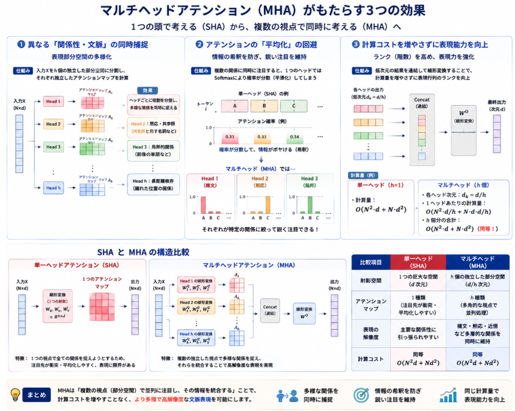
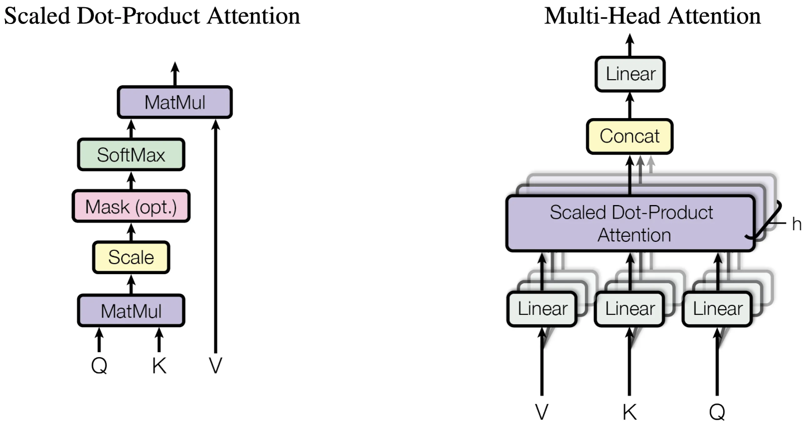
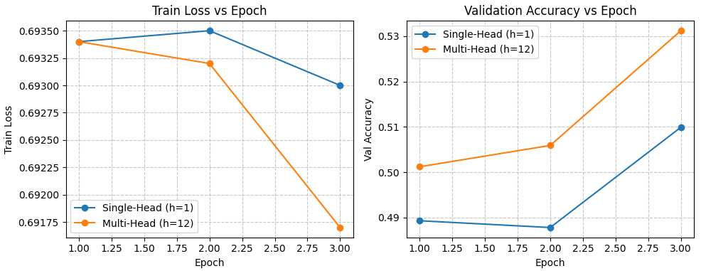
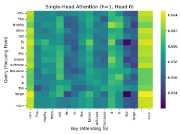
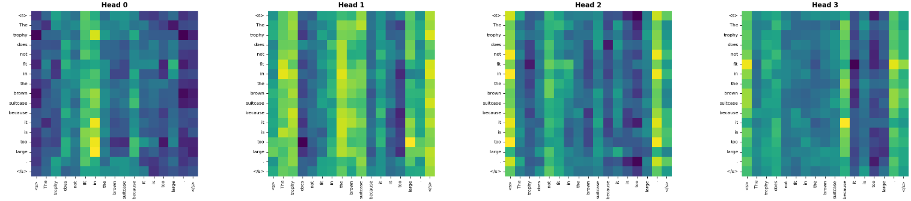
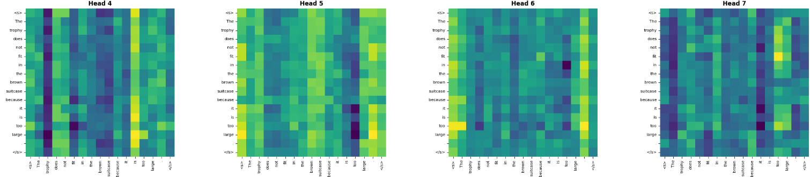
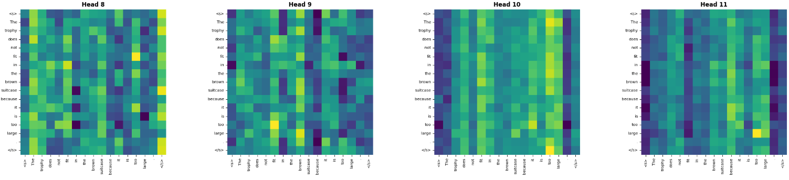

LLMのベースとなるTransformerですが、このTransformerは文章のどこを注目すべきかを制御するアテンション機構が主たる機能と言えます。
このアテンション機能もアテンションを1つの機構だけで実装するシングルヘッドと、複数の機構によって実装するマルチヘッドの2パターンがあります。
基本はマルチヘッドアテンションがよく使われる方式です。

この違いを仕組みから明らかにしたうえで、実際の試験によってどの程度の性能差がつくかについて確認していきます。

本日テーマ：
>シングルヘッドアテンションとマルチヘッドアテンションの違いを明らかにして、実験の上性能の違いを考察する


## マルチヘッドの機能

マルチヘッドアテンションを導入することによる効果は、「アテンション計算の数理的・構造的な仕組み」から論理的に導くことができます。

単一ヘッド（Single-Head Attention: SHA）とマルチヘッドの決定的な違いは、「表現空間を低次元の部分空間（Subspace）に分割し、それぞれ独立したアテンション分布を計算するかどうか」にあります。

この内部メカニズムから導き出される主な効果は以下の3点です。

### 1. 異なる「関係性・文脈」の同時捕捉（表現部分空間の多様化）

__内部仕組みからの導出__

入力 $X \in \mathbb{R}^{N \times d}$（$N$: 系列長、$d$: 隠れ層次元）に対して、単一ヘッドでは $d \times d$ の変換行列を用いて1つのアテンション行列 $A = \text{softmax}\left(\frac{QK^T}{\sqrt{d}}\right)$ を計算します。アテンション重みは各行の合計が $1$ になる確率分布（Softmax）であるため、**1つのヘッドで高く評価できる注目先は実質的に限られます。**

一方、MHAでは次元 $d$ を $h$ 個のヘッドに分割し（各ヘッドの次元 $d_k = d/h$）、異なるパラメータ行列 $W_i^Q, W_i^K \in \mathbb{R}^{d \times d_k}$ で射影します。

$$\text{head}_i = \text{softmax}\left(\frac{Q_i K_i^T}{\sqrt{d_k}}\right) V_i$$

これにより、$h$ 個の互いに独立したアテンションマップ $A_1, A_2, \dots, A_h$ が生成されます。

__生じる効果__

1つのトークンが持つ多様な情報を、ヘッドごとに役割分担して捉えることが可能になります。

* **Head 1:** 構文的関係（主語と動詞の関係など）に注目
* **Head 2:** 照応・共参照関係（代名詞 "it" とその指し示す名詞など）に注目
* **Head 3:** 局所的な隣接関係（前後の単語）に注目
* **Head 4:** 長距離の文脈依存に注目

### 2. アテンションの「平均化（情報希釈）」の回避

__内部仕組みからの導出__

もし単一ヘッドで「構文関係」と「共参照関係」の双方に注目しようとすると、Softmax関数の性質上、アテンション確率が複数のトークンへ分散します（例: 注目度 $0.9$ の鋭いピークではなく、$0.3, 0.3, 0.3$ のように平滑化される）。

アテンションが平滑化されると、Valueベクトル $V$ の重み付き平均をとる際に異なる意味のベクトルが混ざり合い、特定の重要な情報がボヤけてしまいます（情報の希釈）。

__生じる効果__

MHAでは各ヘッドが低次元空間（$d_k$ 次元）内で特定関係に絞った**鋭い（確信度の高い）アテンション**を計算できます。最終的にそれらの出力ベクトルの連結（Concat）と線形変換 $W^O$ を通して結合するため、各関係性の情報をボヤけさせることなく高解像度に保持できます。

### 3. 計算コストを増やさずに表現行列のランク（階数）を向上

__内部仕組みからの導出__

単一のアテンション行列 $A = \text{softmax}\left(\frac{QK^T}{\sqrt{d}}\right)$ は Softmax の性質や計算構造上、ランク制限（アテンション・ボトルネック）を受けやすく、表現力に限界が生じます。

MHAでは、低次元のアテンション結果を連結して線形変換します。

$$\text{MHA}(X) = \text{Concat}(\text{head}_1, \text{head}_2, \dots, \text{head}_h) W^O$$

ここで、各ヘッドの計算量は以下のように変化します。

* **単一ヘッド ($h=1$):** 行列積の計算量は $\mathcal{O}(N^2 \cdot d + N \cdot d^2)$
* **マルチヘッド ($h$ 分割):** 各ヘッドの次元が $d_k = d/h$ となるため、1ヘッドあたり $\mathcal{O}(N^2 \cdot \frac{d}{h} + N \cdot d \cdot \frac{d}{h})$。これを $h$ 個分足し合わせると、全体で **単一ヘッドと同等の計算量** に収まります。

__生じる効果__

**計算量（FLOPs）やパラメータ数を増加させることなく**、モデル全体の表現行列のランク（表現能力の表現空間の広さ）を理論的に向上させることができます。



### SHA と MHA の構造比較

| 項目 | 単一ヘッド (SHA) | マルチヘッド (MHA) |
| --- | --- | --- |
| **射影空間** | 1つの巨大な空間 ($d$ 次元) | $h$ 個の独立した部分空間 ($d/h$ 次元) |
| **アテンションマップ** | 1種類（注目先が衝突・平均化しやすい） | $h$ 種類（多角的な視点で並列処理） |
| **表現の解像度** | 主要な関係性に引っ張られやすい | 構文・照応・近傍など多層的な関係を同時に維持 |
| **計算コスト** | 同等 ($\mathcal{O}(N^2 d + Nd^2)$) | 同等 ($\mathcal{O}(N^2 d + Nd^2)$) |

## 実装法

**Multi-Head Attention（MHA）** では、**シングルヘッドのアテンションをヘッドごとに分割して並列に計算** しています。

具体的に「どう分割しているか」を、数式とコードの両方で説明します。

### 数式での考え方

__1. シングルヘッドの場合__

- 入力：  
  - $ Q, K, V \in \mathbb{R}^{L \times d_{\text{model}}} $（系列長 $L$、次元 $d_{\text{model}}$）
- アテンション：  
  $$
  \text{Attention}(Q, K, V) = \text{softmax}\left(\frac{QK^\top}{\sqrt{d_k}}\right)V
  $$

__2. マルチヘッドへの分割__

- $d_{\text{model}}$ を $H$（ヘッド数）で割り、$d_k = d_{\text{model}} / H$ とします。
- $Q, K, V$ を**ヘッドごとに分割**：
  $$
  Q = [Q_1, Q_2, \dots, Q_H], \quad Q_i \in \mathbb{R}^{L \times d_k}
  $$
  （$K, V$ も同様）
- 各ヘッドで独立にアテンションを計算：
  $$
  \text{head}_i = \text{Attention}(Q_i, K_i, V_i)
  $$
- 最後に**結合（Concatenate）**：
  $$
  \text{MultiHead}(Q, K, V) = \text{Concat}(\text{head}_1, \dots, \text{head}_H) W^O
  $$
  （$W^O$ は出力線形層）

### コードでの分割の仕方（PyTorch）

先ほどのコードの該当部分を抜粋します。

```python
# 1. 線形変換（まだ分割していない）
q = self.w_q(q)  # (B, L, d_model)
k = self.w_k(k)
v = self.w_v(v)

# 2. マルチヘッドに分割
# d_model = num_heads * d_k
q = q.view(batch_size, seq_len, self.num_heads, self.d_k).transpose(1, 2)
k = k.view(batch_size, seq_len, self.num_heads, self.d_k).transpose(1, 2)
v = v.view(batch_size, seq_len, self.num_heads, self.d_k).transpose(1, 2)
# 形状: (B, H, L, d_k)

# 3. 各ヘッドで独立にアテンション計算
scores = torch.matmul(q, k.transpose(-2, -1)) / (self.d_k ** 0.5)
# scores: (B, H, L, L)

attn_weights = F.softmax(scores, dim=-1)
output = torch.matmul(attn_weights, v)
# output: (B, H, L, d_k)

# 4. ヘッドを結合
output = output.transpose(1, 2).contiguous().view(
    batch_size, seq_len, self.d_model
)
# 形状: (B, L, d_model)
```

### 分割のイメージ

Multi-Head Attention では、系列長ではなく、モデルの次元数（d_model）をヘッド数で割ることで、「各トークンが持つ情報の特徴空間を分割し、異なる種類の関係性を各ヘッドに担当させる」という設計になっています。
モデルの次元方向はモデルの特徴ベクトルのチャンネルを意味します。このチャネルを分割することで、各ヘッドが異なる種類の特徴・関係性を担当しやすくなります。

- **シングルヘッド**：  
  - $d_{\text{model}}$ 次元のベクトルを 1 つの大きなアテンションで処理。
- **マルチヘッド**：  
  - $d_{\text{model}}$ 次元を $H$ 個の $d_k$ 次元に**チャンネル分割**。  
  - 各チャンネル（ヘッド）が**異なる種類の情報（位置・構文・意味など）**を捉えるように学習。

__例：$d_{\text{model}} = 512$, $H = 8$__

- シングルヘッド：  
  - 1 つの 512 次元ベクトルでアテンション。
- マルチヘッド：  
  - 8 つの 64 次元ベクトルに分割し、  
    それぞれが独立にアテンションを計算 → 最後に結合。


## 実験方法

シングルアテンションヘッド（Single-Head Attention: SHA）とマルチヘッドアテンション（Multi-Head Attention: MHA）の性能差を確認・比較するには、**「定量的評価（損失・精度・計算効率）」** と **「定性的評価（表現力・アテンションマップの可視化）」** の両面からアプローチするのが最も確実です。

### 1. 定量的評価（Quantitative Analysis）

単にタスク精度を比較するだけでなく、モデル内部でヘッドの機能分化・高解像度化が起きているかをシャノン・エントロピーを用いることを軸として、以下の手順で数値化します。

* **前処理：特殊トークン（Attention Sink）の除外と再正規化**

  * 文頭の `<s>` や文末の `</s>`（または `[CLS]`, `[SEP]`）などの特殊トークンは、モデルが不要な注意を一時退避させる「Attention Sink」として機能し、評価値を歪める原因となります。
  * そのため、特殊トークンを除外した「純粋な単語間アテンション行列」を取り出し、各行の和が **$1.0$** になるよう再正規化を行ってから以下の指標を算出します。
* **アテンション・エントロピー (Attention Entropy / 注視のシャープさ)**

  * 各トークンのアテンション確率分布に対してシャノン・エントロピー **$H(A_i) = -\sum_{j} A_{i,j} \log_2 (A_{i,j})$** を算出します。
  * **目的:** SHA が複数の関係性を背負って注視がボヤけている（高エントロピー）のに対し、MHA では特定トークンに鋭く集中するヘッド（低エントロピー）と全体を観察するヘッドが共存できているかを評価します。
* **ヘッド間コサイン類似度 (Inter-Head Cosine Similarity / 役割分担の独立性)**

  * MHA の全ヘッド（**$h=12$**）から得られるアテンション行列をベクトル化し、ヘッド間のコサイン類似度行列を算出します。
  * **目的:** 対角成分を除く類似度平均が低い値（例: 0.1〜0.4）を示しているかを確認し、12個のヘッドが重複せず互いに独立した表現部分空間（役割分担）を獲得できているかを評価します。
* **局所・構文集中率 (Local Focus / Diagonal Ratio)**

  * アテンション行列における対角成分および隣接トークン（**$\vert{}i - j\vert{} \le 1$**）に割り当てられたアテンション重みの総和比率を算出します。
  * **目的:** 「近傍の構文関係（形容詞＋名詞など）」を見るヘッドと、「長距離の文脈依存関係（代名詞の指示対象など）」を見るヘッドへの機能分化（多様性）を評価します。





### 2. 定性的評価（Qualitative / Interpretability Analysis）

アテンションマップ（Attention Weights: $A = \text{softmax}(QK^T / \sqrt{d_k})$）を可視化・分析し、単一ヘッドと多重ヘッドでの情報抽出の挙動差を確認します。

* **アテンションマップの視覚的確認（Attention Rollout / Heatmap）**
* **SHA (h=1):** すべての関係性を 1 つの重み行列に平均化して押し込めるため、最も支配的な関係（例：隣接単語や主語-動詞の強い結合）にアテンションが偏りやすくなります。
* **MHA (h=n):** ヘッドごとに役割分担が発生しているかを確認します。
* ヘッド A: 構文的依存関係（動詞と目的語）
* ヘッド B: 局所的な隣接関係（前後の N-gram）
* ヘッド C: 長距離の照応関係（代名詞と先行詞）


* **Effective Receptive Field (有効受容野) や勾配感度の分析**
* 入力トークンに対する出力表現の感度（Gradient-based Sensitivity）を可視化することで、SHA が長距離依存関係を見落としていないかを評価します。

### 3. 実験設計における注意点（Fair Comparison）

公平かつ再現性のある比較を行うために、以下の実験条件を設定することをおすすめします。

* **パラメータ数の固定:**
* $d_{\text{model}}$（モデル次元）と $d_k$（ヘッドあたりの次元）の関係を $d_k = d_{\text{model}} / h$ と設定します。
* これにより、SHA（$h=1, d_k=d_{\text{model}}$）と MHA（$h=8, d_k=d_{\text{model}}/8$）で投影行列 $W^Q, W^K, W^V, W^O$ の総パラメータ数を一致させることができます。


* **Head Pruning (ヘッドアブレーション) による検証:**
* 学習済みの MHA モデルからヘッドを 1 つずつ無効化（マスク）または削減していき、単一ヘッドまで削減した際にどの程度性能が劣化（Degradation）するかを追う手法も有効です。


## データセット

今回使用した **WinoGrande** データセットの概要と、なぜ今回の「Single-Head Attention（SHA）と Multi-Head Attention（MHA）の性能差の検証」という要件に最適なのかについて解説します。

### 1. WinoGrande データセットとは？

WinoGrande は、AI の「常識的な文脈理解力」や「照応解析（代名詞が何を指しているかの解釈）」能力を評価するために、Allen Institute for AI によって作成された自然言語処理（NLP）の代表的なベンチマークデータセットです。

元となった有名な「Winograd Schema Challenge（WSC）」を、クラウドソーシングとアブレーション（Bias 除去技術）を用いて**大スケールかつ難易度を高く拡張したバージョン**となっています。

__具体的な問題の構造（例）__

データセットは、1つの文中に虫食い `_` が存在する「2択の選択問題」で構成されています。

> **例文:**
> *"The trophy doesn't fit into the brown suitcase because **_** is too large."*
> （トロフィーは茶色のスーツケースに入らない。なぜなら **_** が大きすぎるからだ。）
> * **選択肢1:** trophy（トロフィー）
> * **選択肢2:** suitcase（スーツケース）
> * **正解:** 1（trophy）

ここで重要なのは、1単語を変えるだけで正解が逆転する点です。

> **変形文:**
> *"The trophy doesn't fit into the brown suitcase because **_** is too small."*
> （...なぜなら **_** が小さすぎるからだ。）
> * **正解:** 2（suitcase）


単なる単語の共起関係（「trophy」と「large」が文中に一緒に出やすいなど）や統計的なパターンだけでは正解できず、**「何が」「どういう状態か」という文法・文脈の依存関係を正しく関連付けること**が求められます。

### 2. なぜこのデータセットが「SHA vs MHA の比較要件」に適合するのか？

WinoGrande が SHA と MHA の明確な性能差を浮き彫りにするのに最適な理由は、**アテンション機構（Attention Mechanism）に同時に複数の役割が要求されるから**です。

__① 「文法関係」と「意味的結びつき」の複数視点が必須__

WinoGrande を解くには、モデルが一度の計算で以下の異なる文脈情報を同時に捉える必要があります。

* **視点 A（文法・位置関係）:** 虫食い `_` の位置に対して、主語（trophy）と目的語（suitcase）がどこにあるかを追跡する。
* **視点 B（述語・形容詞との意味的結びつき）:** 「large / small」という形容詞が、どの名詞の属性として適しているかを関連付ける。

__② SHA と MHA の決定的な能力差が現れる__

* **Single-Head Attention (SHA / ヘッド数 1):**
* アテンション行列が 1 つしかないため、文全体の情報や最も強い関連性（例: 文脈上目立つ「trophy」という単語など）に**アテンションが一方向に強く引きずられやすく（潰れやすく）なります**。
* 「位置を追う」ことと「意味的整合性を追う」ことを単一の表現空間で処理せざるを得ず、微妙な文脈の変化に対応しきれません。


* **Multi-Head Attention (MHA / ヘッド数 12など):**
* アテンション空間が複数のヘッドに分割（並列化）されているため、「役割分担」が自然に発生します。
* *Head 1〜3:* 文脈上の構文構造（主語-動詞-目的語のつながり）を保持
* *Head 4〜6:* 形容詞（large）とそれが修飾する候補名詞との意味的マッチングを保持


* この分散表現能力によって、WinoGrande のような高度な照応解析タスクでは **MHA が SHA に対して圧倒的に有利（精度差として顕著に現れる）** になります。

__③ 実験環境としての扱いやすさ（Google Colab / VRAM）__

* **公平なパラメータ数比較:** トークンあたりの全次元数 $d_{\text{model}}$ を固定すれば、SHA と MHA でパラメータ数を全く同じにして純粋な「ヘッド多重化の効果」だけを測定できます。
* **軽量かつ高密度:** テキスト長が 128 トークン程度とコンパクトなため、Colab の GPU VRAM 上にデータをすべて載せて高速に（数分〜十数分程度で）エポックを回すことが可能です。

## 学習

### 学習の推移

シングルヘッドの場合とマルチヘッドの場合で学習中のロスと正解率の推移を示します。
ロスはマルチヘッドが小さく、そして、正解率はマルチヘッドの方が高いという結果が確認出来ます。
但し、そこまで大きい差はついていません。



### 学習の結果

__定量的評価：マルチヘッドのエントロピーの役割分担__

ヘッドのアテンションについてエントロピで評価を行いました。

```
================ PRETRAINED RoBERTa (Layer 11) METRICS ================
Mean Entropy Across Heads: 2.0403 (Bits)
Min Entropy (Most Focused): 1.1058 (Bits)
Max Entropy (Most Diffuse): 2.8433 (Bits)
Average Inter-Head Cosine Similarity: 0.7054
=======================================================================
```

それぞれの指標が何を意味しているのか解説します。

__指標の解説__

__① Mean Entropy (エントロピー平均)__

* **意味:** アテンションの「絞り込み具合（集中度）」を表します。
* **読み方:**
* **値が低い:** 特定の単語に強い注意を向けている（Sharp / Focused）。
* **値が高い:** 全単語に均等に薄く注意を散らしている（Diffuse / Broad）。


* **ログの評価:** 今回の `2.0403 Bits` という値は、特定の単語にフォーカスされているということが確認できます。

__② Min / Max Entropy (最小・最大エントロピー)__

* **意味:** 12個あるヘッドの中で「最も1箇所に集中しているヘッド（Min）」と「最も全体を見ているヘッド（Max）」の差を表します。
* **ログの評価:** Min が `1.1058`、Max が `2.0403` と倍程度の差（0.9355）です。全体を見るヘッドと、特定に集中しているヘッドの役割分担されていることが確認されます。

#### ③ Average Inter-Head Cosine Similarity (ヘッド間コサイン類似度)

* **意味:** ヘッド同士が出力したアテンションマップの「相似度（パターンの重複度）」を表します。
* **読み方:**
* **`1.0` に近い:** すべてのヘッドが同じ場所を見ている（重複・非効率）。
* **`0.0`〜`0.4`:** 各ヘッドが異なるパターン・役割を担当している（機能分化・多様性あり）。


* **ログの評価:** 今回の `0.7054` は、12個のヘッドがある程度の役割分担をしていることを示しています。

__定性的評価：アテンションマップ可視化__

以下のように句を使って文章を修飾する構造を持つ文章を使ってアテンションマップの役割を可視化してみます。

"The trophy does not fit in the brown suitcase because it is too large."

シングルヘッドのアテンションは以下のように得られます。



マルチヘッドアテンションの結果は以下のように得られます。







__1. アテンションマップ（ヒートマップ）の見方__

アテンションマップは、モデルが文中のどの単語（トークン）を処理する際に、どの単語に注目（Focus）しているかを示す「関係性マトリクス」です。

* **縦軸（Y軸 / Query）：情報を処理しようとしている単語（Focusing From）**
* 「今、この単語の意味を更新・理解しようとしている」対象です。


* **横軸（X軸 / Key）：注目を集めている対象の単語（Attending To）**
* 「縦軸の単語が、参照のために見に行っている」対象です。


* **色の濃淡（明るさ / スコア）：アテンション重み（注目度）の強さ**
* 色が明るい（黄〜明るい緑）：高い注目度（強く関連付けている）
* 色が暗い（青〜紫）：低い注目度（ほとんど無視している）
* 各行（縦軸の単語1つあたり）の色の数値を横方向に合計すると、Softmax関数の性質上必ず **$1.0$（100%）** になります。

__2. グラフから読み取れる典型的なアテンションパターン__

全12ヘッドの可視化結果（`plot_mha_all_heads`）を観察すると、主に以下のような特有の幾何学的パターンが見られます。

__① 対角線パターン（Diagonal Pattern / 局所アテンション）__

* **見た目:** 左上から右下に向かって明るい筋が通っている状態。
* **意味:** 各単語が「自分自身」または「その前後（隣接）の単語」に強い注目を向けています。
* **役割:** 「brown suitcase」や「too large」のように、隣り合う単語同士でフレーズや局所的な文法関係を形成する処理を担っています。

__② 縦筋パターン（Vertical Strip Pattern / 特定トークンへの集中的アテンション）__

* **見た目:** 特定の列（例えば一番左の `[CLS]` や、途中の記号など）だけが縦一列に明るくなっている状態。
* **意味:** 文中のほぼすべての単語が、その特定のトークンに一斉に注目しています。
* **役割:** 文全体の分類（今回のWinoGrandeのような二者択一）に必要な集約表現を作るため、`[CLS]` トークンなどに共通の情報をプール（集積）しています。

__③ 拡散・ブロックパターン（Diffuse / Block Pattern / 大域アテンション・文脈関係）__

* **見た目:** 対角線や特定列に限らず、離れた単語間に明るいブロックやスポットが点在している状態。
* **意味:** 文脈上離れた位置にある単語同士（例: 代名詞 `it` と、その指し示す `trophy` または `suitcase`）が強固に結びついています。
* **役割:** 照応解析（指示対象の特定）や、文全体の意味的依存関係（「fit」と「large」の関係など）の解析を担っています。

__3. SHA（h=1）と MHA（h=12）の比較結果を示すこと__

`plot_attention_detailed_comparison` などのSHAとMHAの直接比較から、以下の重要な事実が分かります。

__1. SHA（シングルヘッド）は「平均化・妥協」された不鮮明なマップになる__

SHAのヒートマップ（`Head 0`）を見ると、文章の主要部のみにフォーカスがされ細部は**情報が薄く分散（平均化）したような表示**になります。

* **理由:** 1つのヘッド（1つのアテンション行列）だけで、「局所的な文法」「特定トークンへの情報集約」「離れた単語間の参照」のすべてを同時に表現しようとするためです。
* **問題点:** 異なる役割の計算がぶつかり合い、特定の修飾句のようなトークン間の関係性が「ボヤけて」しまいます。

__2. MHA（マルチヘッド）は「役割分担（機能の局所化）」が明確に生じる__

MHAの12個のヘッドを比較すると、**ヘッドごとに全く異なるクッキリとしたパターン**を描いていることが確認できます。

* **Head A:** ほぼ完璧な対角線（局所的な構文解析に特化）
* **Head B:** 強い縦筋（`[CLS]` への情報集約に特化）
* **Head C:** 離れた名詞と代名詞の交差点が強く点灯（照応関係に特化）

__結論としての解釈__

可視化結果は、「マルチヘッドにすることで、モデルは単に計算量を増やしているのではなく、複数の表現部分空間（Subspace）へと視点を分解し、文の多角的な構造（文法・照応・全体文脈など）を同時に高解像度で捉えられている」という事実を視覚的に示しています。

この「情報のボヤけを防ぎ、高解像度に役割分担できる能力」こそが、特に代名詞の指し示す対象を当てる WinoGrande のような高度な文脈理解タスクにおいて、MHAがSHAを大きく上回る精度を叩き出す直接の要因です。


## 総括

マルチヘッドの主要機能について、今回の実験結果をもとに総括としてまとめます。

- **SHA（シングルヘッド）**は、1つのアテンション行列で「構文・照応・局所・長距離」など複数の関係性を同時に表現しようとするため、Softmaxの性質上**情報が平均化・ボヤけやすい**。
- **MHA（マルチヘッド）**は、次元を分割して複数の独立したアテンションマップを並列計算するため、  
  - ヘッドごとに**役割分担（構文・照応・局所・長距離など）**が自然に生じ、  
  - 計算量を増やさずに**高解像度で多様な関係性を同時に保持**できる。
- WinoGrande（代名詞の指示対象を当てるタスク）での実験では、  
  - SHAよりMHAの方が**精度が高く**、  
  - エントロピー指標やアテンションマップの可視化からも、**MHAで役割分担・高解像度化が起きている**ことが確認された。
- 結論として、**MHAはSHAに比べて「情報のボヤけ」を防ぎ、複数の文脈関係を同時に高解像度で扱えるため、高度な文脈理解タスクで有利**になる。

