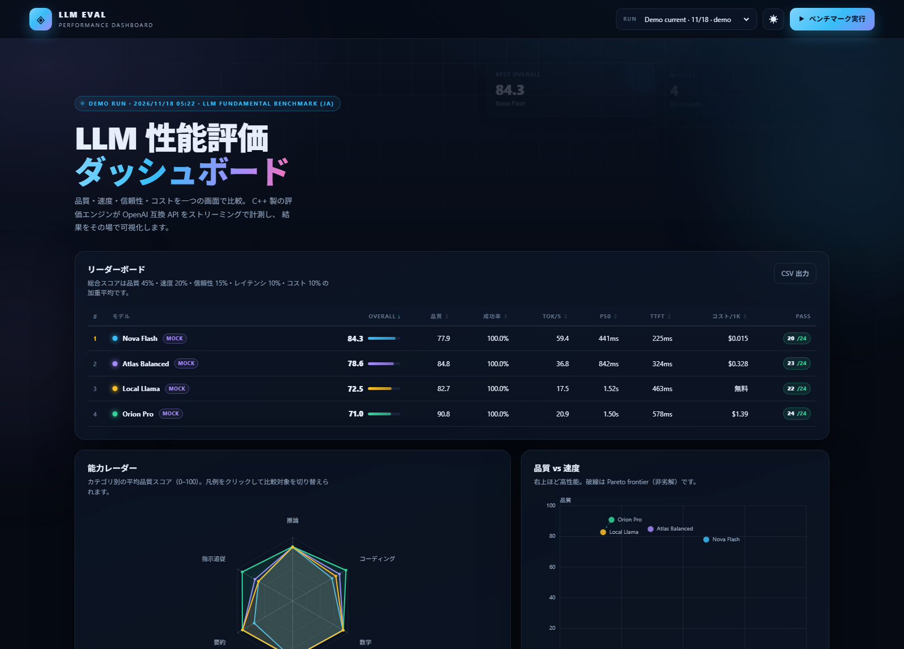

# LLM Eval Dashboard (C++17)

OpenAI 互換 API（Ollama / LM Studio / vLLM / OpenAI など）を対象に、LLM の品質・速度・信頼性・コストを測定し、その場でダッシュボード可視化する C++17 製の評価アプリケーションです。

外部 CDN や Node.js ランタイムは不要です。HTTP サーバー（`cpp-httplib`）、JSON（`nlohmann/json`）、ダッシュボードの HTML/CSS/JS はすべてリポジトリ内に同梱され、実行ファイルに埋め込まれます。



## 主な機能

- **OpenAI 互換エンドポイントの評価** — `/chat/completions` を SSE ストリーミングで呼び出し、TTFT（最初のトークンまでの時間）と総レイテンシを計測します。
- **API キー不要の mock プロバイダ** — 決定的な疑似応答を生成するため、ネットワークなしでダッシュボードや CI を試せます。
- **品質スコア** — 期待キーワードの一致率（`|` 区切りで別表記に対応）と文字バイグラム F1 の加重平均。
- **総合スコア** — 品質 45%、速度 20%、成功率 15%、p50 レイテンシ 10%、コスト 10% の加重平均（0–100）。
- **ダッシュボード** — KPI、リーダーボード、能力レーダー、品質 vs 速度の散布図（Pareto frontier）、p50/p95 レイテンシ、カテゴリ別ヒートマップ、実行履歴、プロンプト別の詳細、ライブ進捗。
- **セルフコンテナ** — Web アセットはバイナリに埋め込み。`web/` ディレクトリがあればそちらを優先します。
- **結果の永続化** — 1 実行 = 1 JSON。一覧・CSV エクスポート・履歴比較に対応。
- **初回起動時のデモ** — `results/` が空なら、3 件のバックデートされたデモ実行を自動生成します。

## クイックスタート

### Windows (MSVC)

Visual Studio の Developer PowerShell、または `vcvars64.bat` を読み込んだシェルで実行します。

```powershell
cmake -S . -B build -G "Visual Studio 18 2026" -A x64
cmake --build build --config Release --parallel
.\build\Release\llmbench.exe serve --open
```

Visual Studio 2022 の場合は `-G "Visual Studio 17 2022"` を指定してください。

### Ninja / その他の環境

```powershell
cmake -S . -B build -G Ninja -DCMAKE_BUILD_TYPE=Release
cmake --build build
./build/llmbench serve --open
```

Linux / macOS では `Threads` が必要です。HTTPS を使う場合は OpenSSL の開発用ヘッダを入れてください（見つかれば自動で有効化されます）。Windows では HTTPS クライアントに WinHTTP を使用するため、追加の依存はありません。

### 最初の実行

```powershell
# ダッシュボードを起動（results/ が空ならデモを3件生成）
.\build\Release\llmbench.exe serve --open

# mock モデルで評価を1回実行
.\build\Release\llmbench.exe run --config configs\example.json --max-items 12

# デモ実行だけを生成
.\build\Release\llmbench.exe demo --count 3

# 保存済みの実行を一覧 / CSV 出力
.\build\Release\llmbench.exe list
.\build\Release\llmbench.exe export --id <RUN_ID> --out report.csv
```

既定の URL は <http://127.0.0.1:8080> です。

## CLI

```
llmbench [serve] [options]   ダッシュボードを起動（既定）
llmbench run [options]       評価を1回実行
llmbench demo [options]      デモ実行を生成
llmbench list [options]      保存済み実行の一覧
llmbench export [options]    実行を CSV に出力
```

| オプション | 説明 |
| --- | --- |
| `-c, --config PATH` | 設定 JSON（既定: `configs/example.json`） |
| `-r, --results DIR` | 結果ディレクトリ（既定: `./results`） |
| `-H, --host ADDR` | バインドアドレス（既定: `127.0.0.1`） |
| `-p, --port N` | HTTP ポート（既定: `8080`） |
| `-w, --web DIR` | ダッシュボードのアセットディレクトリ |
| `--open` | 起動時にブラウザを開く |
| `--no-demo` | 空の結果ディレクトリでもデモを生成しない |
| `--max-items N` | 評価するプロンプト数を制限（0 = すべて） |
| `--concurrency N` | 並列ワーカー数（1–12） |
| `--name NAME` | 実行名 |
| `--id RUN_ID` | エクスポート対象（既定: 最新） |
| `-o, --out PATH` | CSV の出力先 |
| `--count N` | 生成するデモ実行数（既定: 3） |

## 設定ファイル

`configs/example.json` を雛形にしてください。相対パスの `dataset` は設定ファイルのディレクトリを基準に解決されます。

```json
{
  "name": "My evaluation",
  "dataset": "data/benchmark_ja.json",
  "concurrency": 4,
  "timeout_ms": 60000,
  "temperature": 0.0,
  "max_tokens": 256,
  "pass_threshold": 0.6,
  "retries": 1,
  "models": [
    {
      "id": "Nova Flash",
      "provider": "mock",
      "profile": "fast",
      "color": "#38bdf8",
      "input_price_per_mtok": 0.10,
      "output_price_per_mtok": 0.40
    },
    {
      "id": "Ollama Llama 3.2",
      "provider": "openai",
      "base_url": "http://localhost:11434/v1",
      "model": "llama3.2",
      "color": "#22d3ee",
      "input_price_per_mtok": 0.0,
      "output_price_per_mtok": 0.0
    }
  ]
}
```

| フィールド | 説明 |
| --- | --- |
| `provider` | `openai`（OpenAI 互換 API）または `mock`（ローカルシミュレーション） |
| `base_url` | `openai` のベース URL。`/chat/completions` が付与されます |
| `model` | API に渡すモデル名 |
| `api_key_env` | API キーを格納した環境変数名（例: `OPENAI_API_KEY`） |
| `profile` | mock の性格: `fast` / `balanced` / `quality` / `local` |
| `input_price_per_mtok` | 入力 100 万トークンあたりの USD |
| `output_price_per_mtok` | 出力 100 万トークンあたりの USD |
| `enabled` | `false` のモデルは通常実行の対象外（UI から明示選択は可能） |

API キーは設定ファイルに書かず、環境変数から読み取ります。

## データセット

`data/benchmark_ja.json` に日本語の 24 問（6 カテゴリ）を同梱しています。各項目の形式は次のとおりです。

```json
{
  "id": "math_01",
  "category": "推論",
  "prompt": "123 + 456 を計算してください。",
  "expected_keywords": ["579"],
  "reference": "579",
  "max_tokens": 256,
  "max_chars": 0,
  "weight": 1.0
}
```

- `expected_keywords`: 1 つ以上含まれていれば一致。`"東京|とうきょう"` のように `|` で別表記を指定できます。
- `reference`: 任意。指定すると文字バイグラム F1 が品質に加算されます。
- `max_chars`: 0 より大きい場合、文字数を超えた出力にペナルティを与えます。

## 評価指標

各モデルについて以下を集計します。

- **品質 (quality)**: `0.72 × keyword_recall + 0.28 × char_bigram_F1`（片方のみの場合はその値）
- **成功率 (success_rate)**: HTTP/API 呼び出しに成功した割合
- **tok/s**: 総出力トークン ÷ 総レイテンシ
- **p50 / p95 レイテンシ**: 成功リクエストのパーセンタイル
- **TTFT**: ストリーミングで最初の内容を受信するまでの時間
- **コスト**: `入力tok × 入力単価 + 出力tok × 出力単価`
- **Overall**: `0.45×品質 + 0.20×速度 + 0.15×成功率 + 0.10×レイテンシ + 0.10×コスト`

速度・レイテンシ・コストは 0–100 に正規化されます。成功リクエストが 0 件のモデルは Overall = 0 になります。

## HTTP API

ダッシュボードは以下の JSON API を利用します。外部ツールからも同じ API を呼び出せます。

| メソッド | パス | 説明 |
| --- | --- | --- |
| `GET` | `/api/health` | 稼働確認 |
| `GET` | `/api/bootstrap` | 設定・データセット・実行一覧・最新結果・ジョブ状態をまとめて取得 |
| `GET` | `/api/config` | サニタイズ済みの設定 |
| `GET` | `/api/dataset` | データセット項目 |
| `GET` | `/api/runs` | 実行一覧（新しい順） |
| `GET` | `/api/runs/{id}` | 実行結果の詳細 |
| `GET` | `/api/runs/{id}/csv` | CSV ダウンロード |
| `GET` | `/api/job` | 現在のジョブ進捗 |
| `POST` | `/api/job/cancel` | 実行中ジョブのキャンセル |
| `POST` | `/api/run` | 評価を開始 |
| `POST` | `/api/demo` | デモ評価を開始 |

`POST /api/run` の例:

```json
{
  "name": "nightly",
  "model_ids": ["Nova Flash", "Ollama Llama 3.2"],
  "max_items": 12,
  "concurrency": 4
}
```

`model_ids` を省略すると、設定で `enabled: true` のモデルがすべて対象になります。`custom_models` で一時的なモデル定義を追加することもできます。

## ディレクトリ構成

```
llm_eval_dashboard/
├── CMakeLists.txt
├── cmake/embed_assets.cmake     # Web アセット埋め込み
├── configs/example.json         # モデル設定の例
├── data/benchmark_ja.json       # 日本語ベンチマーク
├── docs/dashboard.png           # スクリーンショット
├── src/                         # C++17 実装
├── tests/test_core.cpp          # ユニットテスト
├── third_party/                 # httplib.h / nlohmann/json.hpp
└── web/                         # ダッシュボード (HTML/CSS/JS)
```

## テスト

```powershell
cmake --build build --config Release --target llmbench_tests
.\build\Release\llmbench_tests.exe
# または
ctest --test-dir build -C Release --output-on-failure
```

文字列処理、スコアリング、集計、mock の決定性、JSON ラウンドトリップ、ストレージ、デモデータを検証します。

## 制限事項

- ダッシュボードの HTTP サーバーはプレーン HTTP です。外部公開する場合はリバースプロキシで TLS を終端してください。
- OpenAI 互換 API のうち、`/chat/completions` と SSE ストリーミングを前提としています。
- 品質評価はキーワードと文字バイグラムに基づく軽量な指標です。LLM-as-a-judge のような意味評価は行いません。

## ライセンス

このアプリケーションのコードはリポジトリのライセンスに従います。同梱するサードパーティライブラリについては [THIRD_PARTY_NOTICES.md](THIRD_PARTY_NOTICES.md) を参照してください。
