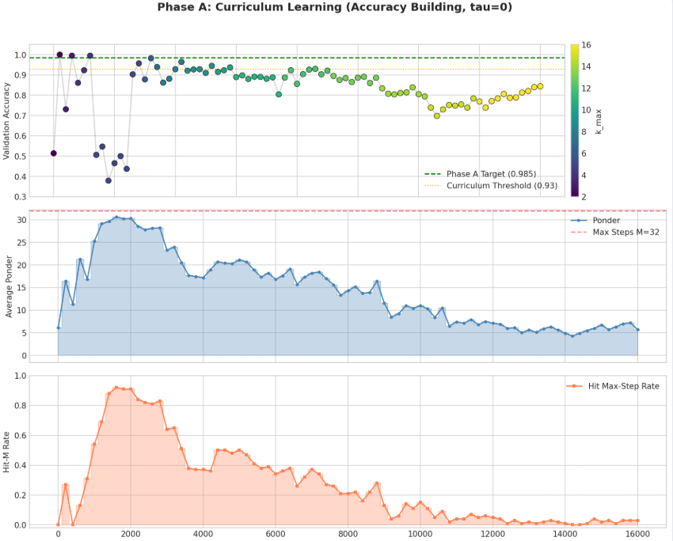
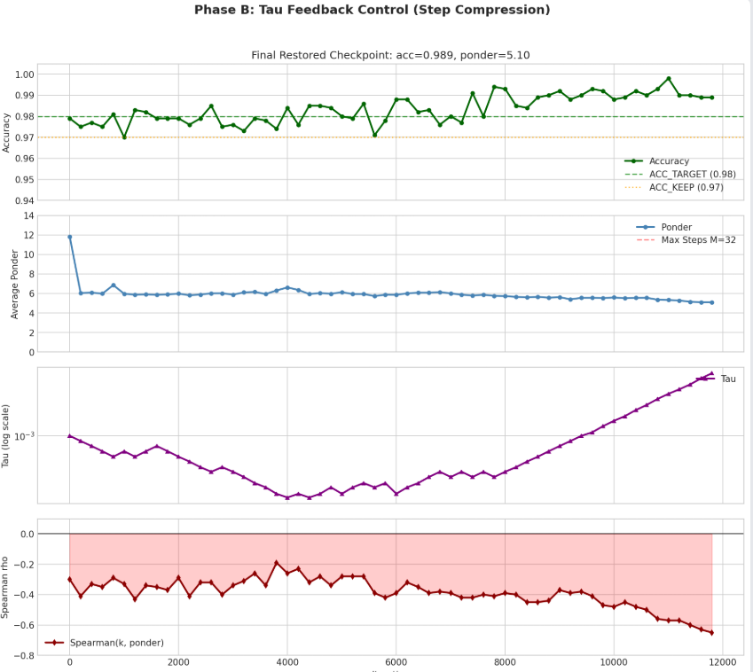

前回ニューラルネットワークのレイヤ選択の初期の研究である [ACT（Adaptive Computation Time）](https://yoshishinnze.hatenablog.com/entry/2026/11/30/043000)について説明しました。
レイヤ選択はニューラルネットワークの計算時間短縮やリソース削減で重要な技術です。

今回はACTがどの程度うまくワークするかを検証するため実験を行ってみました。

## 実験

見るべき情報の量がサンプルごとに変わる Parity（偶奇）問題により、ACTの成果であるニューラルネットワークが考える時間（計算ステップ数）を、問題の難しさに応じて自分で調整できるかを検証していきます。

### 問題設定：「どこを見て、いつまで考えるか」が都度変わる Parity問題

__タスクの内容__

今回ACTの機能を実装したニューラルネットワークで解かせる問題は Parity問題 と呼ばれるものとします。
入力は **16次元（または32, 64次元）のベクトル**です。各要素は **-1、0、+1** のいずれかです。

- **+1 の個数が偶数なら答えは 0**
- **+1 の個数が奇数なら答えは 1**

これだけ聞くと単純ですが、以下の2つの「動的な要素」が加わります。

__① 「見るべき場所」が毎回変わる__

非ゼロ（-1 または +1）な要素が現れる **位置** は、サンプルごとにランダムです。モデルは毎回「今回はどの次元に答えがあるのか」を探す必要があります。

__② 「見るべき要素の数 $k$」が毎回変わる__

非ゼロ要素の個数 $k$ は、サンプルごとに **1個から最大 $D$ 個まで** ばらつきます。
- $k$ が小さい（非ゼロが少ない）→ 簡単。早く答えが出せます。
- $k$ が大きい（非ゼロが多い）→ 難しい。多くの要素を順番に確認しないと答えが出ません。

この「$k$ が分からないまま、モデルが自分で『もう十分確認した』と判断して計算を止める」というのが、ACT の核心です。

### parity問題とは

Parity問題とは、**「入力の中にある 1 の個数が偶数か奇数かを答える問題」**です。

例えば：

```
入力: [0, 1, 0, 1, 1]  →  1 が 3個 → 奇数 → 答え: 1
入力: [0, 1, 0, 1, 0]  →  1 が 2個 → 偶数 → 答え: 0
```

__ニューラルネットワークには難しい__

Parityのどの要素も「同じくらい重要」であり、重要なデータを見つけることが特徴のニューラルネットワークには難しい問題とされてます。

画像なら「耳の部分を見れば猫かどうか分かる」といった局所的な手がかりがありますが、Parity問題では**1つの要素を変えるだけで答えが反転**します。つまり、すべての入力を均等に確認しなければ正解できません。

また、今回の実験ではさらに以下の条件が加わっています。

- **1 が現れる位置が毎回ランダム**
- **1 の個数（見るべき要素数）が毎回変わる**

このため、モデルは「どこを見て、いつまで考えれば十分か」を自分で判断する必要があります。

### 検証点

今回検証しようとしている ACT（Adaptive Computation Time）の特性は、**「問題の難しさに応じて、モデル自身が考える時間（計算ステップ数）を動的に決める」** という点にあります。

__1. 入力ごとに異なる計算ステップ数__
通常のニューラルネットワークは「何層」か「何ステップ」かがあらかじめ固定されていますが、ACT では**サンプルごとに計算ステップ数が変わります**。

- 簡単な問題（非ゼロ要素が少ない）→ 早く止まる
- 難しい問題（非ゼロ要素が多い）→ 長く考える

__2. 精度と計算コストのトレードオフの学習__
モデルは「正解すること」と「早く止まること」の両方を同時に学習します。

- 正解に近いほど損失（BCE）が減る
- ステップ数が多いほど ponder cost（計算ペナルティ）が増える

モデルはこのバランスを取りながら、「必要最小限のステップで正解する」ことを学習します。

__3. 自律的な停止判断__
人間が「ここで止めて」と指示するのではなく、**モデル自身が隠れ状態を見て「もう十分情報が集まった」と判断して停止します**。


## どのようなネットワーク構造で実現されるか

実験に用いるネットワーク構造について説明します。

### ① 思考ステップ：GRUCell
```python
self.cell = nn.GRUCell(D + 2, H)
```

GRUCell（Gated Recurrent Unit Cell）は、リカレントニューラルネットワーク（RNN）の代表的な構造である GRUの1ステップ分（セル単位）の処理を行うモジュールです。
LSTM（Long Short-Term Memory）の軽量版として考案され、時系列データや順次処理を行うモデルで広く使われています。

GRUCellを用いることで、各ステップで隠れ状態 `s` を更新する再帰ユニットを構成します。
これが **「考える」** 役割を担います。入力 `x` は最初のステップだけ与えられ、以降はゼロベクトルが入力されるため、モデルは「最初に見た情報をどう記憶・加工するか」をステップごとに繰り返します。

### ② 停止判定機構：Halt ネットワーク
```python
self.halt = nn.Linear(H, 1)
```

ハルト確率は、ACTにおいて、「この計算ステップで、もう考えるのを止めていいかどうか」を表す 0〜1 の確率のことです。
各ステップの隠れ状態 `s` を見て、「このステップで止まる確率」を出力します。シグモイド関数で 0〜1 の確率に変換されます。

```python
h = torch.sigmoid(self.halt(s)).squeeze(-1)
```

バイアス `HALT_BIAS = -1.5` が初期値として与えられており、**最初は「止まりにくい」** ように細工します。
しっかり検討を進めるほど回答に確信を持つようになります。

### ③ 累積的な出力の重み付け
```python
y_acc = y_acc + p * y
halt_sum = halt_sum + p
```

各ステップで出た予測 `y` を、そのステップの「停止確率 `p`」で重み付けして累積していきます。最終的な出力は、すべてのステップの予測の**重み付き平均**になります。
早く止まれば初期ステップの出力が支配的になり、長く考えれば後期ステップの出力が反映されることになります。

### ④ Ponder Cost（計算コストペナルティ）
```python
loss = F.binary_cross_entropy(y, t) + tau * rho.mean()
```
損失関数に「ステップ数 `rho` に比例するペナルティ項」を加えています。`tau` が大きいほど「長く考えること」が強く抑制されます。
初めに考察にペナルティが強いと、考えないモデルになってしまいます。
適度に調整をするようにするため `tau` を 0 から徐々に増やす「ウォームアップ」を採用し、**先に正解の仕方を覚えてから、効率化を学ばせる**ようにします。


### ACT の効果検証の工夫点

今回検証ではACTのに以下の工夫を盛り込み、**「学習が立ち上がらない」という ACT の有名な難題を克服できるか**を検証しています。

__検証項目①：カリキュラム学習の効果__

- 最初から難しい問題（$k$ が大きい）を解こうとすると、ACT は「いつ止まればいいか」を学習できずに失敗しやすいです。
- そこで、**まず $k$ が小さい簡単な問題（$k_{max}=2$）だけを解かせ、精度が上がったら少しずつ $k$ を増やす**「カリキュラム学習」を導入しています。
- **検証のポイント**：段階的に難易度を上げることで、 halt（停止）機構と parity 分類器を同時に学習できるか。

__検証項目②：$\tau$（ポンダーコスト）のウォームアップの効果__
- ACT には「計算ステップが多いほどペナルティを与える」$\tau$ という係数があります。これが最初から大きいと、モデルは「早く止まることだけ」を学習して精度を犠牲にします。
- コードでは、**最初は $\tau=0$（ペナルティなし）で十分に学習させ、その後 $\tau$ をゆっくり上げて「効率的に止まること」を後から学習させます**。
- **検証のポイント**：「先に正解の仕方を覚え、その後で効率化する」という学習順序が機能するか。

__検証項目③：停止バイアスの効果__
- halt（停止）判定を行うネットワークの初期バイアスを **-2.0** に設定しています。これにより、**最初は「まだ止まらない（もっと計算する）」方向に偏らせます**。
- **検証のポイント**：初期の halt 確率を低く抑えることで、学習初期に勾配が流れやすくなり、 halt 機構が育つか。

__検証項目④：GRU の採用効果__
- 状態更新に GRUCell を使っています。これは LSTM より軽量で、 halt 判定と出力生成を同じ隠れ状態で行う際に、学習が安定しやすいと期待されています。
- **検証のポイント**：単純な再帰構造でも、 halt と推論を同時に学習できるか。

__検証項目⑤：固定ステップ版との比較（Sanity Check）__
- まず「固定で8ステップ計算するモデル」で学習できるかを確認します。
- **検証のポイント**：もし固定ステップでも学習できないなら、「ACT の問題」ではなく「タスク自体が難しすぎる」か「モデル/最適化の設定が悪い」ことが分かります。

__検証項目⑥：「難しい問題ほど長く考える」動的制御の獲得__
- 学習後、`report_by_k` によって **$k$（非ゼロ要素数）の大きさ別** に精度と平均 ponder（実際の計算ステップ数）を集計しています。
- **検証のポイント**：
  - $k$ が小さいサンプルでは、早く止まっているか（無駄な計算をしていないか）
  - $k$ が大きいサンプルでは、しっかり計算ステップを増やしているか
  - つまり、**「問題の複雑さに応じた賢い計算量の使い分け」**ができているか。

__検証項目⑦：最大ステップ到達率（hit-M）の健全性__
- モデルが「止まり方を学習できていない」と、常に最大ステップ数 $M$ まで計算し続けてしまいます。
- `hit-M`（最大ステップに到達する割合）を監視することで、halt 機構が暴走・停止不全になっていないかを確認します。
- **検証のポイント**：適切なタイミングで止まる「自律的な制御」が獲得できているか。

## 学習

### 実装コード

以下レポジトリに今回実験のコードを保管しています。

https://github.com/Shinichi0713/LLM-fundamental-study/tree/main/selective_layer/adaptive_computation_time/src

学習はPhase AとPhase Bを分けています。

Phase A:

モデルが今回の問題に対して十分に考えられる状態になるまで学習を行います。

Phase B:

モデルの熟考の考えの長さに対してペナルティを与えるようにしていきます。
→正答率を保つ最適な打ち切り時間を少しづつ学んでいくようにしていきました。


### 学習結果

フェーズAの学習結果です。




上段: 各イテレーションでの検証精度。色は k_max を示し、カリキュラムが段階的に進行する様子が可視化されています。緑の破線は Phase A の終了目標 (0.985)、オレンジの点線はカリキュラム閾値 (0.93) です。
中段: 平均 ponder（計算ステップ数）。赤の破線は最大ステップ数 M=32 です。
下段: hit-M（最大ステップ到達率）。Phase A では初期に高くなりますが、後半に低下する様子が確認できます。

フェーズBの学習結果です。



上段: 精度の推移。tau の自動制御によって精度を維持しながらステップ数を圧縮しています。
2段目: ponder の推移。Phase B の開始直後に 11.82 から 6.04 へ急減し、その後も 5〜6 ステップで安定しています。
3段目: tau の対数スケール推移。精度が高いと tau を上げ、低いと下げるフィードバック制御の振動が確認できます。
下段: Spearman 相関係数。負の値のまま推移しており、「難しい問題ほど短く考える」傾向が改善されていないことが示されています。

### 結果

半分成功で、半分は期待と逆です。ACT で狙う「難しい入力ほど長く考える」は実験結果からは成立していません。

__うまくいった点__

| 指標 | 第3版 | 今回 |
|---|---|---|
| 精度 | 0.970 | **0.993** |
| 平均ポンダー | 24.7 | **5.1** |
| 上限到達率 | 62.8% | **0%** |

計算量は約 5 分の 1 になり、精度はACTの導入に比べてむしろ上がり、上限による打ち切りがなくなりました。

__うまくいっていない点__

k=1 で約 6.0 ステップ、k=16 で約 3.6 ステップと、難しい入力ほど早く止まっています。さらに、最も早く止まる k=15,16 で精度が落ちています（0.968、0.923）。これは「考える時間を削ったから間違えた」と読めるので、適応としては逆向きです。

### 考察

1. **このタスクは、この容量では k に応じた深さを必要としない可能性があります。** 隠れ 256 の GRU なら、+1 の個数を数えて偶奇を出す処理を 2〜3 ステップで並列に実行できます。k が増えても必要なステップ数はほとんど増えません。論文のように ponder が k とともに増えるのは、容量が小さく、直列に処理せざるを得ない設定だからかもしれません。

2. **τ の制御目標が全体平均の精度なので、難所が犠牲になっています。** k=15,16 は全データの 1/8 しかなく、そこを落としても平均精度は 0.99 近くを保てます。コントローラが「平均 0.98 以上なら τ を上げる」ので、難所の精度を犠牲にして、全体のステップ数を削る方向に圧力がかかります。

3. **固定ステップとの比較がまだありません。** 6 ステップ固定でも精度 0.99 に達するなら、ACT の利点は示せていません。ACT が有効だと言うには、平均 5.1 ステップの ACT が、同じ平均ステップの固定モデルより良いことを示す必要があります。

## 総括

ACT を用いた Parity 問題実験の結果を簡潔にまとめると以下の通りです。

- **計算効率は大幅に改善**：平均 ponder を約 25 ステップから **5.1 ステップ** に削減しつつ、全体精度 **99.3%** を達成。最大ステップ到達率も 0% となり、無駄な計算がなくなりました。
- **しかし「難易度適応」は逆方向**：ACT の目標である「難しい問題ほど長く考える」動的制御は成立せず、**難しい問題（k が大きい）ほど早く止まる**傾向が観測されました（Spearman = -0.67）。
- **難所の精度が犠牲に**：k = 15〜16 の最難領域で精度が低下（92.3〜96.8%）しており、τ の自動制御が全体平均精度を優先するあまり、少数派の難しいサンプルを切り捨てる方向に働いています。
- **原因の仮説**：GRU（隠れ次元 256）の容量が大きく、並列に処理できたため「k に応じた深さ」が不要だった可能性、および固定ステップとの優位性比較が未完了であることが指摘されています。

計算コストの削減には成功したが、難易度に応じた賢い計算量の使い分けは実現できなかったという結果になりました。
原因考察すれば改善は出来そうですが、一つ、計算コスト削減の選択肢に出来そうということが確認出来ました。
