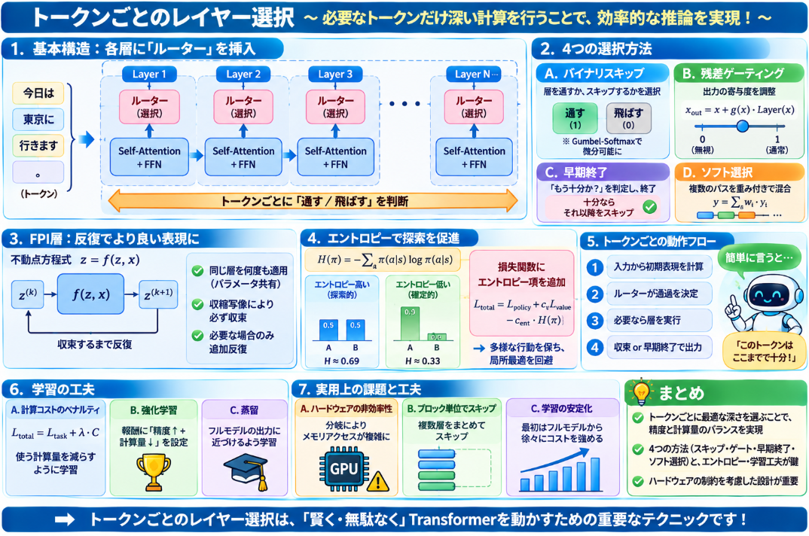

LLMがプロンプトに応じて文章出力するには膨大な計算が必要です。
計算量の増加はLLMシステムのレイテンシに直結し、ユーザーのプロンプトに対する応答速度がもっさい動作ということになります。

現在LLMではこの計算量を削減するための研究成果が実装されています。
そんな研究テーマの一つとして存在するレイヤ選択の機能について説明していきます。

## レイヤ選択の手法

それぞれの方向性について、直感的なイメージを交えながら説明いたします。

### 1. 入力の難易度に応じて計算ステップ数を変える

**「問題が簡単ならすぐ答え、難しければじっくり考える」** という人間の思考パターンをモデルに取り入れる手法です。

従来のLLMは、入力が「1+1=？」であろうと複雑な数学の証明であろうと、同じ数の層（例えば32層や64層）を毎回すべて通ります。これは、簡単な問題に対して「考えすぎ（overthinking）」であり、無駄な計算になっています。

この手法では、**入力全体の難易度や複雑さを判定し、その問題に必要なだけの計算ステップ（深さ）を動的に割り当てます**。

例えば、以下のようなアプローチがあります。

- **早期終了（Early Exit）**: 途中の層で「もう十分答えが確定した」と判断できれば、それ以降の層を計算せずに出力します。
- **Test-Time Depth Adaptation**: 問題の難易度に応じて、層をスキップしたり、逆に同じ層を何度も繰り返し適用（ループ）したりして、モデルの深さを調整します。[Skip a Layer or Loop it?](https://arxiv.org/abs/2507.07996)
- **Adaptive Test-Time Compute**: 推論時の「思考トークン」の予算を、問題の難易度に応じて動的に増減させます。[Reasoning on a Budget](https://arxiv.org/abs/2507.02076)

一言でいえば、**「問題ごとに必要な深さを変える」** のがこの方向性です。

### 2. トークンごとに層を選択する

**「同じ文章の中でも、簡単な単語はサラッと通し、重要で難しい単語だけじっくり処理する」** という発想の手法です。

ここでの「トークン」とは、文章を分解した最小単位（日本語なら文字やサブワード、英語なら単語や語片）のことです。従来は、生成するすべてのトークンが同じ32層を通っていましたが、実は**トークンによって必要な計算量は大きく異なる**ことが研究で明らかになっています。

例えば、「〜ですね」「〜ました」のような定型表現や、すでに文中に何度も出てきた単語は、浅い層だけで十分予測できます。一方で、数学の答えの導出部分や、文脈から慎重に推論が必要な固有名詞などは、深い層まで計算する必要があります。

具体的な手法としては、以下のようなものがあります。

- **Layer Skipping（層のスキップ）**: 各層の入口に小さな「ルーター」を置き、「このトークンはこの層を通る必要があるか？」を判定します。必要なければその層を飛ばします。[DiffSkip](https://aclanthology.org/2025.findings-acl.377.pdf) [Adaptive Layer-skipping in Pre-trained LLMs](https://arxiv.org/abs/2503.23798)
- **Token-wise Routing**: 各トークンに対して、Attention層やFFN層の計算を部分的に省略・軽量化する方法です。[SkipGPT](https://arxiv.org/abs/2506.04179) [What Layers When](https://arxiv.org/abs/2510.13876)
- **Dynamic Layer Routing**: 各トークンごとに、どの層を通るかの経路を動的に決定します。[Dr.LLM](https://arxiv.org/abs/2510.12773)

一言でいえば、**「同じ文章の中で、トークンごとに通過する層の数やパスを変える」** のがこの方向性です。

### 3. 条件付き計算・専門家選択（MoEの系統）

**「病院で、症状に応じて適切な科（内科・外科・眼科など）の専門医にだけ診てもらう」**ような仕組みです。

Mixture-of-Experts（MoE、専門家の混合モデル）では、モデル全体には膨大なパラメータ（例えば1兆個）があっても、**入力に応じてその中の一部の「専門家（エキスパート）」だけを活性化**して使います。これにより、全パラメータを使うわけではないので、計算効率を保ちながら大規模なモデルの能力を引き出せます。

従来のMoEは「どのエキスパートを使うか」を層ごとに決めていましたが、最近の研究ではさらに進化しています。

- **Token-Difficulty Driven MoE**: トークンの難易度に応じて、小さなエキスパート（簡単なトークン用）と大きなエキスパート（難しいトークン用）を使い分けます。[DynaMoE](https://arxiv.org/abs/2502.12325)
- **Layer-Adaptive Expert Selection**: 層ごとに活性化するエキスパートの数や種類を調整し、さらに計算を効率化します。[LExI](https://arxiv.org/abs/2509.02753)

ただし、MoEは基本的に **「層の中のどの部分（エキスパート）を使うか」** を選ぶ問題であり、**「どの層を通るか」** を選ぶ問題（レイヤー選択）とは少し軸が異なります。もちろん、両方を組み合わせる研究も出てきています。

一言でいえば、**「巨大なモデルの中から、入力に合った専門家の部分集合だけを使う」** のがこの方向性です。


### 3つの方向性の比較まとめ

| 方向性 | 何を変えるか | 比喩 |
|--------|-------------|------|
| 1. 入力の難易度に応じて計算ステップ数を変える | **問題全体**に対する計算の深さ | 簡単な問題は早く答え、難問はじっくり考える |
| 2. トークンごとに層を選択する | **各トークン**が通る層の数・パス | 文章の中で重要な単語だけ念入りに処理する |
| 3. 条件付き計算・専門家選択（MoE） | **層の中のどの部分（エキスパート）**を使うか | 症状に応じて適切な科の専門医に診てもらう |


## 現在主流の手法
では、どの手法が現在主流とされているのでしょう？
結論から申し上げますと、**2. トークンごとに層を選択する**の方向性が、現在のレイヤ選択に関する研究の中で最も活発な主流（mainstream）となっています。

ただし、1. と 3. もそれぞれ隣接した大きな研究領域であり、完全に切り離されているわけではありません。以下、検索で確認できた論文群に基づいて整理いたします。

### 1. トークンごとに層を選択する（現在の主流）

2024年から2025年にかけて、デコーダのみのTransformerにおいて「トークンごとに通過させる層の数やパスを変える」手法が多数提案されています。これは、従来の「すべてのトークンをすべての層に通す」均一な計算に対する反発として発展してきた流れです。

具体的な研究例としては以下が挙げられます。

- **DiffSkip** (ACL 2025 Findings): 入力と出力の差分に基づき、トークンごとに層のスキップを差分的に制御する手法です。[DiffSkip](https://aclanthology.org/2025.findings-acl.377.pdf)
- **GateSkip / What Layers When**: residual stream上のゲート機構を用いて、デコーダのみの言語モデルにおけるトークン単位のレイヤースキップを実現しています。[What Layers When](https://arxiv.org/abs/2510.13876)
- **FlexiDepth (Adaptive Layer-skipping)**: 各Transformer層に軽量なrouterとadapterを挿入し、トークンの種類（繰り返しトークンか、計算・不確実性の高いトークンか）に応じて動的に層数を調整します。要約や数学推論の例では、トークンごとに必要な層数が大きく異なることが実証されています。[Adaptive Layer-skipping in Pre-trained LLMs](https://arxiv.org/abs/2503.23798)
- **SkipGPT**: トークン認識（token awareness）とモジュール分離を用いた動的レイヤープルーニングを提案しています。[SkipGPT](https://arxiv.org/abs/2506.04179)
- **Dr.LLM**: すべてのトークンをすべての層に通すことの非効率性を指摘し、動的なレイヤールーティングを提案しています。[Dr.LLM](https://arxiv.org/abs/2510.12773)

また、2026年にIEEE Accessに掲載されたレビュー論文 *"A Survey of Dynamic Token Computation in Transformers"* では、トークンプルーニング・ドロッピング、トークン結合、条件付きトークンルーティング、そして**適応的な深さ（adaptive depth）や早期終了（early-exit）戦略**を「Dynamic Token Computation」として包括的に整理しており、トークン単位の計算制御が確立された研究カテゴリーであることが示されています。[IEEE Access](https://doi.org/10.1109/access.2026.3720106)

### 2. 入力の難易度に応じて計算ステップ数を変える

これは「Adaptive Test-Time Compute」や「Input-Adaptive Inference」として盛んに研究されていますが、**レイヤー選択そのもの**というよりは、推論時の計算量（reasoning budget、thinking tokensの数、早期終了のタイミングなど）を入力全体の難易度に応じて制御する方向性です。

例えば、"Reasoning on a Budget: A Survey of Adaptive and Controllable Test-Time Compute in LLMs" では、L2 adaptiveness として「入力の難易度やモデルの自信に基づいて動的に計算をスケールする」手法が整理されています。[Reasoning on a Budget](https://arxiv.org/abs/2507.02076) また、*"Skip a Layer or Loop it?"* では、サンプルごとに最適な層の構成（Chain-of-Layers）を探索する「test-time depth adaptation」が議論されています。[Skip a Layer or Loop it?](https://arxiv.org/abs/2507.07996)

ただし、これらは「トークンごと」ではなく「入力（サンプル）ごと」または「推論ステップごと」の適応に焦点が当てられており、**レイヤー選択機能**という問いに対する直接的な答えとしては、トークン単位の層選択（2番）の方が研究の中心にあります。

### 3. 条件付き計算・専門家選択（MoEの系統）

MoE（Mixture-of-Experts）は大規模モデルの効率化において確立された主要なパラダイムです。近年でも、トークンの難易度に応じて異なるサイズのエキスパートを選択する **DynaMoE**[DynaMoE](https://arxiv.org/abs/2502.12325) や、レイヤー適応的なエキスパート活性化を行う **LExI**[LExI](https://arxiv.org/abs/2509.02753) などが提案されています。

しかし、MoEは基本的に「**層の中で**（または層間で）どのエキスパートを活性化するか」を選択する問題であり、質問にある「レイヤ選択機能」とは少し異なる軸の研究です。もちろん、MoEとレイヤースキッピングを融合させる研究もありますが、**純粋なレイヤー選択**の文脈では、MoE系統は別の大きなカテゴリーとして扱われています。

### 補足：検証できた範囲と留保事項

- トークンごとのレイヤー選択が「理論上の計算量削減」としては主流であることは多くの論文で確認できました。
- 一方で、**実際の壁時計時間（wall-clock speedup）に繋げるには、可変的なスキップパターンによるI/Oオーバーヘッドやハードウェア利用率の低下が依然として課題**であるという指摘もあります。FlexiDepthの論文でも、この点が言及されています。[Adaptive Layer-skipping in Pre-trained LLMs](https://arxiv.org/abs/2503.23798)
- そのため、「トークンごとに層を選択する」研究が最も活発な一方で、実用上は「入力難易度に応じたサンプル単位の適応」や「早期終了」と組み合わせる形で発展していく可能性もあります。

以上より、**現在のレイヤ選択機能に関する主たる研究は「2. トークンごとに層を選択する」** と考えられます。

## トークンごとにレイヤを選択する仕組み

トークンごとにレイヤを選択する手法は、大きく分けて **「各層の入口に小さな意思決定機構（ルーター/ゲート）を置き、トークンごとにその層を通すかどうかを判断する」** という共通のアーキテクチャを取ります。以下、基本的な方法論を整理して説明いたします。

### 1. 共通の基本構造：層ごとに「ルーター」を挿入する

Transformerの各層（Layer）の手前に、**軽量なルーター（router）** または**ゲート（gate）** を追加します。このルーターは、現在のトークンの隠れ状態（hidden state）を入力として受け取り、「このトークンをこの層に通すべきか？」という二値（または多値の）判断を出力します。

[FlexiDepth](https://arxiv.org/abs/2503.23798) では、各Transformer層に軽量なrouterとadapterを挿入し、トークンの種類に応じて動的に層数を調整しています。[SkipGPT](https://arxiv.org/abs/2506.04179) も同様に、トークン認識（token-aware）なモジュールを各層に配置して、どの計算モジュールを省略するかを決定します。


### 2. 選択の方法論：主に4つのパターン

__A. バイナリスキップ（通す / 飛ばす）__

最も直感的な方法です。ルーターが「0（スキップ）」または「1（通す）」を出力し、通さない場合はその層の計算（Self-AttentionとFFN）を完全に省略します。

ただし、離散的な0/1の選択は微分不可能なため、通常の誤差逆伝播では学習が困難です。この問題を解決するために、以下のような手法が使われます。

- **Gumbel-Softmax /  Concrete分布**: 離散選択を連続的な確率分布で近似し、微分可能にします。
- **Straight-Through Estimator**: 順伝播では0/1のハード選択を使い、逆伝播では連続的な勾配を流します。

[DiffSkip](https://aclanthology.org/2025.findings-acl.377.pdf) は、この「入力と出力の差分」に基づいて差分的にスキップを制御するアプローチを取っており、微分可能なフレームワークとして設計されています。

__B. 残差ストリーム上のゲーティング（スケーリング）__

層を完全に飛ばすのではなく、**残差接続（residual connection）の貢献度をトークンごとに調整**する方法です。[GateSkip](https://arxiv.org/abs/2510.13876)（別名 [What Layers When](https://proceedings.iclr.cc/paper_files/paper/2026/file/7e3491e922bfd199ea34ecafeb7380f0-Paper-Conference.pdf)）では、residual stream上にゲート機構を設置し、トークンごとにその層の出力をどれだけ残差に加えるかをスケールすることで、事実上の「部分スキップ」を実現しています。

数式で表すと、通常の残差接続は `x_out = x + Layer(x)` ですが、ゲート付きでは `x_out = x + g(x) * Layer(x)` となり、`g(x)` が 0 に近ければその層はほとんど無視されたことになります。

__C. 早期終了型（層ごとに「もう十分か？」を判定）__

各層の後に「このトークンの表現はもう十分に定まったか？」を判定する小さな分類器を置き、十分であればそれ以降のすべての層を省略します。これは「トークンごとの早期終了（token-level early exit）」と呼ばれます。

[IEEE Accessのサーベイ](https://doi.org/10.1109/access.2026.3720106) では、このような適応的な深さ（adaptive depth）や早期終了戦略を、Dynamic Token Computationの重要なカテゴリーとして整理しています。

__D. ソフト選択（重み付き和）__

離散的に「通す/飛ばす」を選ぶのではなく、**複数の候補パス（浅い層、深い層、異なるAttentionヘッドなど）の出力を重み付けして足し合わせる**方法です。これはMoEの考え方に近く、トークンごとに最適な計算パスをソフトに混合します。

[Dr.LLM](https://arxiv.org/abs/2510.12773) は、動的なレイヤールーティング（dynamic layer routing）を提案しており、各トークンに対して通過すべき層の経路を可変に制御します。

### 3. 学習方法：どうやって「最適な選択」を学ぶか

単にルーターを置くだけでは、ルーターが「全部通せ」と学習してしまい（計算量が減らない）、あるいは「全部飛ばせ」と学習してしまい（精度が崩壊する）という問題が起こります。これを防ぐために、以下のような学習戦略が取られます。

__計算コストを損失関数に組み込む（Budget Loss）__

目的関数に「計算量のペナルティ項」を加えます。例えば、

```
Total Loss = Task Loss（交叉エントロピーなど）+ λ × Compute Cost
```

`λ` を大きくすれば、モデルは計算量を減らす方向に強く誘導されます。ルーターは「精度を落とさずに計算量を減らす」バランスを学習します。

__強化学習（Policy Gradient）__

ルーターの選択を「方策（policy）」とみなし、REINFORCEなどの方策勾配法で「精度が高く、計算量が少ない選択」を報酬として学習します。

__蒸留（Distillation）による教師あり学習__

まず「すべての層を通したフルモデル」の出力を教師とし、**「どの層を飛ばしても教師の出力に近づく」** ようにルーターを学習します。これにより、スキップによる品質劣化を最小化できます。


### 4. 実用上の制約と工夫

トークンごとのレイヤー選択は理論上は魅力的ですが、実際の推論では以下の課題があります。

__ハードウェアの非効率性__

GPU/TPUは**同じ形状の計算をバッチで処理する**ことに最適化されています。しかし、トークンごとに通過する層が異なると、バッチ内のトークンで計算パスが分岐し、**メモリのアクセスパターンが不規則**になります。結果として、理論的なFLOPs削減が必ずしも壁時計時間の短縮に直結しないことがあります。[FlexiDepth](https://arxiv.org/abs/2503.23798) の論文でも、この点が実用上の課題として言及されています。

__ブロック単位でのスキップ__

この問題を緩和するため、**「層を1つずつ選ぶ」のではなく「層のブロック（例えば4層まとめて）」を単位としてスキップする**という工夫もあります。これにより、計算グラフの分岐を減らし、ハードウェアへの負担を軽減します。

__トレーニングの不安定性__

ルーターが学習初期に「全部飛ばす」極端な状態に陥ると、復帰が難しくなります。そのため、**学習の初期はフルモデルに近い状態から始め、徐々に計算コストのペナルティを強める**（アニーリング）といった工夫が行われます。

### まとめ

トークンごとのレイヤー選択は、基本的に **「各Transformer層の手前に軽量なルーターを置き、トークンの隠れ状態から通過/スキップを判断する」** という構造を取ります。選択の実現方法としては、**バイナリスキップ**、**残差ゲーティング**、**早期終了**、**ソフト選択**の4パターンがあり、学習には**計算コストのペナルティ付き損失関数**や**蒸留**が用いられます。一方で、**可変パスによるハードウェア非効率**が最大の実用上の課題として残っています。




