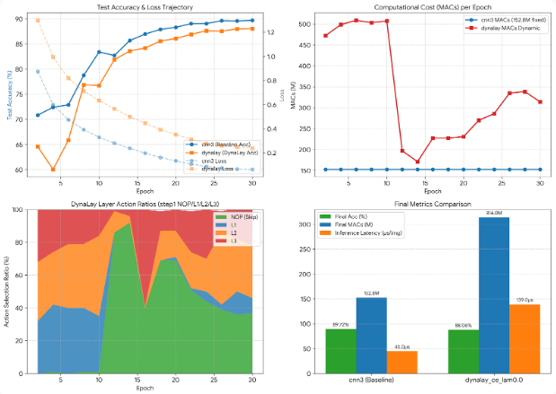

前回ニューラルネットワークの内部を監視して[強化学習したエージェントがモデルの回答が十分自信を持ってるかを観察することでレイヤ計算を打ち切っても良いかを判断するDynaLayer](https://yoshishinnze.hatenablog.com/entry/2026/11/27/043000)という論文について紹介しました。

今回この論文が実現可能なものであるかを検証してみます。

## 論文の内容を簡潔に

詳細は[DynaLayerについて説明した記事](https://yoshishinnze.hatenablog.com/entry/2026/11/27/043000)をご覧ください。

実装のイメージは以下の通りです。

### 全体構成（3つの部品）

3つのコンポーネントより構成します。
各モデルの役割について説明していきます。

```
[メインモデル]  CNNで特徴を段階的に抽出（3ステージ）
      ↓
[エージェント]  メインモデルの内部活性化を見て「次に何をするか」を選択
      ↓
[FPI層]         同じ層を何度も反復して特徴を「磨き上げる」
```

### 1. メインモデル：普通のCNN + FPI層の「スロット」

3段階の CNN で特徴を抽出します。ただし、各ステージの後に **「磨き上げ層（FPI層）」を挿入できる余地**を持たせています。

```python
# イメージ
x = stage1(x)   # 16x16 の特徴
x = refine1(x)  # ← 必要ならここで磨く（不要ならスキップ）
x = stage2(x)   # 8x8 の特徴
x = refine2(x)  # ← 必要ならここで磨く
...
```

### 2. FPI層：「同じ層を何度も適用して収束させる」

同じパラメータの層を反復適用し、特徴が変わらなくなる（収束する）まで回します。

```python
z = x  # 初期値
for _ in range(max_iter):
    z_new = x + scale * conv2(relu(conv1(z)))  # 残差で少しずつ修正
    if ||z_new - z|| < tol: break  # 収束したら止める
    z = z_new
```

- **理論的保証**: 層の Lipschitz 定数を 1 以下に制限（power iteration で重み正規化）することで、**必ず収束する**
- **勾配**: 反復過程は勾配なし、収束点だけ勾配を流す（メモリ効率）

### 3. エージェント：「自分の自信度を見て判断する」

エージェントへの入力は、メインモデルの**内部状態のスナップショット**です。

```python
features = [stage1_out, stage2_out, stage3_out]  # 各ステージの特徴
confidence = softmax(logits).max()               # 予測確信度
entropy    = -sum(p * log(p))                    # 予測の迷い具合
prev_action = 前回選んだ行動
timestep   = 今何ステップ目か

input_to_agent = concat(features + [confidence, entropy, prev_action, timestep])
action = softmax(agent_network(input_to_agent))  # NOP, L1, L2, L3 から選択
```

__行動の選択肢__

| 行動 | 内容 |
|------|------|
| **NOP** | 計算を止めて、今の特徴で予測を出力 |
| **L1** | ステージ1の特徴を FPI で磨き上げ、そこから再開 |
| **L2** | ステージ2の特徴を FPI で磨き上げ、そこから再開 |
| **L3** | ステージ3の特徴を FPI で磨き上げ、そこから再開 |

### 4. 推論時の動作（1サンプルの例）

```
入力: 猫の画像（少し曖昧）

ステージ1後 → エージェント観察 → 「まだ自信ない」→ L1選択 → FPIで磨く
ステージ2後 → エージェント観察 → 「少し自信が出た」→ NOP選択 → 進む
ステージ3後 → エージェント観察 → 「もう少し磨きたい」→ L3選択 → FPIで磨く
→ 分類器 → 「猫」と出力
```

簡単な画像なら NOP が連続して**最小計算**で終わります。難しい画像なら特定のステージで FPI を反復して**深く計算**します。

### 5. 学習の流れ（3段階）

| フェーズ | やること |
|---------|---------|
| **① 事前学習** | ランダムに行動を選びながら、FPI層とメインモデルを学習（FPIに「磨く能力」を身につけさせる） |
| **② エージェント学習** | メインモデルを固定し、ホールドアウトデータでエージェントを REINFORCE で学習（「どの入力を磨けば精度が上がるか」を学習） |
| **③ 評価** | ε-greedy を減衰させてテスト |


## 問題設定

それでは実験の問題設定を行っていきます。
実験環境はもちろんGoogle Colabです。
今回論文の内容をGoogle Colabでそのまま再現するのは難しいので、**効果の有無を検証する**という設定にするのが現実的です。

### 検証したいこと

入力ごとに、エージェントがどの層で固定点反復（FPI）を行うか、または何もしない（NOP）かを選びます。これにより、簡単な入力は計算を節約し、難しい入力には計算をかけます。論文では次の効果が主張されています。

- CIFAR-10で92%（3層CNNは88%）
- 計算コストの削減
- 難しいサンプルほど多く計算する

### Colabで可能か

| 項目 | 論文の設定 | Colab向けの縮小案 |
|---|---|---|
| GPU | A40 40GB | T4 16GB |
| エポック | 100 | 20〜30 |
| シード | 10 | 3 |
| データ | CIFAR-10/100、WikiText-2、IMDB | CIFAR-10のみ（余裕があればCIFAR-100） |
| DEQ比較 | あり | 省略 |

今回論文のコードは掲載されておらず確認できないため、再実装が前提です。
また、AgentNetの詳細構造や報酬の計算方法（サンプル単位の精度をどう扱うか）は論文中で曖昧です。そのため、下記のように合理的な仮定を置く必要があります。

### 問題設定案

**タスク**: CIFAR-10の10クラス分類

**モデル**
- メインモデル: 3ブロックのCNN（Layer1〜3）と分類器
- FPI層: z⁽ᵏ⁺¹⁾ = f(z⁽ᵏ⁾, x)。収縮写像にするためスペクトル正規化などを使う
  - 許容誤差: 1e-2、最大反復数: 10程度
  - 逆伝播: 暗黙微分でもよいが、実装が簡単なJacobian-free（最終1ステップのみ勾配）を推奨
- エージェント: 活性化のプーリング特徴量を入力とする小型MLP
  - 行動は4択: {NOP, FPI-L1, FPI-L2, FPI-L3}
  - 1サンプルあたり最大T=3ステップ、学習時はε-greedy
- 報酬: R = α·Acc − β·Cost·ConsecutiveLayerCount（α=0.5, β=0.3, γ=0.2）
- 損失: L = CE − γR
  - **注意**: 報酬は離散選択に対して微分できないため、REINFORCE（log π × 報酬）として実装する必要があります。論文はこの点を明記していません。
- 事前学習: メインモデルとエージェントをそれぞれ数エポックずつ事前学習（論文では20エポック）

**比較条件**
1. 通常の3層CNN（FPIなし）
2. 全層に常時FPI（静的）
3. DynaLay（エージェント選択）
4. ランダムエージェント（エージェントの学習効果を見るアブレーション）
5. 計算量を揃えた、より深い非FPIのCNN（公平な比較用）

**評価指標**
- テスト精度（平均±標準偏差、3シード）
- 1サンプルあたりの平均FPI反復数（計算量の代理指標）と、推論の実時間
- 行動の選択頻度（NOPが最多になるか）
- 難易度との相関: サンプルごとの損失や確信度と、割り当てられた計算量の相関
- λ（コストペナルティ）を振ったときの精度と計算量のトレードオフ曲線

**検証したい仮説**
- H1: DynaLayは、同程度の計算量のベースラインと比べて精度が同等以上
- H2: 常時FPIと比べて、計算量が有意に少なく精度は同等
- H3: 難しいサンプルほど多く計算される
- H4: 学習済みエージェントはランダムエージェントより良い
- H5: λを上げると計算量が下がり、精度は緩やかに低下する

### 注意点

- FPIを繰り返すことは、重みを共有した深いネットワークとほぼ同じです。精度向上がFPI自体の効果か、単に計算を増やした効果かを区別するため、比較5（計算量を揃えたベースライン）が重要です。
- 論文のTable 1には、単位が混在している点（秒と分）や、「3層CNN」の構成が不明な点があります。92%という値も、再現できない可能性が十分あります。
- 難易度とのH3の検証は、論文では示されていません。仮説が成り立たなくても、それは有意義な結果です。

### 期待する結果

今回うまくいった場合でも、期待できるのは「計算量を抑えながら、常時FPIと同程度の精度が出る」ところまででしょうか。
論文が主張する**88%→92%**のような大きな向上は、簡易的に試験している今回は期待しにくいです。

**最もありそうな「成功」**
- `dynalay_ce` はエージェントが崩壊せず(何もせず、メインモデルが通常推論のみしかしない等)、step1のNOP率が数十%になります。
- 精度は cnn3〜untied の間（88〜91%程度）に収まります。

**難しい「成功」**
- `dynalay_ce` が untied を精度で上回り、かつMACsが少ない（H1とH2がともに ✓）。
- これは論文の主張に最も近い結果ですが、少し厳しいと考えてます。

**失敗に近い結果**
- λ=0でもNOPに崩れます。
- その場合は、行動ポテンシャル表で `acc_L1/L2/L3` が `acc_NOP` を上回らないはずです。
- それは、FPIで改善する余地がこの構成にほぼないことを意味します。

## 実験

### 実験コード

実装コードは以下のサイトの`v2`が実験を行ったコードです。

https://github.com/Shinichi0713/LLM-fundamental-study/tree/main/selective_layer/dynalay/src

因みに上記レポジトリの`v1`は以下の点では論文が主張する「入力ごとの動的な層選択」を再現できていません。
エージェントは学習の早い段階で「何もしない（NOP）」方策に崩れました。FPI分岐自体も、計算量に見合う精度向上を出していません。
これは著者の再実装の問題であり、論文の主張の反証にはなりません。

__数値__

| 手法 | テスト精度（%） | MACs | ベース比 | 推論時間（ms/img） |
|---|---|---|---|---|
| cnn3 | 90.60 / 90.36 | 152.8M | 1.0× | 0.038 |
| untied（重み非共有） | 91.56 / 91.54 | 379.3M | 2.5× | 0.089 |
| static_fpi（常時FPI） | 90.74 / 90.56 | 616〜671M | 4.0〜4.4× | 0.23 |
| dynalay_paper | 86.84 / 82.45 | 152.8M | 1.0× | 0.05 |
| dynalay_delta | 81.60（seed0のみ） | 152.8M | 1.0× | 0.05 |
| random | 90.23（seed0のみ） | 349M | 2.3× | 0.17 |

精度の組は seed0 / seed1 です。seed2 とλ感度分析は未実行です。

__分析__

**1. エージェントはNOPに崩れた（`dynalay_paper` と `dynalay_delta` の両方）。**
- MACsが全評価点でベース推論と同じ152.8M、FPI反復数が0.00です。
- 最初の評価（ep2）の時点で崩れており、学習ではまだεが0.6〜0.8と大きい時期です。
- 論文どおりの報酬 `dynalay_paper` で崩れるのは、事前に警告していた挙動です。
- 一方、`dynalay_delta` が崩れるのは、私が「これで直るかもしれない」と提示した変種だったため、想定外でした。
- 原因は、次の2点の組み合わせだと推測します。
  - 学習初期のFPI分岐は未学習なので、精緻化しても正解率はほとんど上がらず、コストだけが確実に罰として入ります。
  - NOPに寄るとFPI分岐の学習機会が減り、有用になる機会がさらに失われます（吸収状態）。

**2. 崩れたエージェントが cnn3 より4〜9pt低いのは別の問題です。**
- 事実として、学習損失はほぼ同じです。損失の内訳は CE+0.3·補助CE なので、cnn3 の0.063に対し約0.077は、CE≈0.06とほぼ同水準と読めます。つまり未学習ではなく、**テスト時に性能が落ちています**。
- テスト精度がエポック間で大きく揺れ、dynalay_delta s0 は82.6→76.2→81.6と変動しています。
- 有力な仮説は **BatchNormの統計量の汚染** です。
  - `episode` は、ベース推論と下流ステージ再計算の両方でBNを通します。
  - BNのrunning statsは、サブセットのサンプルでも呼び出しごとに同じ重み（momentum 0.1）で更新されます。
  - このため、統計量が「精緻化後の特徴」に引っ張られます。
  - テストではNOPでベース推論のみを使うので、統計量が合わなくなります。
- これは実装の欠陥で、私の設計ミスの可能性が高いです。ただし**まだ検証していません**（検証方法は下記）。

**3. FPIの分岐が効いていません。**
- `static_fpi` は cnn3 より+0.17pt（約4倍の計算量）で、2シードでは誤差の範囲です。
- `random` も cnn3 と同等以下です。同程度の計算量の untied（91.55%、379M）に1pt以上負けています。
- `static_fpi` の反復数は最大33のうち24.6〜27.5で、多くのサンプルが上限近くまで回っています。**固定点にほとんど収束していません**。
- 学習が進むほどMACsが増えています（seed0で399M→616M）。収縮性が学習中に弱まっていると考えられます。スペクトル正規化はconvを2次元に reshape して計算する近似なので、真の作用素ノルムを抑えられていない可能性があります。
- 収束しない場合、Jacobian-free の勾配近似の前提も崩れます。

**4. 実時間は計算量以上に不利です。**
- random は、MACsが2.3×なのに実時間は4.5×です。
- 崩れたエージェントでも、MACsは同じなのに時間は1.3〜1.4×です。分岐やエージェントのオーバーヘッドによるもので、事前に懸念した点です。

__`v2`での変更点__

`v1`の結果を受けてコードの見直しを行いました。

**1. BN汚染への対策**
- 正規化層をBatchNormからGroupNormに変更しました。サンプル単位で正規化するため、サブセット再計算によるバッチ統計の汚染が起きません。
- 全手法に適用するので、cnn3 など前回の結果は再利用できず、全手法を再実行します。
- BN汚染が原因だったかは未検証のままです。GNにして精度の揺れが消えるかで確認できます。

**2. エージェント崩壊への対策**
- 3段階学習にしました。
  - 最初の10エポックはランダム方策でFPI分岐を事前学習します。
  - その後でエージェントを学習します。
- エージェントの報酬は、学習データではなく**ホールドアウト5,000枚**で計算します。学習データではCEがほぼ0になり、精緻化の効果が見えないためです。
- 報酬を `α·正解` から**CE改善量**に変更し、βを0.3から0.05に縮小しました。
- これらは私の設計であり、論文の手順ではありません。
- 論文どおりの係数・報酬（α=0.5, β=0.3, 正解報酬）は `dynalay_paper`（シード0のみ）として残しました。補強しても崩れるかを確認できます。

**3. FPIの収束への対策**
- スペクトル正規化を、固定入力サイズでの**真の作用素ノルム**による制限に置き換えました（power iteration）。
- 収縮率の上限は0.5です。未学習時と学習後に相対残差を表示するので、残差が反復ごとに半減しているか確認できます。

__追加した診断__
- **最初に走らせる `dynalay_ce_lam0.0`**（コストなし）で崩壊の有無を確認します。λ=0でも崩れるなら、原因はコスト設計ではありません。
- **行動ポテンシャル解析**として、NOP/L1/L2/L3を全サンプルに強制したときの精度と、サンプルごとの最良行動を選ぶオラクル上限を出します。エージェントの出来とは切り離して、FPIで改善する余地があるかが分かります。
- 崩壊検知として、学習中に1ステップ目の行動分布を表示し、FPI反復数が0.05未満なら警告を出します。

### 実験結果

`v2`の実験結果は以下のような感じとなりました。



__メインモデルの学習__

- 精度（Accuracy）: ベースラインの cnn3 は初期から順調に精度が上昇し、最終的に 89.72% に達します。一方、dynalay は序盤（Ep 2〜4）で一時的な落込みを見せますが、エージェントのポリシー更新に伴い急回復し、最終的に 88.06% （Oracle精度: 89.03%）まで向上しています。
- Loss: 両モデルともに順調に減少していますが、cnn3 の方が一貫して低いLossを維持しています。

__演算量（MACs）の変化（右上）__

- cnn3: レイヤ構成が固定されているため、一貫して 152.8M を維持しています。
- dynalay: 序盤（Ep 2〜10）は約 500M 前後と大きな計算量を要していましたが、Ep 12付近で大幅に削減され（一時期 171.2M まで縮小）、最終的には 314.0M 付近に収束しています。

### 結果文責

今回実験結果の考察です。

__事実の整理__

| 項目 | 結果 |
|---|---|
| cnn3（BN） | 89.72%、153M MACs |
| dynalay_ce（λ=0） | 88.06%、314M MACs、1ステップ目の行動はNOP/L1/L2/L3 = 37/9/32/23% |
| 行動を強制した精度（NOP/L1/L2/L3） | 87.98 / 87.58 / 87.98 / 87.91% |
| オラクル精度（サンプルごとに最良の行動） | 89.03% |

__分析__

**1. FPIの精緻化は精度を上げていません。**
- 4つの行動の精度は、87.6〜88.0%の範囲に収まっています。
- L1は、NOPよりむしろ0.4pt低くなっています。
- エージェントが選んだ結果（88.06%）は、NOPを強制した場合（87.98%）と0.08ptしか違いません。つまり、行動選択による実質的な利得はありません。

**2. 行動分布は、エージェントが学習していることを示す一方で、利得は示していません。**
- エポック12〜14で、NOP率が86〜92%になっています。λ=0（コストなし）でも、エージェントは「精緻化は損失を悪化させる」と学習して、NOPに寄りました。報酬信号は機能しています。
- その後、メインモデルが適応するにつれてNOP率は37%に戻りました。最終段階では、どの行動も同程度の価値になっていると考えられます。
- なお、λ=0 で崩れなかったこと自体は、期待どおりの結果です。コストがなければ、NOPを選ぶ理由がないからです。

**3. オラクルの +1.05pt は、実質的な利得ではないと見ています。**
- 同程度の精度を持つ4つの出力があれば、境界上のサンプルが分かれるだけで、テストラベルを見て選ぶオラクルは1pt程度上がります。
- 前回お伝えしたとおり、上振れしやすい指標です。実際のエージェントは0.08ptしか取れていません。これが、利得がないことを裏づけています。

**4. 動的モデルのベース推論そのものが、cnn3 より弱くなっています。**
- NOPを強制した精度は87.98%で、cnn3 の89.72%を1.7pt下回ります。
- 学習損失も0.239と、cnn3 の0.064より大きいままです（損失には補助CE分が加わるので単純には比べられませんが、差は大きいです）。
- 原因の仮説は3つあります。まだ検証していません。
  - ランダムな行動による学習時のノイズ。
  - 再計算パスで BN を評価モードにする、私の設計。
  - 30エポックでは足りない。精度はまだ伸びている最中でした。

結論は部分的な効果確認、部分的な成功といったところです。

## 総括

今回実験では、DynaLayの「内省的動的深度調整」というメカニズム自体は機能するが、本実装・本設定では「FPI層が特徴を精緻化する価値が小さすぎた」ため、エージェントに「計算を増やす意味のある選択肢」が存在しなかった。結果として、精度を下げて計算量を増やすだけの構成になってしまったという結果でした。

### 確認できた効果（部分的な成功）

| 項目 | 結果 | 評価 |
|------|------|------|
| **動的深度調整の動作** | エージェントがNOPに崩壊せず、入力に応じてL1/L2/L3を動的に選択 | **実現可能** |
| **内省メカニズムの学習** | 確信度・エントロピーなどの内部状態から、エージェントが「計算を続ける価値があるか」を判断できる | **原理的に機能する** |
| **λ=0での崩壊回避** | コストなしでもエージェントが多様な行動を維持 | v1の致命的問題は解消 |

### 確認できなかった効果（核心目標の未達）

| 論文の主張 | 実験結果 | 評価 |
|-----------|---------|------|
| **精度の維持** | cnn3: 89.72% vs DynaLay: 88.06%（1.7pt低下） | **未達** |
| **計算量の削減** | 152.8M → 314M（約2倍増加） | **未達** |
| **FPIによる精度向上** | 強制行動間の精度差が0.4pt以内（ほぼ無差別） | **FPI層に恩恵がない** |
| **オラクル上限** | 89.03%（ベースライン89.72%を下回る） | **動的選択の上限自体が低い** |

### なぜ核心目標が達成できなかったか

__1. FPI層が「磨き上げる価値」を持っていない__

行動ポテンシャル解析で明らかになったように、**NOPとFPIを選んでも精度にほぼ差がない**。つまり、エージェントに「良い選択肢」が存在しない。これはFPI層の設計（チャンネル数、層の深さ、scale係数）が、CIFAR-10の特徴精緻化に不十分だった可能性が高い。

__2. ベース推論自体が弱体化している__

NOPを強制してもcnn3より1.7pt低い（87.98% vs 89.72%）。動的モデルの学習過程（ランダム行動によるノイズ、再計算パスの影響）で、**ベースラインとしてのCNN自体の性能が低下**している。

__3. 計算オーバーヘッドが削減効果を上回る__

FPI反復・エージェント推論・部分サンプルの再計算パスなどの**動的分岐のオーバーヘッド**が、簡単な入力での計算削減分を上回っている。

### 教訓
- **エージェントの学習が上手くいくには、まず「選択肢の質」を確保する必要がある**。FPI層が単体で明確な精度向上を示せなければ、動的選択は無意味。
- **動的深度調整の成功は、「制御機構（エージェント）」と「被制御対象（FPI層の表現力）」の両方の品質に依存する**。エージェントだけを頑張っても、磨き上げる層自体に磨き上げる力がなければ機能しない。
