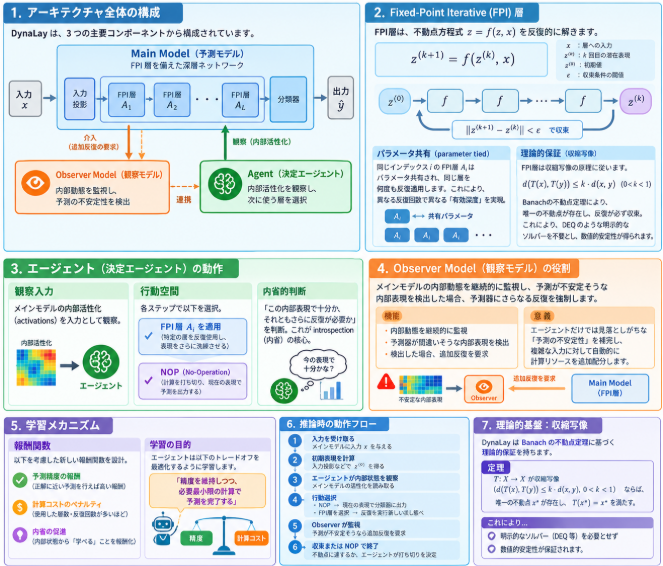

深層学習はニューラルネットワークのレイヤ数が多数であることから、データをいろんな観点で判断することが出来る。
結果、特徴量エンジニアリングや特徴量の解析力を獲得しています。
しかし、すべてのレイヤを活用することがベストではありません。
問題に応じてレイヤ選択する能力を持つことで、この問題はこのレイヤで解けるという選択を行い、計算量の削減をすることが出来ます。

今回はそんなレイヤ選択能力で著名な論文であるDynaLayについて説明していきます。

## 論文概要

[DynaLay: An Introspective Approach to Dynamic Layer Selection for Deep Networks](https://arxiv.org/abs/2312.12781)（Mathur & Plis, NeurIPS 2023 Workshop OPT）の概要を以下にまとめます。

### 論文情報

| 項目 | 内容 |
|------|------|
| **タイトル** | DynaLay: An Introspective Approach to Dynamic Layer Selection for Deep Networks |
| **著者** | Mrinal Mathur, Sergey Plis |
| **所属** | TReNDS Center, Georgia State University |
| **発表** | [NeurIPS 2023 Workshop: OPT 2023](https://opt-ml.org/papers/2023/paper42.pdf) (Optimization for Machine Learning) |
| **arXiv** | [2312.12781](https://arxiv.org/abs/2312.12781) |
| **PDF** | [arxiv.org/pdf/2312.12781](https://arxiv.org/pdf/2312.12781) |

## 解決しようとした課題

[DynaLay](https://arxiv.org/abs/2312.12781) が解決しようとした課題は、**「深層モデルがすべての入力に一律の計算量を使うことによる非効率性」** です。具体的には以下の3点です。

### 1. 計算コストの急増

深層モデルは大規模化するほど学習・推論に多大なリソースと時間を要します。すべての入力に最大計算量を適用するため、モデルが大きくなるほどこの問題は深刻化します。

### 2. 一律計算のムダ

従来のモデルは**入力の難易度に関わらず同じ層数・同じ計算量**を使います。簡単な入力（一目で分かる例）にも深い層まで計算する必要があり、計算リソースが無駄になります。逆に、難しい入力に対しては追加の計算が有益な場合もありますが、固定深度ではその調整ができません。

### 3. 「ワンサイズフィットオール」戦略の限界

すべての入力に同じアーキテクチャを適用する従来手法では、**入力ごとの計算量を最適化**することができません。簡単な入力は浅い計算で、難しい入力は深い計算で処理したいという直感的な要求を満たせません。

## 提案手法
[DynaLay](https://arxiv.org/abs/2312.12781) が提案した手法は、**「メインモデルの内部状態を観察する決定エージェントが、入力ごとに Fixed-Point Iterative 層の反復回数を動的に選択する」** 内省的アーキテクチャです。以下に詳細を説明いたします。

### 1. アーキテクチャ全体の構成

DynaLay は3つの主要コンポーネントから構成されます。

| コンポーネント | 役割 |
|--------------|------|
| **Main Model（予測モデル）** | FPI層を備え、実際の予測を行う深層ネットワーク |
| **Agent（決定エージェント）** | メインモデルの内部活性化を観察し、次にどの層を使うか選択する |
| **Observer Model（観察モデル）** | メインモデルの内部動態を監視し、予測が不安定そうな時に介入して追加反復を促す |

### 2. Fixed-Point Iterative (FPI) 層

DynaLay の計算の核となるのが **FPI層** です。

__仕組み__

各 FPI層は、不動点方程式 $z = f(z, x)$ を反復的に解きます。

$$z^{(k+1)} = f(z^{(k)}, x)$$

- $x$: 層への入力
- $z^{(k)}$: $k$ 回目の反復における潜在表現
- 初期値 $z^{(0)}$ から開始し、収束条件 $||z^{(k+1)} - z^{(k)}|| < \epsilon$ を満たすまで反復

__パラメータ共有__

同じインデックス $i$ の FPI層 $A_i$ は**パラメータ共有（parameter tied）** されています。つまり、同じ層を何度も反復適用する構造であり、異なる反復回数で異なる「有効深度」を実現します。

__理論的保証__

FPI層は**収縮写像（Contraction Mapping）** の原理に従います。

$$d(T(x), T(y)) \leq k \cdot d(x, y) \quad (0 < k < 1)$$

この性質により、Banachの不動点定理から**唯一の不動点が存在し、反復が必ず収束する**ことが保証されます。これにより、[Deep Equilibrium Models (DEQ)](https://arxiv.org/abs/1903.10373) のような明示的なソルバーを必要とせず、数値的安定性が得られます。

### 3. エージェント（決定エージェント）の動作

エージェントは強化学習の枠組みで学習され、各入力に対して以下を決定します。

__観察入力__

エージェントへの入力は、**メインモデルの内部活性化（activations）** です。つまり、モデルが「今どう思っているか」を観察します。

__行動空間__

各ステップでエージェントは以下のいずれかを選択します。

- **FPI層 $A_i$ を適用**: 特定の層を反復使用し、表現をさらに洗練させる
- **NOP（No-Operation）**: 計算を打ち切り、現在の表現で予測を出力する

__内省的判断__

エージェントは「この内部表現で十分予測できるか、それともさらに反復が必要か」を判断します。これが **introspection（内省）** の核心です。

### 4. Observer Model（観察モデル）の役割

Observer Model は単なる層選択を超えた、**メタ的な監視メカニズム**です。

__機能__
- メインモデルの内部動態を継続的に監視
- 予測器（メインモデル）が**間違いそうな内部表現**を持っているかを検出
- 検出した場合、**予測器にさらなる反復を強制**し、収束（convergence）を達成させる

__意義__

これにより、エージェントだけでは見落としがちな「予測の不安定性」を Observer が補完し、**複雑な入力に対して自動的に計算リソースを追加配分**します。

### 5. 学習メカニズム

__報酬関数__

エージェントの学習には、以下を考慮した新しい報酬関数が設計されています。

- **予測精度の報酬**: 正解に近い予測を行えば高い報酬
- **計算コストのペナルティ**: 使用した層数・反復回数が多いほどペナルティ
- **内省の促進**: メインモデルの内部状態から「学べる」ことを報酬化

__学習の目的__

エージェントは以下のトレードオフを最適化するように学習します。

> **「精度を維持しつつ、必要最小限の計算で予測を完了する」**

### 6. 推論時の動作フロー

1. **入力を受け取る**: メインモデルに入力 $x$ を与える
2. **初期表現を計算**: 入力投影などで初期潜在表現 $z^{(0)}$ を得る
3. **エージェントが内部状態を観察**: メインモデルの活性化を読み取る
4. **行動選択**:
   - エージェントが NOP を選べば → 現在の表現で分類器に通して出力
   - エージェントが FPI層 $A_i$ を選べば → 反復を実行し、新しい内部状態へ
5. **Observer が監視**: 予測が不安定そうなら追加反復を要求
6. **収束または NOP で終了**: 不動点に達するか、エージェントが打ち切りを決定するまで繰り返す

### 理論的基盤：収縮写像

DynaLay は**Banach の不動点定理**に基づく理論的保証を持ちます。

> **定理**: $T: X \to X$ が収縮写像（$d(T(x), T(y)) \leq k \cdot d(x, y)$, $0 < k < 1$）ならば、**唯一の不動点 $x^*$ が存在**し、$T(x^*) = x^*$ を満たす。

これにより、明示的なソルバー（[Deep Equilibrium Models (DEQ)](https://arxiv.org/abs/1903.10373) 等で使用）を必要とせず、数値的安定性を保証しています。

## 実験結果

論文で述べられている実験と実験結果についてまとめます。

### 実験の目的

DynaLay の実験では、以下を検証しています。

1. **精度の維持**: 従来の固定深度深層モデルと同等の分類精度を達成できるか
2. **計算コストの削減**: 入力の複雑さに応じた動的層選択により、推論時の計算オーバーヘッドを大幅に削減できるか
3. **内省メカニズムの有効性**: エージェントが内部状態を観察して適切に層を選択できるか

### 実験設定

__アーキテクチャ__
- **メインモデル**: Fixed-Point Iterative (FPI) 層を備えた深層ネットワーク
- **エージェント**: 強化学習エージェント（メインモデルの内部活性化を観察し、層選択または NOP を決定）
- **Observer Model**: メインモデルの内部動態を監視し、予測が不安定な場合に追加反復を促す

__報酬関数の設計__

エージェントの学習には、以下の3要素を組み合わせた**多面的報酬関数**が使用されています。

| 要素 | 内容 |
|------|------|
| **分類精度** | 正解に近い予測を行えば高い報酬 |
| **計算時間** | 使用した層数・反復回数が少ないほど報酬（計算コストの抑制） |
| **冗長層選択のペナルティ** | 無駄な層の反復選択に対してペナルティを与える |

この報酬関数により、**「精度を維持しつつ必要最小限の計算で予測を完了する」** というトレードオフが最適化されます。

### 実験結果

論文で報告されている主な結果は以下の通りです。

__1. 精度と計算効率のトレードオフ__

| 指標 | 結果 |
|------|------|
| **分類精度** | 従来の固定深度深層モデルと**同等の精度**を達成 |
| **計算オーバーヘッド** | **大幅な削減**を確認 |
| **適応性** | 簡単な入力には最小計算、複雑な入力には追加反復を自動配分 |

__2. 内省メカニズムの動作確認__

- エージェントがメインモデルの**内部活性化を観察**し、入力の難易度に応じて適切に層を選択することが確認された
- **Observer Model** が予測の不安定性を検出し、追加の反復を要求することで、複雑な入力に対する精度を維持

### 結果の意義

DynaLay の実験は、以下の点で意義があります。

1. **動的深度調整の実用性**: 強化学習エージェントによる内省的層選択が、実際に計算コストを削減しつつ精度を維持できることを実証
2. **理論と実践の接続**: 収縮写像による理論的保証（FPI層の収束性）を持ちながら、実際の深層モデルで有効性を確認
3. **「考える」モデルへの一歩**: 単に「弾道的に（ballistically）」答えを出すのではなく、**入力の難易度を見て計算量を調整する**モデルの原型を示した

### 歴史的意義と位置づけ

DynaLay は「レイヤー選択」の系譜において、以下の点で特徴的です。

| 研究 | アプローチ | DynaLay の違い |
|------|----------|---------------|
| [Stochastic Depth (2016)](https://arxiv.org/abs/1603.09382) | ランダムに層をドロップ | **入力に応じた内省的選択** |
| [Depth-Adaptive Transformer (2020)](https://arxiv.org/abs/1910.10073) | 自信度に基づく早期終了 | **強化学習エージェントによる層選択** |
| [PonderNet (2021)](https://arxiv.org/abs/2107.05407) | いつ「考えるのをやめるか」を学習 | **FPI 層との組み合わせ・収縮写像理論** |
| **DynaLay (2023)** | **エージェントが内部状態を観察して層選択** | 内省的アーキテクチャ + 理論的保証 |

特に、「モデルが自分の内部状態を見て判断する」という**内省性（introspection）** の概念は、単なる計算効率化を超えた、**「考える」モデル**への一歩として位置づけられています。

## 総括

[DynaLay](https://arxiv.org/abs/2312.12781) が LLM（大規模言語モデル）に果たした役割について、論文の記述に基づきつつ、研究系譜における位置づけを含めて述べます。

### 1. LLM に果たした役割

__直接的な実験はないが、概念的・原理的な示唆が大きい__

[DynaLay](https://arxiv.org/abs/2312.12781) 自体は **FPI 層を用いた一般深層ネットワーク** を対象とした研究であり、Transformer や LLM への直接適用実験は論文には記載されていません。しかし、以下の点で LLM の効率化研究に**先行概念として重要な役割**を果たしています。

__(1) 「一律計算」の非効率性を一般深層モデルで実証__

LLM はすべての入力トークン・すべての推論ステップで**同じ層数**（例えば 96 層）を通過します。DynaLay は、この「ワンサイズフィットオール」の問題を**一般深層モデルで実証**し、「入力の難易度に応じて計算量を変えるべき」という原理を示しました。これは後続の LLM 向け動的深度調整研究（[Mixture-of-Depths](https://arxiv.org/abs/2404.02258) など）への**概念的土台**となっています。

__(2) 「内省（introspection）」という設計思想の提示__

DynaLay の核心である「モデルが自分の内部活性化を観察して、計算を続けるか止めるかを判断する」という**内省的メカニズム**は、LLM における以下の研究方向への示唆を与えます。

- **Self-reflective LLM**: モデルが自身の不確実性を認識し、必要に応じて追加の推論ステップを実行する
- **Early Exit for LLM**: 簡単なトークンや簡単な入力には浅い層で出力し、難しい場合のみ深い層まで計算する動的推論
- **Test-time compute scaling**: 推論時に問題の難易度に応じて計算量を増減させるアプローチ

__(3) 強化学習エージェントによる動的計算配分の原型__

DynaLay が採用した「強化学習エージェントが内部状態を観察して計算ステップを選択する」という枠組みは、LLM における **token-level や layer-level の動的ルーティング** の先駆け的アイデアです。後続研究で発展した [Mixture-of-Depths](https://arxiv.org/abs/2404.02258) の「トークンごとに層を通過/スキップする動的ルーティング」は、この DynaLay が提示した **「入力に応じた計算量の動的配分」** という原理を LLM スケールで実現したものと解釈できます。

__(4) 理論的保証付き動的深度調整の示唆__

DynaLay が採用した**収縮写像（Contraction Mapping）** による FPI 層の収束保証は、LLM における動的深度モデル（[PonderNet](https://arxiv.org/abs/2107.05407) など）と比較して、**数値的安定性を理論的に保証できる動的計算**の可能性を示唆しています。

### 2. 本論文の簡潔な総括

| 項目 | 内容 |
|------|------|
| **課題** | 深層モデルがすべての入力に一律の計算量を使うことによる非効率性 |
| **提案手法** | FPI 層を備えたメインモデル + 内部活性化を観察する RL エージェント + Observer Model による動的層選択アーキテクチャ |
| **核心アイデア** | モデルが自分の内部状態を「内省」し、簡単な入力は浅く、難しい入力は深く計算する |
| **理論的基盤** | 収縮写像による FPI 層の収束保証（Banach の不動点定理） |
| **実験結果** | 従来の固定深度モデルと同等の精度を維持しつつ、計算オーバーヘッドを大幅削減 |
| **意義** | 「考える（内省する）モデル」の原型を提示。入力難易度に応じた動的計算配分の実用性を実証 |

### 3. 一言でまとめると

> **DynaLay は「モデルが自分の内部状態を見て、必要なだけ計算し、不要なら止める」という内省的動的深度調整の原型を提示し、後続の LLM 効率化研究（動的ルーティング、推論時計算スケーリング）に原理的・概念的な先行例を提供した。**
