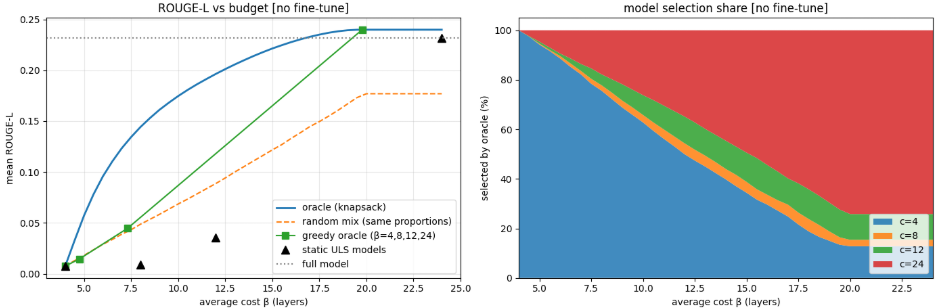
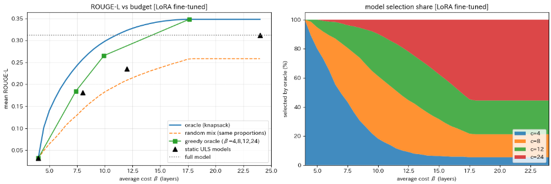
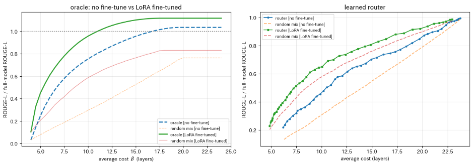

[先日紹介した Dynamic Layer Selection in Decoder-Only Transformers で提案](https://yoshishinnze.hatenablog.com/entry/2026/12/30/043000)されている "質問ごとに計算の深さを使い分けると、同じ計算量でかなり良い結果が出せる" という結果が確認できるかについて実験の上確認していきます。

## 実験意義

今回実験の意義は、**論文が提示する『動的レイヤ選択』の効果が、縮小版の設定でも本物かどうかを、オラクルという上限値を手がかりに検証する** 点にあります。

### 1. 論文の主張を「再現」ではなく「検証」する実験

論文は「OPT-1.3B を Alpaca で6エポックフル微調整し、オラクルによる動的レイヤ選択で平均5.6層（23.3%）でフルモデルと同等の ROUGE-L に到達した」と報告しています。

今回実験は、その**絶対値を再現することを目標としていません**。以下の問いを検証することを実験目的とします。

| 問い | この実験で確認したこと |
|------|----------------------|
| オラクルと静的モデルの差は本物か？ | β=8 で oracle が静的 c=8 を +0.075（約4割）上回ることを確認 |
| その差は「ノイズの事後利用」だけか？ | greedy oracle と静的がほぼ同じ（0.184 vs 0.182）なので、**sampling advantage だけでは説明できない** |
| 混合そのものに意味があるか？ | random mix が静的を下回るため、**「混ぜるだけ」ではなく系列ごとの配分が重要** |


### 2. オラクルの「上限値」としての性質を正しく扱う

論文のオラクルは、テストの正解スコアを見て最適な深さを選ぶため、**実用可能な制御器ではなく「理論上の上限」** です。実験記録でもこの点を明確に認識しています。

> 「オラクルはテスト用の正解 ROUGE を使うので、ばらつきのなかから良い出力を選べてしまう」

今回の実験では、**greedy oracle** と **random mix** を対照実験として導入することで、オラクルの数字を以下のように分解しました。

- **greedy oracle**: 各プロンプトで予算内の最良を選ぶ（sampling advantage のみ）
- **random mix**: 同じ選択比率をランダムに配分（比率だけの効果）
- **oracle**: 予算をプロンプト間で融通する（配分効果＋sampling advantage）

この構造により、**「配分効果そのもの」** を切り出すことが出来るはずです。

### 3. 実用化への道筋を示す「ルーター」実験

プロンプトの埋め込みから各深さの ROUGE-L を予測する**軽量ルーター**（Ridge 回帰）を学習し、オラクル・random mix と比較しています。

これは、**「オラクルは上限だが、どこまで実用化できるか」** という問いに直接対応する実験です。

- ルーターが random mix を上回れば、**プロンプトの情報だけで難易度を判別し、適切な深さを選べる**可能性がある
- ルーターの予測と実測の相関が改善した（特に c=8, c=12）ことは、**学習可能なパターンが存在する**ことを示唆

今回実験は、オラクルという「理想値」と実用化の間の**ギャップを測る第一歩**として意義があります。

## 実験内容

この実験は、**AI（大規模言語モデル）の計算を、入力に応じて賢く減らせるのか** を調べたものです。

### 1. 実験の条件：何を使ったか

| 項目 | 内容 |
|------|------|
| **モデル** | OPT-1.3B（24層のdecoder-only Transformer） |
| **データ** | Alpaca（指示に従う文章を生成する学習データ） |
| **評価データ数** | 500件（論文は7,800件だが、Colab環境で回るよう縮小） |
| **計算環境** | Google Colab（無料のT4 GPU） |
| **層の構成** | 4パターン（c = 4, 8, 12, 24層） |
| **評価指標** | ROUGE-L（生成した文章と正解がどれだけ似ているか、0〜1で大きいほど良い） |

__「c = 4, 8, 12, 24」って何？__
- **c = 24**：24層すべて使う（通常通り、フルモデル）
- **c = 12**：24層の半分だけ使う
- **c = 8**：さらに少ない層
- **c = 4**：1/6の層だけ使う

層は**均等に間引く**方式（Uniform Layer Skipping）を使います。例えば c=4 なら、24層のうち約4層だけを等間隔に残します。

### 2. 実験の内容：何をどうしたか

実験は大きく2つのパートに分かれます。

__パートA：微調整なしで、まず現状を測る__

1. **4つのモデルで文章を生成**
   - 同じ500個の質問に対して、c=4, 8, 12, 24 のそれぞれで回答を生成
   - 生成方法は「greedy decoding」（毎回最も確率の高い単語を選ぶ）

2. **ROUGE-L で採点**
   - 各（質問, 層数）の組み合わせで、生成文章と正解の一致度を計算
   - 結果は「質問500個 × 層数4種類」のスコア表（行列）になります

3. **オラクル（Oracle）で「理想の使い分け」を計算**
   - **オラクル**とは「各質問に対して、どの層数が最も良い答えを出すかを**正解スコアを見て選べる仮想の賢い制御器**」です
   - 制約：全質問の**平均コスト（層数）が予算 β 以下**
   - 目的：平均スコア（ROUGE-L）を最大化
   - 解法：これは「多選択ナップサック問題」と呼ばれる組み合わせ最適化問題で、動的計画法（DP）で解きます

   例えば「平均で8層まで使っていい」という予算なら、簡単な質問には c=4、難しい質問には c=12 を割り当てるように選びます。

4. **比較対象を複数用意**
   - **静的 c=8**：すべての質問を c=8 で処理
   - **greedy oracle**：各質問で予算内の最良の1つを選ぶ（予算の融通はしない）
   - **random mix**：オラクルと同じ選択比率をランダムに割り当て
   - **oracle**：予算を質問間で融通して最適化

   これにより、「良い答えを選んだから上手くいったのか」「配分そのものが効いたのか」を切り分けます。

__パートB：層を削った状態で微調整して、モデルを立て直す__

パートAでは「元のモデルをそのまま削っただけ」ですが、深く削る（c=4など）と性能が大きく落ちます。そこで：

1. **各層構成（c=4, 8, 12, 24）ごとに LoRA で微調整**
   - LoRA は「モデルの重みの大部分はそのままに、少量のパラメータだけを追加学習する」手法
   - 各 c ごとに別々のアダプタを学習
   - 学習データ：Alpaca から2,000件、1エポック（論文は全量・6エポック）

2. **微調整後に再び生成・評価**
   - パートAと同じ500問で生成し、ROUGE-L を計算
   - オラクル・greedy oracle・random mix・ルーターを再度比較

3. **学習ルーター（実用化の試み）**
   - プロンプト（質問文）の埋め込みベクトルから、各層数のスコアを予測する軽量モデル（Ridge回帰）を学習
   - 「この質問なら c=8 で十分そう」という判断を、正解スコアを見ずに予測する
   - これがオラクルに近い性能を出せれば、「実際に使える制御器」になり得る

## 実験コード

今回で行った実験コードについて説明していきます。


### データの準備

Alpacaデータセット（指示に従う文章生成の学習データ）を読み込み、以下のように分割します：

- **評価用**：データの末尾15%相当から500件
- **学習用**：データの先頭70%相当から2,000件
- **重複なし**：評価と学習でデータが被らないように設計

```python
ds = load_dataset("tatsu-lab/alpaca", split="train")
```

各データは以下の形式に変換されます：

```
### Instruction:
（指示文）

### Input:
（入力文）

### Response:
```

### モデルの読み込み
```python
tok = AutoTokenizer.from_pretrained(...)
model = AutoModelForCausalLM.from_pretrained(..., torch_dtype=torch.float16).to(device).eval()
```

OPT-1.3Bモデルを `float16`（半精度浮動小数点）で読み込み、GPUに配置します。これによりメモリを節約します。

### `uniform_pattern` 関数
```python
def uniform_pattern(L, c):
    U = [1]
    for l in range(2, L + 1):
        U.append(1 if sum(U) <= (l - 1) * c / L + 1e-9 else 0)
    return U
```

論文の式(2)をそのまま実装したものです。24層から `c` 層を**均等に間引く**パターンを生成します。
- `c=4` の場合：約1, 7, 13, 19層目が残る
- 1層目は必ず残す

### `skip_layers` コンテキストマネージャ
```python
@contextmanager
def skip_layers(model, c):
    dec = model.model.decoder
    orig_layers = dec.layers
    keep = [i for i, g in enumerate(uniform_pattern(...)) if g]
    ...
    dec.layers = torch.nn.ModuleList([orig_layers[i] for i in keep])
    try:
        yield
    finally:
        dec.layers = orig_layers  # 必ず元に戻す
```

**この実装の核心部分です。** Python の `contextmanager` を使い、`with` ブロックの間だけモデルの層を差し替えます。

**工夫点**：層を抜くだけだと Attention が「自分は何層目か」を表す `layer_idx` の番号がずれ、計算が壊れます。そこで、残した層に `0, 1, 2...` と新しく番号を振り直しています。`finally` で必ず元に戻す設計により、安全に層を差し替えられます。

### 生成とROUGE-L評価

#### `generate_all` 関数
```python
@torch.no_grad()
def generate_all(c, tag="", m=None, prep=None):
    path = f"{CFG['out_dir']}/gens{tag}_c{c}_n{len(prompts)}.json"
    if os.path.exists(path):
        return json.load(open(path))  # キャッシュがあれば読み込み
    ...
    with skip_layers(base_for_skip(m), c):
        for s in tqdm(...):  # バッチ処理
            ...
    json.dump(outs, open(path, "w"), ...)  # キャッシュに保存
    return outs
```

**生成結果をキャッシュする設計**が重要です。一度生成した結果はJSONファイルに保存し、再実行時は読み込むだけにします。これにより、Colabのセッション切断後も再計算を避けられます。

プロンプトを**長さ順に並べる**ことで、パディング（無駄な計算）を減らす工夫も入っています。

#### `rouge_matrix` 関数
```python
def rouge_matrix(gens):
    return np.array([[scorer.score(refs[i], gens[c][i])["rougeL"].fmeasure
                      for c in costs]
                     for i in range(len(prompts))])
```

各（質問, 層数）の組み合わせでROUGE-Lスコアを計算し、**500×4の行列 `R`** を作ります。`R[i, j]` は「質問iを層数jで処理したときのスコア」です。

### オラクルの計算

#### `solve_oracle` 関数
```python
def solve_oracle(R, costs, betas):
    n, k = R.shape
    g = reduce(gcd, costs); u = [c // g for c in costs]
    Wmax = n * max(u)
    prev = np.zeros(Wmax + 1)
    choices = np.zeros((n, Wmax + 1), dtype=np.int8)
    for i in range(n):
        new = np.full(Wmax + 1, -np.inf); ch = np.zeros(Wmax + 1, dtype=np.int8)
        for j in range(k):
            cand = np.full(Wmax + 1, -np.inf)
            cand[u[j]:] = prev[:Wmax + 1 - u[j]] + R[i, j]
            ...
        prev, choices[i] = new, ch
    ...
```

**多選択ナップサック問題を動的計画法（DP）で解いています。**

- 各質問に対して4つの層数（c=4,8,12,24）から1つを選ぶ
- 全質問の平均コストが予算 β 以下
- 平均ROUGE-Lを最大化

**効率化の工夫**：コストの最大公約数（g=4）で割って整数化し、計算量を削減しています。

#### `analyze_oracle` 関数
```python
def analyze_oracle(R, label, plot=True):
    ...
    orc_score = np.array([R[idx_n, a].mean() for a in assigns])
    shares = np.array([np.bincount(a, minlength=len(costs)) / n for a in assigns])
    ...
```

以下の4つを計算・比較します：
1. **oracle**：DPで最適化した配分
2. **greedy oracle**：各質問で予算内の最良を選ぶ（予算の融通なし）
3. **random mix**：同じ選択比率をランダムに配分
4. **static**：固定の層数で全質問を処理

結果は2つのグラフで可視化されます：
- **左**：予算 β に対する平均ROUGE-Lの曲線
- **右**：オラクルが各層数を選んだ割合（%）

### 学習ルーター

#### 特徴量抽出
```python
@torch.no_grad()
def extract_features():
    ...
    hs = model(**enc, output_hidden_states=True).hidden_states[FEAT_LAYER]
    m = enc["attention_mask"].unsqueeze(-1).to(hs.dtype)
    pooled = ((hs * m).sum(1) / m.sum(1)).float().cpu().numpy()
    lens = enc["attention_mask"].sum(1).float().cpu().numpy()
    ...
```

プロンプトの特徴量として以下を使用します：
- **OPTの第12層の隠れ状態**を attention mask で平均プーリング
- **プロンプトの長さ**の対数

#### Ridge回帰による予測
```python
Rhat = np.column_stack([
    cross_val_predict(make_pipeline(StandardScaler(), Ridge(alpha=ALPHA)), X, R[:, j], cv=cv)
    for j in range(len(costs))])
```

5分割交差検証で、各層数のROUGE-Lを予測します。`StandardScaler` で特徴量を正規化し、`Ridge`（正則化付き線形回帰）で学習します。

#### ルーターの動作
```python
ok = Rhat >= (Rhat[:, [-1]] - tau); ok[:, -1] = True
sel = ok.argmax(1)
```

「予測スコアがフルモデル（c=24）より閾値 τ 以内に収まる最安の層数」を選びます。τを動かすことで、コストと精度のトレードオフ曲線を描きます。

### LoRA微調整

#### LoRAの設定
```python
lora_cfg = LoraConfig(r=CFG["lora_r"], lora_alpha=2 * CFG["lora_r"],
                      target_modules=["q_proj", "k_proj", "v_proj", "out_proj", "fc1", "fc2"])
peft_model = get_peft_model(model, lora_cfg, adapter_name=f"c{costs[0]}")
for c in costs[1:]:
    peft_model.add_adapter(f"c{c}", lora_cfg)
```

**各層数（c=4,8,12,24）ごとに別々のLoRAアダプタを用意します。** これにより、同じベースモデルに対して異なる層構成での学習パラメータを切り替えて使えます。

#### 学習データの作成
```python
def make_example(prompt, output):
    p = tok(prompt)["input_ids"]
    o = tok(output, add_special_tokens=False)["input_ids"][:CFG["max_new_tokens"] - 1] + [tok.eos_token_id]
    return p + o, [-100] * len(p) + o
```

**損失計算からプロンプト部分を除外**するため、プロンプト部分のラベルを `-100`（無視）に設定します。これにより、モデルは「応答部分の生成」のみを学習します。

#### `train_adapter` 関数
```python
def train_adapter(c):
    ...
    with skip_layers(base, c):  # スキップ状態のまま学習
        for ep in range(CFG["ft_epochs"]):
            ...
            with torch.autocast("cuda", dtype=torch.float16):
                loss = peft_model(...).loss / accum
            scaler.scale(loss).backward()
            ...
```

**層を削った状態のまま学習する**のが重要です。`skip_layers` コンテキストマネージャの中で勾配計算を行い、削った構成に適応したパラメータを学習します。

学習の工夫：
- `GradScaler` + `autocast("cuda", float16)`：fp16混合精度でメモリを節約
- 勾配累積（`accum=2`）：小さいバッチサイズでも実効的に大きなバッチを模擬
- アダプタのキャッシュ：学習済みパラメータを `lora_c{c}_n{2000}_e{1}.pt` に保存

## 実験結果

実験結果について説明していきます。

### 実験結果の全体像

実験は**Part A（微調整なし）** と**Part B（LoRA微調整あり）** の2段階で行われました。

__1. 微調整の効果：フルモデルの品質が大幅に改善__

| 指標 | 微調整前 | 微調整後 | 論文 |
|------|---------|---------|------|
| **フルモデルの ROUGE-L** | 0.232 | **0.312** | 0.342 |
| **フルに並ぶ最小コスト β** | 17.0層 (70.8%) | **11.5層 (47.9%)** | 5.6層 (23.3%) |

**解説**：
- 微調整により、フルモデルの品質が0.232→0.312と大幅に改善し、**論文の0.342に近づきました**。これは「基準となるモデルの品質は確保できた」と言えます。
- オラクルがフルモデルに並ぶための最小コストも、70.8%→47.9%と改善しました。
- しかし、**論文の23.3%には届かず、約2倍のコストが必要**でした。

結果は以下の図のようになっています。
調整の前後でROUGE-Lに改善が確認出来ました。





__2. オラクルの効果は「本物」：予算配分の効果が大きい__


予算 β=8（平均8層まで使える）での比較：

| 手法 | ROUGE-L | 静的 c=8 との差 |
|------|---------|----------------|
| 静的 c=8 | 0.182 | — |
| greedy oracle | 0.184 | +0.002 |
| random mix | 0.143 | -0.039 |
| **oracle** | **0.257** | **+0.075（約4割増）** |

**この結果から3つの重要なことが分かります**。

__① sampling advantage（ノイズの事後利用）は小さい__
greedy oracle（0.184）と静的 c=8（0.182）はほぼ同じです。つまり、「複数の出力からたまたま良いものを選んだだけ」では、オラクルの高性能を説明できません。

__② 予算配分の効果は大きい__
oracle（0.257）は静的 c=8（0.182）を **+0.075（約4割）上回りました**。これは「簡単な質問には浅いモデル、難しい質問には深いモデル」と使い分けることの効果が実在することを示しています。

__③ 混合そのものは損になる__
random mix（0.143）は静的 c=8（0.182）を下回りました。これは、深さと品質の関係が「上に凸」（c=4→8で大きく伸び、その先は伸びが鈍る）ため、無作為に混ぜると平均で損になることを意味します。この不利を払ってもoracleが上回っているので、**「適材適所の配分」そのものが効いている**と言えます。


### 3. 再現できなかった点：c=4（浅いモデル）の選択比率

| 項目 | 論文 | 今回 |
|------|------|------|
| **フルに並ぶ最小 β での c=4 選択率** | **69.6%** | **11.4%** |

論文では「浅いモデル（c=4）を大部分使う」絵になっていましたが、今回はc=4がほとんど選ばれませんでした。

**推測される原因**：
- 論文は**フル微調整・全量（7,800件）・6エポック**
- 今回は**LoRA（軽量微調整）・2,000件・1エポック**

深く削った構成（c=4）を立て直すには、学習の容量（LoRAのrank）も学習量（データ数・エポック数）も不十分だった可能性があります。c=4モデルの品質が回復しきれていないため、オラクルが「浅いモデルを選ぶ」判断をしなかったと推測されます。

### 4. 学習ルーターの結果：実用化への道のり

プロンプトの情報だけから、どの深さが適切かを予測する「ルーター」の結果です。

**予測と実測の相関**（c=4, 8, 12, 24の順）：

| 深さ | 微調整前 | 微調整後 |
|------|---------|---------|
| c=4 | 0.311 | 0.108 |
| c=8 | 0.140 | **0.342** |
| c=12 | 0.179 | **0.391** |
| c=24 | 0.363 | 0.340 |

c=8とc=12は改善しましたが、c=4は低下しました。

**重要なポイント**：ルーターに効くのは「各モデルの絶対的な品質」ではなく、「**モデル間の差**」（例：c=24とc=8の差）です。水準の予測が当たっても、差の予測が当たらないことは十分ありえます。

実用化の見込みは、**ルーターとrandom mixの曲線の差**で判断する必要があります。この差が大きければ、「プロンプトの情報だけで難易度を判別し、適切な深さを選べる」可能性があります。




## 結果のまとめ

### 再現できたこと

1. **オラクルと静的モデルの差は大きく出た**（β=8で+0.075）
2. **greedyと静的はほぼ同じ** → sampling advantageは小さく、配分効果が主因
3. **random mixは静的を下回る** → 「混ぜるだけ」ではなく、系列ごとの選択が重要
4. **フルモデルの絶対値は論文水準に到達**（0.312 vs 0.342）

**結論**：論文の「系列単位で深さを選べば得がある」という定性傾向は、縮小版でも確認できました。

### 再現できなかったこと

1. **「層の23%でフルと同等」には届かなかった**（47.9%まで）
2. **c=4が選ばれなかった**（11.4% vs 論文69.6%）

**原因**：再現条件の差（フル微調整 vs LoRA、全量 vs 2,000件、6エポック vs 1エポック）

### この結果の限界

1. **n=500・1シード・信頼区間なし**：細かい差（0.182 vs 0.184など）は誤差の範囲
2. **オラクルは出力のノイズも事後的に利用**：greedyとの比較で小さいと分かりましたが、完全には排除されていません
3. **プロンプトの扱いが簡易版**：論文はプロンプトをフル層で処理し、生成トークンだけ層を飛ばしますが、今回は全体を層削除モデルで処理しています
4. **ルーターのコスト未計上**：プロンプト1回分の前向き計算がかかります


## 実験まとめ

「質問ごとに計算の深さを使い分けると、同じ計算量でかなり良い結果が出せる」という論文の核心は再現できた。ただし、「24層中5.6層でフルと同等」という絶対値は、LoRA・縮小データ・短い学習では達成できなかった。浅いモデルの品質を立て直すことが、効率化の鍵である。


