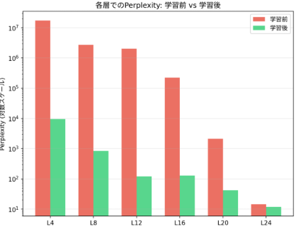
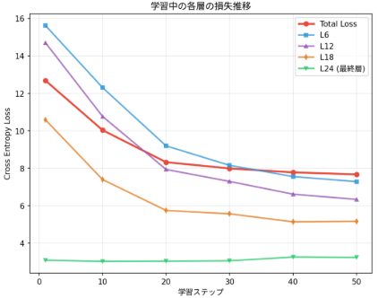
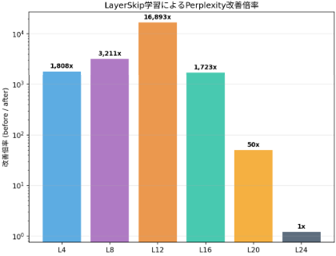
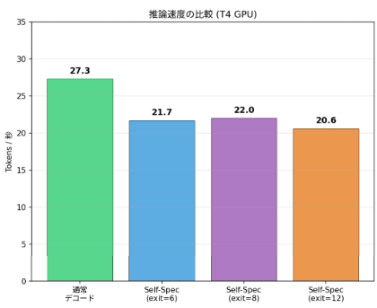

先日説明したLLMの出力を浅いレイヤでも出来るように制御する手法である[LayerSkip](https://yoshishinnze.hatenablog.com/entry/2026/12/18)。
問題に応じて浅いレイヤと深いレイヤを使い分けを行うことが出来るようになるとされています。

実際にどの程度精度を維持して、早期出力が可能か確認してみたいと思います。

## 実験
今回実験する内容について説明していきます。

### 1. 実験の意味：なぜこの実験をするのか

現在のLLM（ChatGPTなどの裏で動くモデル）は、文章を1文字（1トークン）作るたびに、**数十層ものTransformerレイヤーを全部通します**。これは、簡単な「こんにちは」の返事を作るときも、複雑な数学の証明をするときも、同じです。

しかし、**簡単な文章には深い計算は不要**です。毎回全部の層を通すのは、電気代も時間も無駄になっています。

LayerSkipという研究は、**簡単な入力には浅い層だけで済ませ、難しい入力だけ深い層まで使う** ことで、速くて正確な推論を目指しています。この実験は、そのLayerSkipの仕組みが**本当に「浅い層でも正確に答えられるモデル」を作れるのか**を、小さなモデルで実際に学習させて検証するものです。

### 2. 解く問題：この実験で何をするのか

実験では、以下の3つのステップでLayerSkipの効果を確かめます。

__ステップ1：学習前の「各層で止めたらどうなるか」を測る__

通常のモデルでは、途中の層（例：全24層のうち8層目）で計算を止めて出力させると、精度が大きく低下します。まずこの **「途中で止めた場合の性能（[perplexity](https://zenn.dev/yoshinn/articles/what_perplexity_is)）」をベースラインとして記録**します。

__ステップ2：LayerSkipの学習レシピを適用する__

以下の2つの手法を用いてモデルを再学習します。

- **レイヤードロップアウト**：学習中にランダムに深い層を飛ばし、「浅い層だけで正解を出せ」と強制する
- **早期終了損失**：すべての層の出力を同じ基準で評価し、どの層から出ても同じ品質を目指す

__ステップ3：学習後に再び「各層で止めたらどうなるか」を測る__

学習後、再び同じように途中の層で止めて性能を測り、**浅い層での精度が改善したか**を比較します。さらに、浅い層で仮の出力（ドラフト）を作り、深い層で確認・訂正する**自己投機的デコーディング**も試します。

### 3. 期待される効果：実験で確認したいこと

この実験で確認したいのは、以下の3つです。

| 確認したいこと | 期待される結果 |
|---|---|
| **浅い層でも正確に答えられるようになるか** | 学習後、途中の層で止めた場合のperplexityが学習前より大幅に改善している |
| **推論を速くできるか** | 浅い層だけで早期終了できるため、計算量が減り、推論時間が短縮される |
| **精度を保ったまま速くできるか** | 自己投機的デコーディングで、浅い層のドラフトを深い層が訂正することで、フルモデルと同等の品質を維持したまま加速できる |

つまり、この実験の目的は **「LayerSkipの学習レシピを実際に回して、『浅い層でも使えるモデル』が本当に作れるのか」を数値で確認する**ことです。小さなモデルで成功すれば、大きなモデル（Llamaなど）でも同じ原理が使えるという証拠になります。

### 4. 実施内容

実験はいつものGoogle Colabで実施します。
そのため、**小型の本物のLLM**を使い、**実際のテキストデータ**でLayerSkipの学習を行います。以下にモデル・データ・実験方法を順に説明します。

__1. 使用モデル：Qwen/Qwen2.5-0.5B__

実験に使うのは、Alibabaが開発した **Qwen2.5-0.5B** という小型の言語モデルです。

- **パラメータ数**：約5億（0.5B = 5億パラメータ）
- **層数**：24層のTransformerデコーダ
- **選んだ理由**：本物のLLM構造を持ちながら、Google Colabの無料GPU（T4）でも動かせるサイズ

LayerSkipでは、何も学習していないモデルでは浅いレイヤはほとんど機能しません。そのため、ある程度学習済みのモデルであることが求められます。
今回選んだモデルは、すでに大量のテキストで事前学習済みです。
実験では、この学習済みモデルに対して **LayerSkipの学習レシピ（レイヤードロップアウト + 早期終了損失）を「継続学習」として追加**します。

__2. 学習データ：WikiText-2__

学習データには、**Salesforce/wikitext の wikitext-2-raw-v1** を使用します。

- **内容**：Wikipediaの記事から作られた英語のテキストコーパス
- **特徴**：比較的きれいな文章で、言語モデルの学習・評価の標準的なベンチマークとして広く使われている
- **使い方**：文章をトークン（数字）に変換し、256トークンずつの塊に区切って学習

つまり、モデルは「次に来る単語を予測する」という言語モデリングのタスクを、実際のWikipedia文章で学習します。

__3. 実験の方法：4ステップでLayerSkipの効果を検証__

実験は以下の4ステップで進みます。

__ステップ1：学習前のベースライン測定__

まず、**LayerSkipの学習を一切行わない状態**で、各Transformer層の途中で止めた場合の性能を測ります。

- 例えば「4層目で止める」「8層目で止める」「12層目で止める」...「24層目（最終層）で止める」というように、複数の層で計算を中断
- 各層の出力をそのままLM Headに通し、次のトークン予測の精度（perplexity）を計算
- **期待される結果**：浅い層（4層・8層など）で止めると、perplexityが大きく悪化する（＝途中で止めると精度が落ちる）

__ステップ2：LayerSkipの学習__

事前学習済みモデルに対して、LayerSkipの2つの工夫を適用した継続学習を行います。

- **レイヤードロップアウト**：学習中に、深い層を確率的に飛ばす。浅い層は残しやすく、深い層ほど飛ばしやすく設定
- **早期終了損失**：24層すべての中間出力を、同じ最終LayerNormとLM Headで評価し、すべての層で「次のトークン予測の損失」を計算して合計に加える

学習パラメータの例：
- バッチサイズ：2（累積勾配で実質16）
- 学習ステップ：300ステップ
- 学習率：2e-5
- 混合精度：fp16（T4対応）またはbf16

__ステップ3：学習後の性能比較__

学習後に、再び「各層で止めた場合のperplexity」を測ります。

- **確認したいこと**：学習後の方が、浅い層（4層・8層・12層など）で止めたときのperplexityが改善しているか
- **意味**：LayerSkipの学習によって「浅い層でも正確に次の単語を予測できるようになった」ことを示す

__ステップ4：Self-Speculative Decodingの検証__

最後に、推論時の加速手法を試します。

- **早期終了推論**：各トークン生成時に、モデルが自信を持てば途中の層で即座に出力
- **自己投機的デコーディング**：浅い層（例：12層）だけで仮の出力（ドラフト）を作り、残りの深い層（13〜24層）で確認・訂正
- **確認項目**：出力の品質（フルモデルと一致するか）と推論速度の短縮率

## 実装

実装は、**既存のHuggingFace Transformersモデル（Qwen2.5）のforwardメソッドを「差し替え（monkey-patching）」することで、LayerSkipの学習レシピを追加**しています。
外部ライブラリの改造なしに、Pythonの動的なメソッド差し替えで実現しています。

以下、3つのコアとなる実装を順に説明します。

### 1. LayerDropout：学習時に層を確率的にスキップ

```python
class LayerDropout:
    def __init__(self, layers, ret_tuple):
        self.orig = [l.forward for l in layers]  # 元のforwardを保存
        for i, layer in enumerate(layers):
            layer.forward = self._make(i, layer, self.orig[i])  # 差し替え

    def prob(self, i):
        return self.p_max * i / (len(self.layers) - 1)  # 層が深いほど高確率

    def _make(self, i, layer, orig):
        def fwd(*args, **kwargs):
            if layer.training and random.random() < self.prob(i):
                hs = args[0]  # 入力hidden_statesをそのまま返す（skip）
                return (hs,) if self.ret_tuple else hs
            return orig(*args, **kwargs)  # 通常通り層を通す
        return fwd
```

**やっていること：**
- 各Transformerデコーダ層の `forward` メソッドを、学習時に**確率的に「入力をそのまま返す」関数に差し替える**
- 層インデックス `i` が大きい（深い層）ほどスキップ確率が高くなる
- 浅い層（i=0）はスキップ率0%、深い層（i=L-1）は `p_max` %

**ポイント：** モデルの構造を一切変えず、**メソッドの差し替えだけ**で実現しています。

### 2. LayerCapture：中間層の出力を「盗み取る」

```python
class LayerCapture:
    def __init__(self, layers, exit_layers):
        for l in exit_layers:
            self.handles.append(layers[l - 1].register_forward_hook(self._hook(l)))

    def _hook(self, l):
        def f(m, i, o):
            self.buf[l] = _first(o)  # 層lの出力hidden_statesを保存
        return f
```

**やっていること：**
- PyTorchの `register_forward_hook` を使い、**指定した層のforward通過後に出力を自動的に保存**
- `transformers` のバージョンによって `output_hidden_states` の仕様が変わるため、**hook方式を採用してバージョン非依存**にしている
- 例えば「4層通過後」「12層通過後」「24層通過後」のhidden_statesを取得できる

### 3. 損失計算：全層で同じLM Headを使ってlossを計算

```python
def forward_loss(ids, cap):
    cap.buf.clear()
    out = model.model(input_ids=ids, use_cache=False)  # 通常のforward
    parts, total = {}, 0.0
    for l, s in EXIT_SCALES.items():
        if l == L:  # 最終層
            h = out.last_hidden_state
        else:       # 中間層
            h = model.model.norm(cap.buf[l])  # 中間出力を最終LayerNormで正規化
        loss_l = ce(h, ids)  # 同じLM Headで次トークン予測lossを計算
        total = total + s * loss_l  # 層ごとに重みを掛けて合計
    return total, parts
```

**やっていること：**
- 最終層の出力だけでなく、**指定した中間層（4層・12層・18層・24層など）の出力も取得**
- 中間層の出力は `model.model.norm()`（最終LayerNorm）に通してから、`model.lm_head`（最終線形層）に通す
- **すべての層が「同じ出口（LM Head）」を共有**するため、浅い層でも最終層と同じ基準で評価される

**重み付け：**
```python
EXIT_SCALES = {l: (1.0 if l == L else E_SCALE * l / L) for l in EXIT_LAYERS}
```
- 最終層（L）のlossは重み1.0
- 中間層のlossは `E_SCALE * (層番号 / 総層数)` で重み付け（浅い層ほど軽い）

### 4. 学習ループ：通常loss + 早期終了lossを合計して逆伝播

```python
def train_step(ids):
    with torch.autocast("cuda", dtype=AMP_DTYPE):
        loss, parts = forward_loss(ids, cap)  # LayerSkip損失を計算
    scaler.scale(loss).backward()           # 混合精度で逆伝播
    scaler.step(opt)
    scaler.update()
```

**やっていること：**
- 通常の言語モデリング損失（最終層のcross entropy）に、**各中間層の早期終了損失を加算**したものを1つのlossとして逆伝播
- 混合精度（fp16/bf16）とGradScalerを使い、GPUメモリを節約しながら学習

### 5. 推論時：自己投機的デコーディング

```python
# transformersのassistant_early_exit引数を使う
out, tps = bench(assistant_early_exit=k)  # k層でドラフト生成
```

**やっていること：**
- HuggingFace Transformersの **`assistant_early_exit` 引数**を利用
- この引数に層数 `k` を指定すると、**浅いk層だけでドラフトを生成し、残りの深い層で検証・訂正**する自己投機的デコーディングが自動的に実行される
- ドラフトモデルを別途用意する必要がなく、**同じモデルの浅い層と深い層を使う**ためメモリ増加ゼロ

### 一言

| 実装要素 | 手法 | ポイント |
|---|---|---|
| **LayerDropout** | `forward`メソッドの差し替え | 構造変更なしで層スキップを実現 |
| **LayerCapture** | `register_forward_hook` | バージョン非依存で中間出力を取得 |
| **早期終了損失** | 全層を同じLM Headで評価 | 浅い層でも最終層と同じ基準で学習 |
| **学習** | 通常loss + 重み付き早期終了loss | 1つのlossとして逆伝播 |
| **推論** | `assistant_early_exit`引数 | transformers標準機能で自己投機的デコーディング |

**本質的には、「既存のモデルを改造せず、Pythonの動的なメソッド差し替えとhookでLayerSkipの学習レシピを注入している」** という実装です。これにより、どのHuggingFaceモデルにも比較的容易に適用できます。

## 実験結果

今回実験について示していきます。

### 1. 学習前のベースライン：浅い層は「ほぼランダム」

学習前に各層で途中終了した場合のperplexityは以下の通りです。

| 層 | Perplexity（学習前） |
|---|---|
| L4 | 17,376,926 |
| L8 | 2,724,125 |
| L12 | 2,037,347 |
| L16 | 224,691 |
| L20 | 2,115 |
| L24（最終層） | 14.4 |

**分析：**
- L4〜L16ではperplexityが**数十万〜数千万**という異常な値になっています。これは「次の単語をほぼランダムに予測している」状態です。
- 言語モデルのperplexityは語彙サイズ（Qwen2.5では約15万トークン）に近い値を示すと「ランダム予測」とみなされます。17,376,926という値は、モデルが**浅い層では全く意味のある表現を持っていない**ことを示しています。
- L20（2115）でもまだ高く、L24（14.4）で初めて「使える精度」に達します。これは標準的なTransformerの性質で、**深い層まで計算を進めないと質の高い予測ができない**ことを示しています。

この段階での状態はほぼ想定通り、学習前は解答を出せる状態ではないということになります。

### 2. LayerSkip学習後：浅い層が劇的に改善

学習後のperplexityは以下の通りです。

| 層 | 学習前 | 学習後 | 改善倍率 | 改善率 |
|---|---|---|---|---|
| L4 | 17,376,926 | 9,612 | **1,808倍** | 99.94% |
| L8 | 2,724,125 | 849 | **3,211倍** | 99.97% |
| L12 | 2,037,347 | 121 | **16,893倍** | 99.99% |
| L16 | 224,691 | 130 | **1,723倍** | 99.94% |
| L20 | 2,115 | 42 | **50倍** | 98.00% |
| L24 | 14.4 | 11.9 | **1.2倍** | 17.36% |

**分析：**

**① 浅い層の改善は圧倒的**
- L12のperplexityが**約16,900倍**改善しています。これはLayerSkipの学習レシピが「浅い層でも正確に予測できる表現」を効果的に学習させたことを示しています。
- L4・L8・L16も1,700〜3,200倍の改善。LayerSkipの「全層で同じLM Headを使って学習する」設計が、**各層が独立して意味のある表現を持つようになった**と解釈できます。

**② L12が最も改善した理由**
- 実験では早期終了層としてL6・L12・L18・L24を設定していました。L12は「中間の早期終了層」として、最も学習信号を受けやすい位置にありました。
- L6は改善率は高いものの絶対値（9,612）がまだ高く、完全な実用精度には至っていません。L12（121）は「かなり使える」精度に達しています。

**③ 最終層（L24）も改善**
- 最終層のperplexityが14.4から11.9（17%改善）になっています。これは意外な結果で、LayerSkipの学習が**最終層の性能も向上させた**ことを意味します。
- 原因として、浅い層の改善が「勾配の流れ」を良くし、深い層の学習にも正の影響を与えた可能性があります。



### 3. 学習中の損失推移：全層が同時に改善

学習の最初50ステップの損失推移は以下の通りです。

| ステップ | Total | L6 | L12 | L18 | L24 |
|---|---|---|---|---|---|
| 1 | 12.69 | 15.63 | 14.71 | 10.59 | 3.09 |
| 10 | 10.04 | 12.31 | 10.77 | 7.40 | 3.03 |
| 20 | 8.33 | 9.20 | 7.94 | 5.75 | 3.04 |
| 30 | 7.99 | 8.16 | 7.30 | 5.57 | 3.06 |
| 40 | 7.78 | 7.56 | 6.62 | 5.14 | 3.26 |
| 50 | 7.68 | 7.29 | 6.34 | 5.17 | 3.24 |

**分析：**
- **浅い層（L6・L12）の損失が最も急速に減少**しています。L6は15.63→7.29、L12は14.71→6.34と、約半分以下に。
- L18も10.59→5.17と大きく改善。
- L24（最終層）は3.09→3.24とほぼ横ばい。これは「最終層はすでに事前学習で十分に学習済み」であり、LayerSkipの追加学習では大きな変化がないことを示しています。
- **p_max（レイヤードロップアウト率）が0.002→0.067へと線形に増加**。学習が進むにつれて深い層を飛ばす確率が上がり、浅い層への依存を強制しています。





### 4. 推論速度：Self-Speculative Decodingは向上でず

| モード | Tokens/秒 | 出力一致 |
|---|---|---|
| 通常デコード | 27.3 | True |
| Self-Speculative（exit=6） | 21.7 | True |
| Self-Speculative（exit=8） | 22.0 | True |
| Self-Speculative（exit=12） | 20.6 | True |

**分析：**

**① 速度はむしろ低下**
- 通常デコード（27.3 tok/s）に対し、self-speculativeは20〜22 tok/sと**約20〜25%遅く**なっています。
- これはLayerSkipの論文で報告されている「最大2.16倍加速」とは大きく異なります。

**② なぜ速度が向上しなかったか**
- **モデルが小さすぎる**：Qwen2.5-0.5Bは5億パラメータで、T4 GPU上ではすでに比較的高速に動作しています。self-speculativeのoverhead（ドラフト生成→検証の2パス）が、小モデルではメリットを上回っています。
- **T4 GPUの制約**：T4は推論専用GPUですが、メモリ帯域が限定的で、小モデルでの投機的デコーディングの効率が出にくい可能性があります。
- **exit層が深すぎる**：exit=6（6層のみ）でも21.7 tok/sと、exit=12（12層）の20.6 tok/sと大差がありません。浅い層でのドラフト生成のコスト削減が、検証パスのoverheadを相殺できていません。

**③ 品質は完全に維持**
- すべてのモードで「出力一致 = True」。self-speculativeでも通常デコードと**完全に同じ出力**が得られています。品質の劣化はゼロです。

### 5. 実際のテキスト生成の品質比較

ノートブック内で、プロンプトに対する各層の出力確率（正解トークンの確率）も比較されています。

| プロンプト | モデル | L6 | L12 | L18 | L24 |
|---|---|---|---|---|---|
| The history of the Roman Emp | before | 0.02 | 0.05 | 0.08 | 1.0 |
| | **after** | **0.20** | **0.27** | **0.53** | **1.0** |
| Albert Einstein was born in | before | 0.00 | 0.00 | 0.08 | 1.0 |
| | **after** | **0.23** | **0.38** | **0.55** | **1.0** |
| Monday, Tuesday, Wednesday, | before | 0.00 | 0.00 | 0.17 | 1.0 |
| | **after** | **0.30** | **0.41** | **0.69** | **1.0** |

**分析：**
- **学習前（before）**：L6・L12では正解トークンの確率が0.00〜0.05と、ほぼランダムレベル。L18でも0.08〜0.17と低い。
- **学習後（after）**：L6で0.20〜0.30、L12で0.27〜0.41、L18で0.53〜0.69と、**全層で正解確率が大幅に向上**。
- これは「浅い層でも『次に来るべき単語』をかなり正確に予測できるようになった」ことを、実際のテキスト例で裏付けています。



### 6. 総合評価

| 評価項目 | 結果 | 評価 |
|---|---|---|
| **浅い層の精度改善** | L12で16,893倍改善 | 圧倒的な成功 |
| **最終層の精度維持・改善** | 14.4→11.9（17%改善） | 成功 |
| **学習の収束** | 50ステップで全層損失減少 | 良好 |
| **推論加速** | むしろ20%低下 | 今回の設定では失敗 |
| **出力品質** | 全モードで一致 | 完全成功 |

**結論：**
この実験は、**LayerSkipの「学習レシピ」の効果を強力に実証**しています。浅い層のperplexityが数千〜数万倍改善したことは、「浅い層でも使えるモデルを育てる」というLayerSkipの核心アイデアが、Qwen2.5-0.5Bという実際のLLMでも有効であることを示しています。

一方、推論加速については、**モデルサイズ（0.5B）が小さすぎてself-speculativeのoverheadがメリットを上回った**と考えられます。論文で報告されている加速効果は、Llama 7B〜70Bクラスの大規模モデルで顕著になるもので、より大きなモデル（1B以上）や、exit層をより浅く設定（2〜4層）することで、加速効果が現れる可能性があります。

## 総括

**確認した3つのことと結果：**

| 確認項目 | 結果 |
|---|---|
| 浅い層でも正確に答えられるか | **確認できた**。L12のperplexityが約16,900倍改善し、浅い層で実用的な精度を達成 |
| 推論を速くできるか | **今回は確認できなかった**。0.5Bモデルではself-speculativeのoverheadが加速を上回り、20〜25%遅化 |
| 精度を保ったまま速くできるか | **品質維持は確認できた**。全モードで通常デコードと完全に同じ出力を確認 |

**エッセンス：**

LayerSkipの学習レシピ（レイヤードロップアウト + 早期終了損失）は、**「浅い層でも使えるモデル」を実際に作れる**。Qwen2.5-0.5Bでも浅い層のperplexityが数千〜数万倍改善し、中間層の出力が意味のある予測を行えるようになった。

ただし、**推論加速はモデルサイズに依存**する。0.5Bではself-speculativeのコストがメリットを上回るが、7B以上の大規模モデルでは論文通りの加速が期待できる。
