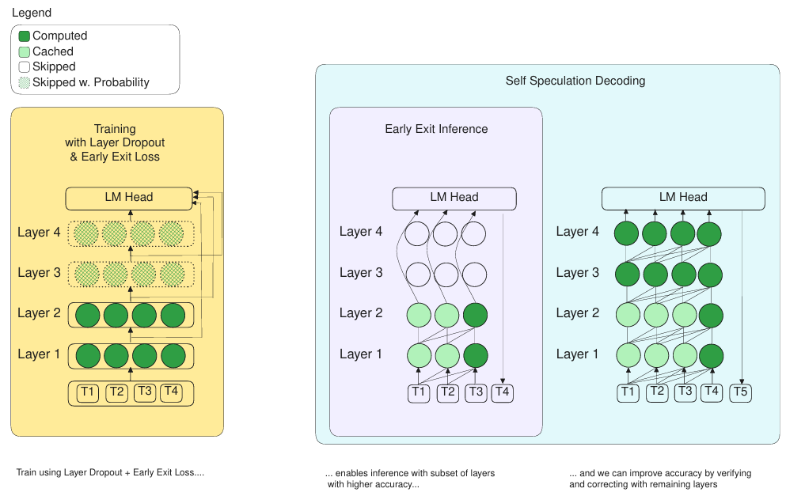

先日より話していた[ニューラルネットワークのレイヤ選択機能](https://yoshishinnze.hatenablog.com/entry/2026/12/06/043000)に関して、現在でも応用されている手法であるLayerSkipについて解説していきます。

本手法はMetaのAIチーム FAIR が開発を行い、ACL 2024で採択された論文です。

## 論文概要
LayerSkipは、Meta（FAIR）の研究チームによる、**LLMの推論を加速するためのエンドツーエンドな手法**です。[LayerSkip](https://arxiv.org/abs/2404.16710)

### 論文明細

__発表学会__
- **ACL 2024**（第62回計算言語学協会年次大会）
- 採択区分：Long Papers
- 論文ID：`2024.acl-long.681`
- 掲載ページ：pp. 12622-12642

__著者__
- **Mostafa Elhoushi**（Meta FAIR, 共同第一著者）
- **Akshat Shrivastava**（Meta FAIR, 共同第一著者）
- Diana Liskovich（Meta GenAI）
- Basil Hosmer（Meta FAIR）
- Bram Wasti（Meta GenAI）
- Liangzhen Lai（Meta Reality Labs）
- Anas Mahmoud
- Bilge Acun（Meta FAIR）
- Saurabh Agarwal
- Ahmed Roman
- Ahmed A Aly
- Beidi Chen
- Carole-Jean Wu

__arXiv情報__
- **arXiv:2404.16710**
- 初回投稿：2024年4月25日
- 最終版（v4）：2024年10月18日

__オープンソース__
- **GitHub**: `facebookresearch/LayerSkip`
- **Hugging Face**: `facebook/layerskip-llama`（学習済みモデル公開）

### 問題意識

従来のTransformerは、すべての入力に対して**すべてのレイヤーを順番に通過**させます。しかし、簡単なクエリには深い計算が不要であり、難しいクエリにはより多くの計算が必要です。この「一律の計算」が推論の非効率の原因になっていました。


### 骨となる3つのアイデア

LayerSkipは、**「学習時の工夫」と「推論時の工夫」を組み合わせる**ことで、追加のモジュールなしに早期終了を実現します。

**1. 学習時：レイヤードロップアウト + 早期終了損失**

- 学習中に**ランダムにレイヤーをドロップ**させます
- 重要な点は、**浅い層のドロップ率を低く、深い層のドロップ率を高く**設定すること
- さらに、**すべてのTransformerレイヤーが同じ出口（exit）を共有**する早期終了損失を追加
- これにより、モデルは「途中の浅い層の出力でも正解を出せるように」学習されます

**2. 推論時：早期終了（Early Exit）**

- 学習済みモデルに**補助レイヤーや追加モジュールを一切加えず**、浅い層で自信があればそこで出力
- 通常の早期終了手法と異なり、LayerSkipは学習時のドロップアウトによって「浅い層でも使えるモデル」に育てているため、精度低下が少ない

**3. 推論時：自己投機的デコーディング（Self-Speculative Decoding）**

- 浅い層でドラフト（仮の出力）を生成し、残りの深い層で**検証・訂正**を行う
- 他の投機的デコーディング手法と比べて、**ドラフトモデルを別途用意する必要がない**（同じモデルの浅い層と深い層を使う）
- メモリフットプリントが小さく、ドラフト生成と検証で計算と活性化を共有できる


### 実験結果

Llama系モデル（様々なサイズ）で検証し、以下の加速を達成しています。

| タスク | 加速率 |
|---|---|
| 要約（CNN/DM） | **最大2.16倍** |
| コード生成 | **1.82倍** |
| 意味解析（TOPv2） | **2.0倍** |

学習パイプラインも多様で、**スクラッチからの事前学習、継続事前学習、特定ドメインのファインチューニング、特定タスクのファインチューニング**のすべてで有効性を確認しています。


### なぜ重要か

LayerSkipの最大の特徴は、**「モデル構造を変えず、追加モジュールも不要」** で、学習時のドロップアウト戦略の変更だけで「浅い層でも使えるモデル」を育てられる点です。これにより、既存のLLM推論パイプラインに比較的容易に組み込める実用的な加速手法となっています。[LayerSkip GitHub](https://github.com/facebookresearch/LayerSkip)


## 解決したい課題

LayerSkipが解決しようとしている課題は、**「Transformerはすべての入力に対して一律で深い計算を行うため、推論が非効率になる」** という点です。以下、2つの側面で整理します。

### 課題1：一律計算による無駄

通常のTransformerは、入力が簡単な問いかけであろうと複雑な推論が必要な問いであろうと、**すべてのレイヤーを最後まで通過**させます。

- 簡単なクエリ（例：「こんにちは」の翻訳）には浅い層だけで十分
- 難しいクエリ（例：数学の証明）には深い層が必要

にも関わらず、両方に同じ計算量を使うため、**簡単な入力に対して計算リソースが無駄**になっています。

### 課題2：従来の早期終了手法の限界

「浅い層で自信があればそこで出力する」という早期終了（Early Exit）は以前から研究されていましたが、以下の問題がありました。

- **浅い層の精度が低い**：通常の学習では、浅い層は「深い層への前処理」としてしか育っていないため、途中で出力しても精度が大きく低下する
- **追加モジュールが必要**：精度を保つために補助レイヤーや分岐構造を追加すると、モデルが複雑化し、メモリ・実装コストが増える
- **推論パイプラインの改修**：既存のLLM推論インフラに組み込みにくい

## 提案手法

LayerSkipの提案手法は、**「学習時にモデルを浅い層でも使えるように育て、推論時に浅い層でドラフトを出して深い層で訂正する」** という2段階の構成です。

### 1. 学習時の工夫：浅い層でも使えるモデルを育てる

通常のTransformerは、浅い層が「深い層への前処理」としてしか学習されないため、途中で出力しても精度が悪くなります。LayerSkipは以下の2つの技術でこれを解消します。

__① レイヤードロップアウト（Layer Dropout）__

学習中にランダムにレイヤーを「飛ばす（ドロップ）」ことで、モデルに「途中の層でも正解を出せ」と強制します。

- **浅い層**：ドロップ率を**低く**設定（重要なので残す）
- **深い層**：ドロップ率を**高く**設定（浅い層だけで済む場面を学習させる）

これにより、浅い層だけでもある程度の出力能力を持つようになります。

__② 早期終了損失（Early Exit Loss）__

すべてのTransformerレイヤーに**同じ出口（exit）を共有させる**損失を追加します。

- 通常は最終層の出力だけで損失を計算
- LayerSkipでは、途中の各層の出力も最終層と同じ基準で評価
- 結果として、**どの層から出ても同じ品質の出力が期待できる**モデルに育つ

**ポイント**：補助レイヤーや追加モジュールは一切不要。既存のTransformer構造のまま、学習方法だけを変える。

### 2. 推論時の工夫：速くて正確な出力

学習済みモデルは「浅い層でもそれなりに正解を出せる」ようになっているので、推論時に以下の2つの戦略を使います。

__① 早期終了（Early Exit）__

入力が簡単な場合、浅い層で自信があればそこで即座に出力します。

- 追加のモジュールや分岐構造は不要
- 通常のTransformer推論パイプラインにそのまま組み込める

__② 自己投機的デコーディング（Self-Speculative Decoding）__

これがLayerSkipの最大の特徴です。

自己投機的デコーディングとは、同じ1つのモデルで「仮の出力（ドラフト）」と「本番の検証・訂正」の両方を行う推論加速手法です。
通常の投機的デコーディングでは、小さなドラフトモデルと大きな本モデルの2つのモデルが必要でしたが、LayerSkipでは以下のように動作します。

- 浅い層だけでドラフトを生成：モデルの前半の層だけを通して、仮のトークン列を素早く生成
- 残りの深い層で検証・訂正：同じモデルの後半の層を使って、ドラフトが正しいか確認し、間違いがあれば修正

浅い層で出したドラフトは確かに速いですが、表現力不足となり、不適と考えられるトークンを含む可能性があります。
精度はやはり深い層の方が良いわけです。
そこで、深い層がドラフトを検証して、修正すべき点を上書きするという仕組みをとります。
投機的デコーディングの基本思想は「仮の出力を素早く出し、本番で確認する」であり、検証なしには速さと精度の両立が成立しません。

なぜ「自己」なのか： ドラフト生成も検証も同じモデルの中で完結するためです。別のモデルを用意する必要がなく、メモリ増加がゼロです。

なぜ速いのか： ドラフトは浅い層だけで生成できるので計算量が少なく、かつドラフト生成時の中間活性化を検証時にそのまま再利用できるため、無駄な計算がありません。

```
【通常の投機的デコーディング】
小さなドラフトモデル → 大きな本モデルで検証・訂正
（別のモデルが必要でメモリが2倍）

【LayerSkipの自己投機的デコーディング】
同じモデルの浅い層でドラフト → 同じモデルの残りの深い層で検証・訂正
（モデルは1つだけ。メモリ増加なし）
```

**なぜ「自己」なのか：**
- ドラフト生成と検証が**同じモデル**の中で完結
- 浅い層の活性化を深い層の検証にそのまま再利用できる
- 他の投機的デコーディング手法と比べて**メモリフットプリントが大幅に小さい**

### まとめ：LayerSkipの提案手法の全体像

```
【学習時】
通常のTransformer + レイヤードロップアウト（浅い層は残す、深い層は飛ばす）
                    + 早期終了損失（すべての層が同じ出口を共有）
                    ↓
         「浅い層でも使えるモデル」が育つ

【推論時】
入力 → 浅い層でドラフト生成 → 残りの深い層で検証・訂正 → 出力
       （簡単ならここで早期終了）
                    ↓
         精度を保ちながら最大2倍以上の加速
```

**本質的には、「浅い層と深い層を同じモデルの中で使い分ける」ことで、計算の無駄を省きつつ精度を維持する**手法です。



## 実験

LayerSkip論文で行われた実験とその結果は以下の通りです。

### 実験設定

**使用モデル：** Llama系モデル（複数のサイズ）

**学習パイプラインの多様性：** 以下4つの異なる学習シナリオすべてで有効性を検証しています。
1. スクラッチからの事前学習
2. 継続事前学習
3. 特定データドメインへのファインチューニング
4. 特定タスクへのファインチューニング

**評価タスク：**
- 要約（CNN/DM）
- コード生成
- 意味解析（TOPv2）


### 実験結果

**1. 推論加速の達成**

| タスク | 加速率 |
|---|---|
| CNN/DM要約 | **最大2.16倍** |
| コード生成 | **1.82倍** |
| TOPv2意味解析 | **2.0倍** |

加速範囲はタスクによって**1.34倍〜2.16倍**でした。

**2. 早期終了精度の向上**

通常のLlama 7Bでは、各トークンの予測に平均**23.45層**（全32層中）が必要であり、完璧な予測器があっても計算量を**最大26%**しか節約できませんでした。LayerSkipの学習レシピ（レイヤードロップアウト＋早期終了損失）を適用することで、**浅い層での早期終了精度が大幅に向上**し、実際に少ない層数で高品質な出力が得られるようになりました。

**3. 自己投機的デコーディングの有効性**

他の投機的デコーディング手法と比較して、以下の利点が確認されました。
- **メモリフットプリントが小さい**：ドラフトモデルを別途用意する必要がなく、同じモデル内で完結
- **計算と活性化の共有**：ドラフト生成時の中間活性化を検証時にそのまま再利用できる
- **精度低下なし**：深い層での検証・訂正により、フルモデルと同等の出力品質を維持

**4. モデル構造の変更なし**

すべての実験で、**補助レイヤーや追加モジュールを一切加えていない**既存のTransformer構造のまま、学習方法の変更だけで上記の成果を達成しています。これがLayerSkipの実用的な強みです。[LayerSkip](https://arxiv.org/abs/2404.16710)

## 総括

LayerSkipの本質的な価値は以下の3点です。

**1. 構造変更なしで「動的深度」を実現した実用性**
追加モジュールや補助レイヤーを一切加えず、既存のTransformerに学習方法の変更だけを適用することで、推論時に浅い層で早期終了したり、自己投機的デコーディングで加速したりできる点です。既存の推論インフラに組み込みやすいという実用上の価値が大きいです。

**2. 「浅い層も使えるモデル」を育てる学習設計**
通常のTransformerは浅い層が「深い層への前処理」にしかなりませんが、レイヤードロップアウト（浅い層は残し、深い層を飛ばす）と早期終了損失（全層が同じ出口を共有）により、**浅い層だけでも正解を出せるモデル**を育てました。これは「深度を入力の難易度に応じて動的に割り当てる」という発想の転換です。

**3. 精度を保ったままの大幅な推論加速**
自己投機的デコーディングにより、同じモデルの浅い層でドラフトを生成し深い層で検証・訂正することで、**メモリ増加ゼロ**で最大2.16倍の推論加速を達成。精度低下なしに計算の無駄を省くという、効率性と品質の両立を実現しました。
