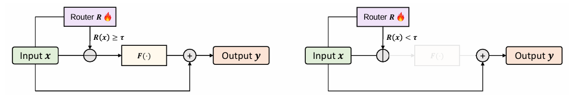

## 概要

**Router-Tuning**は、EMNLP 2025のメイントラックに採択された研究です。以下にその明細をまとめます。


### 論文明細

| 項目 | 内容 |
|------|------|
| **タイトル** | Router-Tuning: A Simple and Effective Approach for Dynamic Depth |
| **著者** | Shwai He, Tao Ge, Guoheng Sun, Bowei Tian, Xiaoyang Wang, Dong Yu |
| **所属** | University of Maryland, College Park; Tencent AI Lab |
| **会議** | EMNLP 2025 (Main Conference) |
| **ページ** | pp. 1925–1938 |
| **arXiv** | [2410.13184](https://arxiv.org/abs/2410.13184) |
| **PDF** | [ACL Anthology](https://aclanthology.org/2025.emnlp-main.99.pdf) |
| **コード** | [GitHub](https://github.com/CASE-Lab-UMD/Router-Tuning-Mixture-of-Depths) |

### 研究の概要

この論文は、**Mixture of Depths (MoD)** の実用化における2つの課題を解決することを目指しています。

1. **学習コストの高さ**: 従来のMoDはモデル全体をスクラッチから学習するか、高価な継続的事前学習が必要でした。
2. **精度劣化のリスク**: TransformerブロックやMLP層をスキップすると性能が大きく低下します。

**Router-Tuning** のアイデアは、**バックボーンモデルのパラメータを完全に固定し、軽量なルーターネットワーク（単層の投影層）のみを小規模データセットでファインチューニングする**というものです。ルーターは全体パラメータの0.01%未満であり、学習コストはLoRAよりもさらに低く、Nvidia RTX A6000で30分未満で完了します。

さらに、精度劣化を防ぐため、**Attention層に動的な深さを適用する「MindSkip」**を提案しています。Attention層はMLP層に比べ冗長性が高く、スキップしても性能劣化が小さいことが知られているためです。


### 主な実験結果

| 指標 | 結果 |
|------|------|
| 推論速度向上 | **21% speedup** |
| 性能低下 | **わずか 0.2%** |
| 対象モデル | Llama, Mistral, Qwen, DeepSeek-MoE, OLMoE |
| 学習時間 | RTX A6000 で30分未満 |
| 適用粒度 | シーケンスレベル（トークンレベルではなく） |

## 解決したい課題

本論文が解決しようとした課題は、**Mixture of Depths (MoD)** を実用化する際に立ちはだかる**2つの根本的な障壁**です。


### 課題1：学習コストが膨大である

MoDは入力に応じて層を動的にスキップすることで計算効率を高める有望な手法ですが、従来のアプローチには**壊滅的な学習コスト**が伴いました。

具体的には、以下の2つの方法しかありませんでした。

- **スクラッチからの事前学習**: MoD対応のルーターを持つモデルをゼロから学習し直す。[Raposo et al., 2024] の手法に相当します。
- **高価な継続的事前学習**: 学習済みモデルにMoDを組み込み、大規模なデータで長時間の追加学習を行う。[Tan et al., 2024] の手法に相当します。

いずれも、既存の強力な学習済みLLM（LlamaやQwenなど）にMoDを「後付け」するには現実的ではありませんでした。論文では、この障壁を**「既存LLMへのMoD統合における大きな障壁（significant barrier）」**と表現しています。[Router-Tuning](https://aclanthology.org/2025.emnlp-main.99.pdf)


### 課題2：スキップ対象を選ぶと性能が大きく劣化する

MoDで層をスキップする際、**「何をスキップ対象にするか」** が極めて重要です。従来のMoDは主に**Transformerブロック全体**や**MLP層**をスキップ対象にしていましたが、これらはスキップに対して非常に敏感です。

論文内の実験（Table 1）では、以下のような結果が示されています。

| スキップ対象 | 速度向上 | 平均性能（Llama-3） |
|---|---|---|
| Baseline（スキップなし） | 1.00× | 69.7% |
| **Block（ブロック全体）** | 1.27× | **61.3%**（-8.4ポイント） |
| **MLP層** | 1.06× | **61.8%**（-7.9ポイント） |
| **Attention層（MindSkip）** | 1.21× | **69.4%**（-0.3ポイント） |

MLP層やブロック全体をスキップすると**8ポイント近い性能低下**が生じる一方、Attention層をスキップしても性能低下は**わずか0.3ポイント**に留まります。つまり、従来のMoDは「速くはなるが、壊れてしまう」というトレードオフに陥っていたのです。

### 論文の解決策：2つのアイデア

これら2つの課題に対し、本論文は以下の2つを提案しています。

__① Router-Tuning（学習コスト問題の解決）__

バックボーンモデルのパラメータを**完全に固定**し、**ルーター（単層の線形投影層）のみをファインチューニング**します。ルーターは全体パラメータの**0.01%未満**であり、小規模データセットと少ない学習ステップで済みます。結果として、Nvidia RTX A6000で**30分未満**で学習が完了し、従来手法（DLOなど）と比較して**1000倍高速**です。

__② MindSkip：Attention with Dynamic Depths（性能劣化問題の解決）__

スキップ対象を**Attention層に絞る**ことで、性能劣化を最小化します。Attention層は先行研究でも冗長性が高いことが知られており、KVキャッシュのメモリ消費や二次的な計算コストも削減できるため、効率と精度の両立が可能になります。

## 提案手法

本論文の提案手法は、**「既存の強力なLLMを壊さずに、最小限のコストで動的な層スキップ能力を後付けする」** というものです。2つの柱から成り立っています。


### 柱1：Router-Tuning（学習方法）

**「本体は一切触らず、鍵穴だけを調整する」** イメージです。

従来のMoD（Mixture of Depths）は、モデル全体を最初から学習し直すか、長時間の追加学習が必要でした。本論文はこれを根本から変え、**バックボーンモデルのパラメータを完全に凍結（固定）し、各層に新しく付けた「ルーター」という小さな判断機構だけを学習**します。

ルーターは**単層の線形層（入力次元→1次元）**で、全体のパラメータの**0.01%未満**です。これにより、学習データも少なく、時間もNvidia RTX A6000で**30分未満**で済みます。LoRAよりも圧倒的に安価です。


### 柱2：MindSkip（スキップ対象の選び方）

**「無駄を削るなら、削っても壊れにくい部分から」** という発想です。

Transformer層の中で「スキップしても性能がほとんど落ちない部分」はどこか？論文の実験では、**Attention層**がその答えでした。

| 削る対象 | 性能への影響 |
|---------|------------|
| MLP層 | 大幅に劣化（約8ポイント低下） |
| ブロック全体 | 大幅に劣化（約8ポイント低下） |
| **Attention層** | **ほぼ影響なし（0.3ポイントのみ）** |

MindSkipは、**Attention層だけを動的にスキップする**仕組みです。AttentionはKVキャッシュのメモリ消費も大きく、計算量もシーケンス長の2乗に比例するため、スキップの効果が大きいという利点もあります。


### ルーターの動作イメージ

各Attention層の手前にルーターが配置されています。ルーターは入力シーケンス全体を見て、「この層は必要？」を0から1のスコアで判定します。

```
入力シーケンス → [平均プーリング] → [ルーター: 単層線形] → sigmoid → スコアR(x)
                                                     ↓
                                              R(x) >= 閾値τ ?
                                                 Yes → Attention層を通す
                                                  No → Attention層を飛ばす
```

この0/1の判断は微分不可能ですが、**Straight-Through Estimator**というテクニックで、順伝播ではハードな0/1を使い、逆伝播ではソフトな勾配を流すことで、ルーターだけを勾配法で学習できます。



### なぜ「シーケンスレベル」なのか？

本論文では**トークンごとではなく、シーケンス（入力文）全体で一括して「この層を通すかどうか」** を決めます。これには理由があります。

トークンごとにスキップを変えると、バッチ内の各トークンが異なる計算パスを通るため、GPUの並列計算が複雑化し、実際の壁時計時間が短縮しにくくなります。シーケンスレベルなら、**「この層はこの入力では全トークン分スキップ」** と統一的に扱えるため、ハードウェア効率が良く、実際の速度向上（21%）が実現できます。


### 全体像のまとめ

```
既存の学習済みLLM（Llama, Qwen, Mistralなど）
        ↓
各Attention層に「ルーター」（単層線形形層）を挿入
        ↓
バックボーンは完全固定 → ルーターだけを小規模データで学習（30分未満）
        ↓
推論時: ルーターが各Attention層の必要性を判定
        ↓
不要なAttention層をスキップ → 21%高速化、性能低下わずか0.2%
```

一言で表すと、**「本体はそのまま、Attention層の通過/スキップを決める小さなルーターだけを安価に学習し、速くて壊れにくい動的推論を実現する」** 手法です。

## 実験

本論文の実験は、既存の強力なLLMにRouter-Tuningを適用したとき、実際に速くなり、しかも壊れないのか? ということを検証しています。
以下に問題設定と結果を整理して説明いたします。


### 問題設定（何を検証したか）

__使用モデル__
以下の5つの代表的なオープンソースLLMで検証し、**手法がモデルによらず通用するか**を確認しました。

- **Llama-3**（Meta）
- **Mistral**（Mistral AI）
- **Qwen**（Alibaba）
- **DeepSeek-MoE**（DeepSeek）
- **OLMoE**（Allen AI）

__評価タスク__
言語モデルの総合的な知識・推論能力を測る、標準的な8つのベンチマークを使用しました。

| ベンチマーク | 測る能力 |
|---|---|
| ARC-C | 科学の多肢選択推論 |
| BoolQ | Yes/No質問応答 |
| HellaSwag | 常識的な文脈完結 |
| MMLU | 多岐にわたる知識 |
| OBQA | オープン・ブック質問応答 |
| PIQA | 物理的常識推論 |
| RTE | テキスト含意認識 |
| WinoGrande | 代名詞解決・常識推論 |

__比較対象（何と比べたか）__

| 比較相手 | 内容 |
|---|---|
| **Baseline** | スキップなしの通常のモデル（全層通過） |
| **Blockスキップ** | Transformerブロック全体をスキップする従来MoD |
| **MLPスキップ** | MLP層だけをスキップする従来MoD |
| **DLO**（Tan et al.） | 継続的事前学習ベースのMoD適用手法 |
| **LoRA** | パラメータ効率学習との組み合わせ検証 |

__実験の条件__
- **スキップ対象**: 最大16層をスキップ可能に設定
- **容量制約**: 全体の50%の層しか使わない（=半分をスキップ）という厳しい条件
- **適用粒度**: シーケンスレベル（1つの入力文に対して「この層を使うか」を一括決定）

### 実験結果（何が分かったか）

__結果1：「何をスキップするか」で性能が劇的に変わる__

同じ「50%の層をスキップする」条件でも、**スキップ対象を変えるだけで性能が大きく異なる**ことが明らかになりました。

| スキップ対象 | 速度向上 | 平均性能（Llama-3） | 性能低下幅 |
|---|---|---|---|
| Baseline（なし） | 1.00× | 69.7% | — |
| **Block全体** | 1.27× | 61.3% | **-8.4ポイント** |
| **MLP層** | 1.06× | 61.8% | **-7.9ポイント** |
| **Attention層（MindSkip）** | 1.21× | 69.4% | **-0.3ポイント** |

**ポイント**: Attention層をスキップしても性能低下はわずか0.3ポイントですが、MLPやブロック全体をスキップすると**8ポイント近く崩壊**します。これは「Attention層には冗長性が多く、MLP層には重要な知識が詰まっている」ことを示しています。

__結果2：Router-Tuningは圧倒的に学習が速い__

| 手法 | 学習にかかる時間・コスト |
|---|---|
| DLO（従来の継続学習型MoD） | 大規模な継続的事前学習が必要 |
| **Router-Tuning（提案手法）** | **RTX A6000で30分未満** |
| 速度差 | **DLOの約1000倍高速** |

ルーターは全体パラメータの0.01%未満なので、学習データも少なく、GPU時間も極めて短く済みます。

__結果3：速度と精度のバランスが優秀__

- **推論速度向上**: **21%の加速**
- **性能低下**: **わずか0.2%**
- **メモリ使用量**: KVキャッシュの削減により大幅削減

これは「速くなった代わりに壊れた」ではなく、**「ほぼ壊さずに有意に速くなった」** ことを意味します。

__結果4：モデルを問わず通用する__

Llama-3だけでなく、Mistral、Qwen、DeepSeek-MoE、OLMoEでも同様の傾向が確認されました。特にMoEモデル（DeepSeek-MoE, OLMoE）では、**エキスパートレベルでRouter-Tuningを適用**することで、MoE特有の計算コストも削減できることが示されています。

__結果5：LoRAとの組み合わせも可能__

Router-Tuning（ルーターだけ学習）とLoRA（アダプタ層の学習）を**同時に適用**することも可能で、タスク適応と推論効率化を同時に実現できます。これにより、特定の下流タスクにファインチューニングしつつ、動的な層スキップも併用できる柔軟性が示されました。


